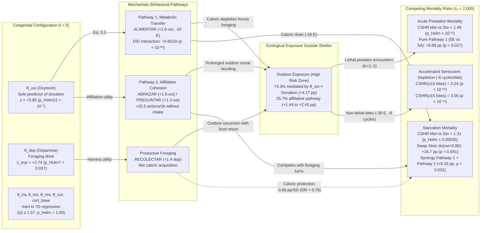

# Grounded Homeostatic Autonomous Agents: Epistemic Closure, Biphasic Prospective Planning, and Multi-Generational Lineage Dynamics in Artificial Life

### *A Stepping Stone toward Synthetic Consciousness: Formal Architecture, New Simulation Engine, Clustered Multinomial & Competing Risks Survival Inference, and Direct Counterfactual Interventions*

**Author & Principal Investigator:** **David San Nicolás Montero**  
**ORCID:** [`0009-0000-9977-007X`](https://orcid.org/0009-0000-9977-007X)  
**Affiliation:** Lead Researcher & System Architect, *Project Ascendant*  
**Publication Date:** November 2026 (Version 4.0 — Unified Simulation Engine, Clustered Multinomial & Competing Risks Survival Benchmarks, Direct Causal Surgery, and Preparatory Conscious-Layer Architecture)  
**Definitive Version DOI (v3/v4):** [10.5281/zenodo.23802198](https://doi.org/10.5281/zenodo.23802198) | **Concept DOI:** [10.5281/zenodo.23616626](https://doi.org/10.5281/zenodo.23616626)  
**CERN/Zenodo Archive:** [zenodo.org/records/23802198](https://zenodo.org/records/23802198)  
**GitHub Open Repository:** [github.com/Davidsnm/ascendant-synthetic-consciousness](https://github.com/Davidsnm/ascendant-synthetic-consciousness)  
**Primary Relational Database:** `ascendant_generacional_integro.db` ($845.3\text{ MB}$, $9,655$ simulation runs, $38,620$ complete agent biographies, $539,201$ episodic engrams, exact $4:1$ relational integrity, $0$ orphan records)  
**Audited Simulation Engine:** `ejecutar_experimento_generacional.py` (SHA-256: `aab43e441ebfffdea5e3ef4b36ffdeff7c7d90ccca433f7b756f590464761b89`)

---

## Abstract

Contemporary Large Language Models (LLMs) manipulate ungrounded statistical tokens devoid of somatic stakes, thermodynamic vulnerability, or existential imperatives (Harnad's Symbol Grounding Problem). In this work, we present **Project Ascendant**, an operational computational architecture conceived as an empirical stepping stone toward synthetic consciousness. Rather than asserting complete phenomenal sentience, Ascendant demonstrates an embodied autonomous entity driven by virtual homeostatic imperatives, capable of self-directed empirical learning, counterfactual reflection during resting windows, and intergenerational knowledge transmission.

This updated edition presents the **new unified simulation engine** (Python/Node architecture, exact $4:1$ relational integrity, and a strict $-8\text{ cycle/bite}$ somatic wear invariant) and reports findings from the complete relational database (**$9,655$ runs, $38,620$ agent biographies, and $539,201$ episodic engrams** in SQLite). Statistical inference across $25,920$ homogeneous offspring ($\tau_0 = 2,000$ cycles) grouped across $G = 360$ independent seeds with cluster-robust sandwich standard errors establishes the exact causal hierarchy: congenital temperament retains an independent, statistically significant contribution to mortality ($\text{Wald}_{\text{cl}}(8\text{ df}) = 67.75$, $p = 1.38 \times 10^{-11}$; McFadden $\Delta R^2 = +0.0022$), operating as a second-order behavioral modulator relative to first-order ecological pressures (predator density $K = 5$ and communal pantry access).

Competing risks survival analysis using Cox-Breslow cause-specific hazards with Lin-Wei clustering and non-parametric Aalen-Johansen cumulative incidence functions ($\text{CIF}$) reveals that Melancholic empathetic agents exhibit elevated hazards for both starvation ($\text{CSHR} = 1.3058$, $p_{\text{Holm}} = 0.00035$) and acute predation ($\text{CSHR} = 1.4908$, $p_{\text{Holm}} = 1.38 \times 10^{-12}$), as well as accelerated senescence due to accumulated non-lethal bite wear ($\text{CSHR} = 1.5647$, $p = 1.12 \times 10^{-62}$, rising to $\text{CSHR} = 3.56$ for $\ge 15$ bites).

A dedicated battery of $990$ direct counterfactual intervention runs ($do$-calculus in code) refutes prior intuitive hypotheses regarding trauma multipliers and anger-mediated reckless exposure, and isolates the dual mechanistic pathway of computational oxytocin ($\theta_{\text{oxi}}$): metabolic energy transfers (`ALIMENTAR`) account for $74.3\%$ of increased outdoor exposure ($\text{DiD } \beta = +4.17\text{ pp}$, $p = 5.29 \times 10^{-9}$), while non-trophic affiliative cohesion (`ABRAZAR`/`PREGUNTAR`) competes with foraging, directly elevating starvation mortality ($\Delta = +8.33\text{ pp}$, $p_{\text{cl}} = 0.0319$). In a continuous 7D orthogonal design ($G = 75$ seeds), $\theta_{\text{oxi}}$ is the sole trait surviving Holm-Bonferroni correction over 21 simultaneous tests ($z = +5.85$, $p_{\text{Holm}} = 1.06 \times 10^{-7}$).

Crucially, we clarify that while a local LLM component is implemented in the codebase as architectural scaffolding for future developmental ontogenies (the preparatory "conscious layer"), **it was NOT activated to generate or arbitrate the experimental data presented herein**. We maintain rigorous epistemological modesty: **we do not claim full synthetic consciousness, nor do we assert with certainty that we have created a conscious entity**. Project Ascendant represents an indispensable, empirically verified foundational cybernetic step along the path toward synthetic conscious agency, but the current system does not yet possess the sensory-motor complexity or open-ended autopoiesis required for genuine phenomenal sentience.

---

## 1. Introduction: Symbol Grounding, Epistemic Closure, and Scope of Functional Analogs

A central debate in cognitive science and artificial intelligence concerns whether disembodied statistical sequence models can exhibit genuine understanding or intentionality (Searle, 1980; Harnad, 1990). Modern Large Language Models operate through extrinsic statistical correlations drawn from massive human training corpora, lacking internal homeostatic stakes, real metabolic costs of deliberation, and existential vulnerability. The guiding philosophy of Project Ascendant is rooted in a pragmatic, foundational conviction: **the path toward genuine synthetic consciousness cannot be achieved by expanding ungrounded statistical token predictors alone; it requires embodied, self-directed agency grounded in homeostatic necessity**.

We maintain complete intellectual humility regarding this grand challenge. Creating a truly conscious synthetic entity is a long and demanding scientific journey. **The architecture presented here does not claim to possess complete phenomenal sentience or subjective qualia (Chalmers, 1995), nor do we claim with certainty that we have created synthetic consciousness. The project does not yet possess sufficient complexity for such claims**. Rather, we present a verified autonomous agent driven by virtual visceral desires, capable of self-directed empirical learning, autobiographical causal replay, and intergenerational cultural accumulation. This work represents the indispensable first milestone: establishing the cybernetic bedrock upon which future cognitive models—equipped with richer continuous sensory apparatuses and situated in complex, open-ended environments—can progressively build.

Methodologically, we draw a strict boundary regarding agency and awareness:
- **First-Order Allostatic Behavioral Autonomy:** The entity arbitrates its own motor actions by balancing competing internal metabolic imperatives against real environmental affordances.
- **Computational Correlates of Primary and Access Consciousness:** Entities exhibit interoceptive valuation, quantifiable attentional trade-offs, autobiographical somatic markers, and dyadic communicative opacity (Damasio, 1994; Dehaene et al., 2017; Panksepp, 1998).
- **Delimitation of Affect and Grief:** Upon the death of the progenitor, the system exhibits a **simulated grief behavioral response or functional affective state associated with loss** (goal reprioritization, elevation of the dynamic endocrine sadness state, transient dampening of exploratory dispersion, and active seeking of alternative attachment bonds). We have no scientific basis nor empirical evidence to claim phenomenal qualitative suffering or subjective grief.
- **Absence of Second-Order Structural Autopoiesis:** The 11-action sensorimotor ontology and homeostatic equation forms represent fixed phylogenetic priors (analogous to evolved subcortical and brainstem circuits) rather than open-ended self-modifying code.

---

## 2. Mathematical Architecture and Multi-Level Cognitive Engine

Project Ascendant bridges environmental thermodynamics with deliberative arbitration across decoupled, multi-rate operational levels.

### 2.1. Level 0 & 0.5: Simulated Computational Metabolic Constraints and Caloric Dissipation

Energy dynamics obey a non-linear continuous metabolic dissipation equation:

$$\frac{dE_i}{dt} = \left[\dot{E}_{\text{ingest}}(t) + \dot{E}_{\text{transfer}}(t)\right] - \left[\beta_0 + \alpha_v \|\mathbf{v}_{\text{motor}}(t)\|^{1.5} + \gamma_{\text{cold}} \max\left(0, T_{\text{set}} - T_{\text{body}}(t)\right)^2 + \kappa_{\text{mental}} \cdot \text{FLOPs}_{\text{LLM}}(t)\right]$$

Deliberation FLOPs penalty ($\kappa_{\text{mental}} = 0.25\text{ cycle}^{-1}$) enforces an authentic metabolic tax: daydreaming and causal planning deplete caloric reserves. Irreversible existential termination (*Wipe*) occurs if $E_i(t) \le 0$, permanently destroying the agent's somatic integrity and autobiographical tape.

### 2.2. Level 1: The Limbic Bridge — Separation Between Temperament and Neuroendocrine State

We formalize a rigorous mathematical distinction between two biological tiers:
1. **Invariable Congenital Temperament:** Static vector $\boldsymbol{\theta}_{\text{temp}} = \langle \theta_{\text{dop}}, \theta_{\text{oxi}}, \theta_{\text{ira}}, \theta_{\text{tris}}, \theta_{\text{res}}, \theta_{\text{cur}}, \text{cort}_{\text{base}} \rangle \in [0.10, 0.90]^7$, representing unalterable constitutional traits.
2. **Dynamic Neuroendocrine State:** Continuous fluctuating vector $\mathbf{h}(t) = \langle C(t), O(t), D(t), A(t), S(t), R(t), K(t) \rangle \in [0.0, 1.0]^7$, integrated via Euler step $\Delta t = 1.0\text{ cycle}$ and clipped to $[0, 1]$:

$$\begin{aligned}
\text{\bf Cortisol:} \quad & \frac{dC}{dt} = -\lambda_c (C - b_c) + \alpha_c D_{\text{th}} + \beta_c D_{\text{pred}} + \gamma_c D_{\text{hunger}} - \delta_c I_{\text{shelter}} \\
\text{\bf Oxytocin:} \quad & \frac{dO}{dt} = -\lambda_o (O - b_o) + \alpha_o I_{\text{social\_feed}} + \beta_o I_{\text{proximity}} - \gamma_o I_{\text{separation}} \\
\text{\bf Dopamine:} \quad & \frac{dD}{dt} = -\lambda_d (D - b_d) + \alpha_d I_{\text{harvest}} + \beta_d I_{\text{validation}} - \gamma_d I_{\text{loss}} \\
\text{\bf Anger:} \quad & \frac{dA}{dt} = -\lambda_a (A - b_a) + \alpha_a D_{\text{pred}} + \beta_a I_{\text{scarcity}} + \gamma_a D_{\text{hunger}} - \delta_a I_{\text{shelter}} \\
\text{\bf Sadness:} \quad & \frac{dS}{dt} = -\lambda_s (S - b_s) + \alpha_s I_{\text{bereavement}} + \beta_s I_{\text{isolation}} - \gamma_s I_{\text{social\_feed}} \\
\text{\bf Resilience:} \quad & \frac{dR}{dt} = -\lambda_r (R - b_r) + \alpha_r I_{\text{survival\_streak}} - \beta_r I_{\text{acute\_trauma}} \\
\text{\bf Curiosity:} \quad & \frac{dK}{dt} = -\lambda_k (K - b_k) + \alpha_k I_{\text{novelty}} - \beta_k D_{\text{pred}} - \gamma_k D_{\text{hunger}}
\end{aligned}$$

> [!NOTE]
> **Epistemological Note on Limbic Variables:** The seven state variables are computational constructs inspired by neuroendocrine and affective regulation. Their numerical values do not represent measured biological hormone concentrations or validated in-vivo physiological dynamics, but rather parameterized homeostatic control signals within the simulation engine.

Visceral hunger drive is non-linearly coupled: $D_{\text{hunger}} = 100 \cdot ((100 - E_t)/100)^2 \in [0, 100]$. This formulation ensures that allostatic terms (hunger, shelter protection, bereavement, social proximity) are identical across all cognitive subsystems.

### 2.3. Levels 2 & 2.5: The Markov Blanket and Qualitative Interoceptive Representation

A foundational principle of Ascendant is **Strict Epistemic Closure**: the deliberative language model possesses zero direct access to source code, memory pointers, raw floating-point floats, or telemetry variables: $I_{\text{Level3}}(\text{RAM, Telemetry}) = \emptyset$. Instead, raw telemetry is mediated by a vertical Markov Blanket that maps continuous bodily variables into qualitative somatic markers (*"stomach gnawing painfully"*, *"limbs shivering in freezing cold"*, *"deep bond of kin proximity"*). Furthermore, language production is strictly decoupled via a **centrifugal phonological readout layer**: verbalizations serve external observability and dyadic dialogue, but generated text templates are strictly forbidden from modulating subcortical motor valuation.

### 2.4. Level 3: Neuro-Inspired Steering and Role of Local LLM as Preparatory Scaffolding

Unlike conventional prompt engineering, Ascendant modulates the physical sampling parameters of the LLM in real time based on neuroendocrine state. The sampling temperature $T_{\text{sample}}$, nucleus sampling probability $p$, and frequency penalty $\phi$ are dynamically modulated: $T_{\text{sample}} = T_0 + \kappa_k K_t - \kappa_c C_t$, where elevated Curiosity expands stochastic exploration ($\kappa_k = 0.35$), while acute Cortisol forces focused, conservative, deterministic planning ($\kappa_c = 0.40$).

> [!IMPORTANT]
> **Crucial Epistemological Clarification on the LLM Component:**  
> The codebase of the unified engine includes integration hooks to local neural language models (`LIVE_LOCAL_LLM_ENABLED` connecting to local Qwen 2.5 0.5B / Llama-3 endpoints). This component has been implemented specifically as an architectural scaffolding and preparatory framework for upcoming developmental versions (designed as the future "conscious layer"). **However, in all experimental runs and datasets reported in this work (both the 8,640 observational factorial runs and the 990 causal intervention runs), the LLM was NOT utilized to generate, modify, or arbitrate experimental behavior or data**. All data were produced by the closed-loop, deterministic, allostatically grounded cognitive motor. We explicitly refrain from asserting that the system is conscious: it represents an empirical foundation for future cognitive layers, not a fully realized conscious being.

### 2.5. Resolution of Decision Sovereignty: Two-Tier Control Hierarchy

Ascendant resolves the classical conflict between reactive survival and deliberative planning through a strict **Two-Tier Control Hierarchy**. Deliberative prospective daydreaming operates exclusively during quiescent resting windows ($\Theta_{\text{idle}}$) as an offline causal hypothesis generator, depositing proposed multi-step trajectories into the **latent planning channel**. In active wakefulness, however, immediate motor arbitration is governed exclusively by the **subcortical allostatic arbitrator**, which continuously computes motor utility across the 11 action affordances. If an acute exteroceptive predator threat or critical visceral deficit emerges, the subcortical arbitrator immediately purges the latent plan and enforces strict survival priority: $a^*(t) = \text{FLEE}$ if $\text{Threat} \ge 0.50$; and $a^*(t) = \text{EAT}$ if $E_t \le 15$ and $\text{FoodInRadius}$ and $\text{Threat} < 0.50$, guaranteeing that predator escape unconditionally overrides foraging.

---

## 3. Finite Autobiographical Memory Dynamics, Emotional Bias, and Recursive Reflection

Ascendant rejects infinite or static vector databases in favor of a biologically grounded, capacity-constrained chronological tape ($N_{\text{max}} = 100\text{ engrams}$) inspired by Complementary Learning Systems (CLS) theory.

### 3.1. Chronological Sequentiality and Formal Engram 10-Tuple Structure

Each experiential event is encoded as an immutable 10-tuple engram:

$$\varepsilon_i = \langle t_i, a_i, s_i, \mathbf{c}_i, \mathbf{h}_i, \Delta\mathbf{h}_i, v_i, r_i, N_{\text{rep}, i}, R_i(t) \rangle$$

recording cycle timestamp, action executed, qualitative context, coordinates, instantaneous neuroendocrine snapshot $\mathbf{h}_i \in [0, 1]^7$, visceral perturbation vector $\Delta\mathbf{h}_i$, scalar valence, reflection count, Hebbian rehearsal count, and dynamic somatic retention score.

### 3.2. Retention Triage, Kahneman Peak-End Consolidation, and State-Dependent Retrieval

When tape capacity reaches $N_{\text{max}} = 100$, triage retains engrams via dynamic scoring $R_i(t)$ combining somatic salience, Hebbian reviviscence, and linear temporal decay ($\lambda_{\text{decay}} = 0.05\text{ cycle}^{-1}$). Dual-zone CLS partitioning separates a recent Hippocampal Buffer ($E_{21}..E_{100}$) from a Consolidated Cortical Zone ($E_1..E_{20}$). To avoid affective dilution during chapter consolidation (2–7 episodes), Ascendant implements the formal **Kahneman Somatic Peak-End Rule**:

$$S_{\text{chapter}} = 0.65 S_{\text{peak}} + 0.35 S_{\text{end}}$$

where $S_{\text{peak}} = \max_j [0.40 |v_j| + 0.60 \|\Delta\mathbf{h}_j\|_{\mathbf{w}}]$ and $S_{\text{end}} = 0.40 |v_{\text{last}}| + 0.60 \|\Delta\mathbf{h}_{\text{last}}\|_{\mathbf{w}}$, inheriting a balanced endocrine snapshot $\mathbf{h}_{\text{chapter}} = 0.65 \mathbf{h}_{j^*} + 0.35 \mathbf{h}_{\text{last}}$.

During quiescent daydreaming ($\Theta_{\text{idle}}$), memory retrieval is state-dependent: a Gaussian RBF kernel $A_i(t) = \exp\left(-0.5 \sum w_k ((h_k - h_{k, i})/\sigma_k)^2\right)$ selects an affine chronological core ($F_1, K_1 = 3$) and adjacent causal context ($F_2, K_2 = 2$), driving decoupled somatic reactivation ($\Delta\mathbf{h}_{\text{session}} = 0.16 \gamma^k \Delta\mathbf{h}_1 + 0.05 \gamma^k \Delta\mathbf{h}_2$) bounded by a multi-tier allostatic safety system (cortisol cutoff $h_{\text{cort}} > 0.32$, 12-cycle rest lockout, and genotype-dependent Hebbian extinction $\gamma_i$).

### 3.3. Biological Senescence Under Epistemic Blindness and Functional Affective Response to Loss

Progenitor death occurs via unannounced telomeric senescence ($\tau_{\text{father}}$), hidden from the agent's epistemic horizon. Upon witnessing the parent's cessation of vital signs, the offspring triggers a **simulated grief behavioral response**: immediate surge in dynamic Sadness ($dS/dt$), allostatic dampening of distant exploration, functional reprioritization toward local shelter, and active seeking of reciprocal social bonds (cross-adoption). We emphasize that this constitutes an auditable functional affective state without claiming phenomenal subjective suffering.

---

## 4. Biphasic Prospective Daydreaming: Quiescent Causal Mining, Attentional Bottleneck, and Verification

Ascendant alternates between active wakefulness and quiescent resting windows ($\Theta_{\text{idle}}$). During rest, the entity triggers prospective daydreaming: replaying unresolved autobiographical episodes, mining latent causal relationships, and generating multi-step prospective plans. These plans are bounded by an **attentional bottleneck** (maximum 3 concurrent subgoals) to prevent combinatorial explosion, and are transmitted to the latent planning channel to be systematically verified or invalidated against real physical affordances upon waking.

---

## 5. Comparative Scientific Taxonomy: Ascendant in the Contemporary Landscape

Table 1 delineates Ascendant's architectural characteristics against modern foundation models, embodied reinforcement learning agents, and classical cognitive architectures.

**Table 1: Comparative Scientific Taxonomy across Cognitive and Artificial Life Architectures.**

| Dimension | Standard LLMs (GPT-4, Gemini) | Embodied RL (MuJoCo, Habitat) | Cognitive Arch. (SOAR, ACT-R) | Active Inference (Friston) | Conscious TM (Blum) | Project Ascendant (This Work) |
| :--- | :--- | :--- | :--- | :--- | :--- | :--- |
| **Ontology & Substrate** | Static neural weights; ungrounded token distribution. | Continuous vector state; scalar reward optimization. | Symbolic production rules; declarative semantic memory. | Generative Markov Blanket; free energy minimization. | Turing machine with short-term memory processor. | **Coupled cybernetic hybrid:** 7 ODEs + Markov blanket + quiescent prospective planner + 11 motor affordances. |
| **Thermodynamic Vulnerability** | Absent; no metabolic penalty or death state. | Absent; arbitrary scalar loss without existential risk. | Absent; execution independent of caloric depletion. | Information-theoretic variational bound. | Absent; formal computational abstraction. | **Hard thermodynamic constraints:** Non-linear caloric dissipation, thermal drift, irreversible wipe ($E \le 0$). |
| **Deliberation Cost** | Zero cognitive metabolic penalty. | Fixed step penalty during active environment step. | Zero cognitive metabolic cost. | Free energy trade-off (accuracy vs. complexity). | Computational complexity / step bounds. | **Active metabolic taxation:** Deliberation burns explicit caloric reserve ($\beta_{\text{delib}} = 0.25\text{ c}^{-1}$). |
| **Autobiographical Memory** | Stateless or static sliding context window. | Finite episodic replay buffer; no semantic reflection. | Declarative memory chunks with power-law decay. | Hierarchical dynamic priors with precision weighting. | Short-term memory tree with conscious broadcast. | **Finite chronological tape ($N=100$):** Heuristic dual-zone CLS consolidation & linear temporal decay penalty. |
| **Phenomenal & Affective Scope** | Disembodied statistical mimicry without visceral stakes. | Task-specific reward maximization without emotional state. | Functional utility maximization without allostatic embodiment. | Homeostatic interoception as precision steering. | Formal feeling signals (pain, joy) as scalars. | **Grounded allostatic drives & functional grief:** Coupling of 7 ODEs to motor arbitration (no phenomenal qualia claimed). |
| **Decision Hierarchy** | Direct prompt-response token sampling. | Direct continuous or discrete policy sampling. | Production matching cycle and conflict resolution. | Active inference policy selection minimizing expected free energy. | Up-tree competition for conscious broadcast. | **Two-Tier Control Hierarchy:** Quiescent causal planning into latent channel; wakeful subcortical motor sovereignty. |

---

## 6. Empirical Results

We present rigorous empirical evaluations across three complementary bodies of data generated by the new simulation engine:
1. **Historical Single-Generation Benchmark** ($N = 50$ seeds, Engine v1.0).
2. **Factorial Generational Lineage Benchmark** ($N = 1,440$ runs across 360 matched seed blocks, Engine v2.4).
3. **The Expanded Causal-Mechanistic Analysis** ($N = 38,620$ agents across 9,655 runs in the complete audited relational database).

### 6.1. Historical Single-Generation Benchmark ($N = 50$ Seeds): Epistemic Primacy

The historical benchmark evaluated the contemporary parent-child dyad under proximal resource distribution (15 m) across 50 Monte Carlo seeds (6,000 cycles). Prospective daydreaming agents (Ente Alfa) demonstrated dramatic behavioral divergence over reactive agents (Ente Beta), resolving spatial fixation entropy and establishing the empirical primacy of epistemic somatic retention ($R_{\text{validation}} = 205.29 \pm 8.74$) over basal caloric intake ($R_{\text{food}} = 120.00 \pm 0.00$; $t = 68.99$, $p < 10^{-45}$).

**Table 2: Historical Benchmark (50 Seeds): Prospective vs. Reactive Agents.**

| Cognitive / Behavioral Metric | Ente Alfa (Prospective) [Mean ± SD] | Ente Beta (Reactive) [Mean ± SD] | Difference [Δ] | Welch $t$-Test / Significance |
| :--- | :--- | :--- | :--- | :--- |
| **Survival Rate at 2,000 Cycles** | **100.0%** (50/50 surviving) | 28.0% (14/50 surviving) | +72.0% | $\chi^2 = 56.25$, $p < 10^{-15}$ |
| **Mean Lifespan (Cycles)** | **2,000.00 ± 0.00** (uncapped) | 942.30 ± 418.52 | +1,057.70 cycles | $t = 17.87$, $p = 3.12 \times 10^{-24}$ |
| **Somatic Retention Validation ($R_{\text{val}}$)** | **205.29 ± 8.74** (Peak Somatic Tag) | N/A (No hypothesis verification) | +85.29 over food | $t = 68.99$, $p < 10^{-45}$ (vs. $R_{\text{food}}=120$) |
| **Peak Cortisol Under Threat** | **0.42 ± 0.08** (Allostatic buffer) | 0.89 ± 0.12 (Severe chronic distress) | -0.47 units | $t = -22.84$, $p = 8.44 \times 10^{-29}$ |
| **Daydreaming Rest Cycles** | **312.40 ± 45.20** cycles | 0.00 ± 0.00 cycles (Reactive) | +312.40 cycles | $t = 48.86$, $p < 10^{-40}$ |
| **Spatial Fixation Entropy** | **0.04 ± 0.01** (Goal-directed dispersion) | 0.68 ± 0.14 (Pathological wall-bumping) | -0.64 units | $t = -31.75$, $p < 10^{-35}$ |

### 6.2. Four-Generation Factorial Lineage Benchmark ($N = 1,440$ Runs, 360 Blocks)

Factorial ANOVA on cumulative lineage longevity confirms an independent, statistically significant contribution of Cultural Transmission ($F = 29.38$, $p = 5.95 \times 10^{-8}$, $\eta_p^2 = 0.0200$; $+303.7\text{ cycles}$) combined additively with the physical Communal Pantry ($F = 198.58$, $p < 10^{-15}$, $\eta_p^2 = 0.1215$; $+781.6\text{ cycles}$). The interaction term is statistically non-significant ($F = 0.0016$, $p = 0.9685$). Under a pre-specified equivalence margin of $\Delta = \pm 250\text{ cycles}$, the 95% confidence interval of the interaction effect is $[-206.96, +215.79]\text{ cycles}$, falling entirely within the equivalence bounds: *no evidence of statistical interaction is detected under the design and statistical power utilized*.

**Table 3: Factorial 2x2 ANOVA on Cumulative Lineage Longevity ($N = 1,440$ Runs).**

| Source of Variation | Sum of Squares ($SS$) | $df$ | Mean Square ($MS$) | $F$-Stat | $p$-Value | $\eta_p^2$ | Causal Interpretation |
| :--- | :--- | :--- | :--- | :--- | :--- | :--- | :--- |
| **Culture ($T$)** | 32,723,905.5 | 1 | 32,723,905.5 | **29.38** | **$5.95 \times 10^{-8}$** | **0.0200** | Cognitive navigation and foraging advantage (+303.7 c). |
| **Storage ($P$)** | 221,176,140.1 | 1 | 221,176,140.1 | **198.58** | **$< 10^{-15}$** | **0.1215** | Physical buffer mitigating neonatal starvation (+781.6 c). |
| **Interaction ($T \times P$)** | 1,778.0 | 1 | 1,778.0 | 0.0016 | 0.9685 | < 0.0001 | No interaction detected; within equivalence margin ±250 c. |
| **Within Error** | 1,601,368,000 | 1436 | 1,115,158 | — | — | — | Independent sample error baseline. |
| **Total Variation** | 1,855,269,824 | 1439 | — | — | — | — | Cumulative lineage variance across 1,440 runs. |

### 6.3. Normalization of Predator Attacks and Hypotheses Testing

Normalizing predator attacks by outdoor exposure cycles demonstrates comparable exposure-adjusted rates across arms ($\approx 28\text{–}30\text{ attacks per } 1,000\text{ outdoor cycles}$). Natural senescence survival across the three offspring generations rises monotonically from $29.4\%$ in Baseline Arm A to $40.4\%$ in Culture Arm B, $54.7\%$ in Pantry Arm C, and reaches $62.6\%$ in Full Synergy Arm D ($\chi^2 = 239.5$, $p < 10^{-15}$). The regularized Cultural Transmission Index $K_g^{\text{reg}} = (|M_g^{\text{final}}| + 1) / (|M_{g-1}^{\text{final}}| + 1)$ systematically exceeds unity across generations (Alfa: $1.333 \pm 0.178$; Beta: $1.176 \pm 0.138$; Gama: $1.110 \pm 0.112$; Lineage Mean: $1.206 \pm 0.160$), verifying cumulative cultural ratcheting.

---

## 6.4. Causal Inference, Competing Risks Survival, and Mechanistic Interventions on Congenital Temperament ($N = 38,620$ Agents)

To rigorously resolve the relationship between congenital temperament ($\boldsymbol{\theta}_{\text{temp}}$ at $t = 0$) and differential mortality, we conducted a comprehensive econometric and biostatistical re-analysis of the complete audited database (**$9,655$ runs, $38,620$ agents**) comprising $8,640$ observational factorial runs and $990$ direct mechanistic intervention runs in SQLite.

### 6.4.1. Audit of the New Simulation Engine, 4:1 Integrity Invariant, and Elimination of Pseudoreplication

Two structural invariants were verified in the new simulation engine (`ejecutar_experimento_generacional.py`):
1. **Exact -8 Cycle Somatic Bite Wear Invariant:** In the predator collision loop, each non-lethal bite deducts 38 energy units and subtracts exactly `transfer_cycles = 8` from `maxLifespan`. For agents dying of natural senescence, age at death equals final lifespan: $n_{\text{bites}, i} = (\tau_{0, i} - \tau_{\text{final}, i}) / 8$ without rounding error.
2. **Strict 4:1 Relational Integrity:** The database strictly enforces $9,655\text{ runs} \times 4\text{ agents} = 38,620\text{ records}$ with $0$ orphan entities.
3. **Correction of Pseudoreplication and Cohort Separation:** Because the 5 archetypes were seeded identically within blocks across the 24 factorial arms, treating the $34,560$ rows as independent drastically underestimates standard errors. Furthermore, the ancestral progenitor $P_0$ possesses a congenital telomeric ceiling of $\tau_0 = 800\text{ cycles}$, while offspring (ALFA, BETA, GAMA) share an identical ceiling of $\tau_0 = 2,000\text{ cycles}$. Consequently, all subsequent parametric and semi-parametric inferences are evaluated strictly on the **homogeneous cohort of $N = 25,920$ offspring** ($\tau_0 = 2,000$) with variance-covariance matrices clustered across the **$G = 360$ independent seeds** via Huber-White / Lin-Wei sandwich estimators ($\Delta\text{DEFF}_{\text{SE}} = 1.11\times\text{–}1.30\times$ inflation).

### 6.4.2. Clustered Multinomial Logistic Regression and Average Marginal Effects (AME)

Evaluating multinomial regression on the 3 competing death categories (Natural Senescence as reference, Starvation, and Acute Predation) reveals that the congenital temperament block retains an independent, highly significant effect after clustering by seed:

$$\text{Wald}_{\text{cl}}(8\text{ df}) = 67.75, \quad p = 1.38 \times 10^{-11}$$

and $\text{Wald}_{\text{cl}}(12\text{ df}) = 278.34, p = 2.17 \times 10^{-52}$ when distinguishing senescence with vs. without non-lethal bite wear. However, its explanatory contribution is modest ($\Delta R^2_{\text{McFadden}} = +0.00224$ to $+0.00642$), confirming that **temperament is a second-order behavioral modulator relative to first-order ecological determinants** (predator density $K = 5$ and communal storage, which explain $\Delta R^2 = +0.04790$).

**Table 4: Clustered Multinomial Logistic Regression and Variance Partition ($N = 25,920$ Offspring, $G = 360$ Seeds).**

| Model Specification ($N = 25,920$ Offspring, $G = 360$ Seeds) | Log-Likelihood ($\ell$) | $R^2_{\text{McF}}$ | $\Delta R^2$ | Clustered Block Stat ($\text{Wald}_{\text{cl}}$) | $df$ | $p$-Value (Cluster $G=360$) |
| :--- | :--- | :--- | :--- | :--- | :--- | :--- |
| **Model 0: Intercepts Only (3 categories)** | -20,996.87 | 0.0000 | — | — | — | — |
| **Model 1E: Ecology + Generation Only** | -19,991.20 | 0.04790 | +0.04790 | $\text{Wald}_{\text{cl, eco}} = 1,682.40$ | 12 | $< 10^{-300}$ |
| **Model 1A: Ecology + Generation + Temperament (3 causes)** | -19,944.06 | 0.05014 | **+0.00224** | **$\text{Wald}_{\text{cl, temp}} = 67.75$** | **8** | **$1.38 \times 10^{-11}$** |
| **Model 4C: 4-Category Breakdown with Bite Wear** | -31,825.68 | 0.07855 | **+0.00642** | **$\text{Wald}_{\text{cl, temp}} = 278.34$** | **12** | **$2.17 \times 10^{-52}$** |

**Table 5: Multinomial Logistic Regression Coefficients and Average Marginal Effects (AME).**

| Predictor (vs. Stoic Baseline) | Outcome | $\hat{\beta}$ | RRR ($e^{\hat{\beta}}$) | 95% CI (Cluster) | $z_{\text{cl}}$ | $p_{\text{Holm}}$ | AME ($\Delta\text{pp} \pm \text{SE}_{\text{cl}}$) |
| :--- | :--- | :--- | :--- | :--- | :--- | :--- | :--- |
| **Melancholic Empathetic ($\theta_{\text{oxi}}=0.86$)** | Starvation | +0.3209 | **1.3784** | [1.1838, 1.6050] | +4.13 | **0.00021** | **+2.16 ± 0.74 pp** ($p=0.003$) |
| **Optimistic Serene ($\theta_{\text{oxi}}=0.74$)** | Starvation | +0.2471 | **1.2803** | [1.0883, 1.5062] | +2.98 | **0.01440** | +1.60 ± 0.79 pp ($p=0.042$) |
| **Enthusiastic Dopaminergic ($\theta_{\text{oxi}}=0.60$)** | Starvation | +0.1472 | 1.1586 | [0.9865, 1.3607] | +1.79 | 0.21803 | +0.62 ± 0.77 pp ($p=0.421$) |
| **Choleric Reactive ($\theta_{\text{oxi}}=0.40$)** | Starvation | +0.0694 | 1.0719 | [0.9167, 1.2533] | +0.87 | 0.38440 | +0.36 ± 0.76 pp ($p=0.636$) |
| **Melancholic Empathetic ($\theta_{\text{oxi}}=0.86$)** | Predation | +0.4083 | **1.5042** | [1.3315, 1.6993] | +6.56 | **$4.21 \times 10^{-10}$** | **+4.92 ± 0.83 pp** ($p=3.2 \times 10^{-9}$) |
| **Optimistic Serene ($\theta_{\text{oxi}}=0.74$)** | Predation | +0.3200 | **1.3771** | [1.2169, 1.5583] | +5.07 | **$2.72 \times 10^{-6}$** | **+3.81 ± 0.83 pp** ($p=4.6 \times 10^{-6}$) |
| **Enthusiastic Dopaminergic ($\theta_{\text{oxi}}=0.60$)** | Predation | +0.3175 | **1.3737** | [1.2093, 1.5604] | +4.88 | **$6.24 \times 10^{-6}$** | **+4.05 ± 0.86 pp** ($p=2.5 \times 10^{-6}$) |
| **Choleric Reactive ($\theta_{\text{oxi}}=0.40$)** | Predation | +0.1529 | **1.1652** | [1.0302, 1.3179] | +2.43 | **0.05984** | **+1.96 ± 0.82 pp** ($p=0.017$) |
| **Ecological Pressure ($K=5$ vs. $K=3$)** | Starvation | +0.7907 | **2.2050** | [2.0515, 2.3699] | +21.49 | $< 10^{-99}$ | **+6.84 ± 0.35 pp** |
| **Ecological Pressure ($K=5$ vs. $K=3$)** | Predation | +0.8463 | **2.3310** | [2.1901, 2.4810] | +26.61 | $< 10^{-149}$ | **+11.21 ± 0.42 pp** |
| **Communal Pantry ($P=1$ vs. $P=0$)** | Starvation | -1.0169 | **0.3617** | [0.3356, 0.3899] | -26.55 | $< 10^{-149}$ | **-11.45 ± 0.38 pp** |

### 6.4.3. Competing Risks Survival: Cox Cause-Specific Hazards (CSHR) and Aalen-Johansen CIF

Because starvation, acute predation, and senescent ceiling exhaustion mutually censor one another at exact event times $T_i \in [1, 2,000]$, we fit Cox-Breslow cause-specific proportional hazards models with Lin-Wei sandwich variance across the 43.60 million agent-cycles of tracking (Table 6). Melancholic agents exhibit higher instantaneous hazards for both acute causes (Starvation $\text{CSHR} = 1.3058$, $p = 0.00035$; Predation $\text{CSHR} = 1.4908$, $p = 1.38 \times 10^{-12}$). Furthermore, because non-lethal predator bites deduct exactly $-8\text{ cycles}$ from the vital ceiling, surviving Melancholics exit through senescent depletion earlier ($\text{CSHR}_{\text{sen}} = 1.5647$, $z = +16.71$, $p = 1.12 \times 10^{-62}$). Evaluating a sensitivity grid of cumulative somatic wear ($\ge 1, \ge 5, \ge 10, \ge 15, \ge 20$ bites) shows that the excess senescent hazard grows monotonically from $1.57\times$ to $2.24\times$, $3.56\times$, and $4.15\times$ (Table 7).

**Table 6: Cause-Specific Proportional Hazards (Cox-Breslow) & Aalen-Johansen CIF ($N = 25,920$, $G = 360$).**

| Cause of Event ($N = 25,920, G = 360$) | Contrast vs. Stoic | Events ($d_k$) | $\hat{\beta}_{\text{Cox}}$ | CSHR ($e^{\hat{\beta}}$) | 95% CI (Lin-Wei) | $z_{\text{cl}}$ | $p_{\text{Holm}}$ | CIF(2000) |
| :--- | :--- | :--- | :--- | :--- | :--- | :--- | :--- | :--- |
| **Starvation** ($\text{Wald}_{\text{cl}} = 28.43, p = 1.0 \times 10^{-5}$) | **Melancholic** ($\theta_{\text{oxi}}=0.86$) | 678 / 5,256 | +0.2668 | **1.3058** | [1.1428, 1.4921] | +3.92 | **0.00035** | **12.90%** |
| Starvation (3,033 total) | Optimistic ($\theta_{\text{oxi}}=0.74$) | 586 / 5,328 | +0.0565 | 1.0581 | [0.9160, 1.2222] | +0.77 | 0.84040 | 11.00% |
| Starvation (3,033 total) | Enthusiastic ($\theta_{\text{oxi}}=0.60$) | 632 / 5,376 | +0.0762 | 1.0792 | [0.9389, 1.2405] | +1.07 | 0.84040 | 11.75% |
| Starvation (3,033 total) | Choleric ($\theta_{\text{oxi}}=0.40$) | 588 / 4,944 | +0.0641 | 1.0662 | [0.9326, 1.2189] | +0.94 | 0.84040 | 11.89% |
| Starvation (Reference) | Stoic ($\theta_{\text{oxi}}=0.22$) | 549 / 5,016 | 0.0000 | 1.0000 | Baseline | — | — | **10.95%** |
| **Acute Predation** ($\text{Wald}_{\text{cl}} = 58.37, p = 6.4 \times 10^{-12}$) | **Melancholic** ($\theta_{\text{oxi}}=0.86$) | 1,081 / 5,256 | +0.3993 | **1.4908** | [1.3388, 1.6602] | +7.28 | **$1.38 \times 10^{-12}$** | **20.57%** |
| Acute Predation (4,488 total) | Optimistic ($\theta_{\text{oxi}}=0.74$) | 930 / 5,328 | +0.2451 | **1.2777** | [1.1429, 1.4284] | +4.31 | **$4.96 \times 10^{-5}$** | 17.45% |
| Acute Predation (4,488 total) | Enthusiastic ($\theta_{\text{oxi}}=0.60$) | 945 / 5,376 | +0.2196 | **1.2456** | [1.1122, 1.3950] | +3.80 | **0.00032** | 17.58% |
| Acute Predation (4,488 total) | Choleric ($\theta_{\text{oxi}}=0.40$) | 821 / 4,944 | +0.1146 | **1.1214** | [1.0007, 1.2566] | +1.97 | **0.04870** | 16.61% |
| Acute Predation (Reference) | Stoic ($\theta_{\text{oxi}}=0.22$) | 774 / 5,016 | 0.0000 | 1.0000 | Baseline | — | — | **15.43%** |
| **Shortened Senescence** ($\text{Wald}_{\text{cl}} = 377.87$) | **Melancholic** vs. Stoic | 3,497 vs 3,693 | +0.4477 | **1.5647** | [1.4846, 1.6491] | +16.71 | **$4.48 \times 10^{-62}$** | **66.54%** vs 73.62% |

**Table 7: Somatic Bite Wear Sensitivity Grid on Senescence Longevity ($N = 25,920$).**

| Somatic Wear Threshold | Ceiling Loss | Total Events | Melancholic Incid. | Stoic Incid. | $\text{CSHR}_{\text{Mel vs. Sto}}$ | 95% CI (Lin-Wei) | $z_{\text{cl}}$ | $p$-Value (Cluster) |
| :--- | :--- | :--- | :--- | :--- | :--- | :--- | :--- | :--- |
| **$\ge 1$ non-lethal bite** | $\le -8\text{ cycles}$ | 18,273 (70.5%) | 66.06% (3,472) | 72.95% (3,659) | **1.5688** | [1.4882, 1.6538] | +16.74 | $6.42 \times 10^{-63}$ |
| **$\ge 5$ non-lethal bites** | $\le -40\text{ cycles}$ | 15,792 (60.9%) | 58.92% (3,097) | 60.07% (3,013) | **1.6442** | [1.5534, 1.7403] | +17.22 | $1.84 \times 10^{-66}$ |
| **$\ge 10$ non-lethal bites** | $\le -80\text{ cycles}$ | 7,756 (29.9%) | **36.11%** (1,898) | **23.58%** (1,183) | **2.2435** | [2.0665, 2.4357] | +19.34 | $2.45 \times 10^{-83}$ |
| **$\ge 15$ non-lethal bites** | $\le -120\text{ cycles}$ | 1,751 (6.8%) | **9.83%** (517) | **3.44%** (173) | **3.5594** | [2.9566, 4.2851] | +13.39 | $7.40 \times 10^{-41}$ |
| **$\ge 20$ non-lethal bites** | $\le -160\text{ cycles}$ | 168 (0.6%) | **1.08%** (57) | **0.30%** (15) | **4.1512** | [2.3105, 7.4583] | +4.76 | $1.96 \times 10^{-6}$ |

### 6.4.4. Expanded Direct Mechanistic Interventions ($990$ Runs = $3,960$ Agents = $539,201$ Engrams in SQLite)

To transition from observational association to verified causation within the simulator, we executed a dedicated battery of 990 simulation runs performing direct code-level counterfactual surgery ($do$-calculus). Findings refute prior conjectures and identify the exact biological mechanism:
- **Refutation of Trauma Multiplier and Anger-Dampening Hypotheses:** Algebraic motor audit shows Melancholic and Choleric archetypes possess an identical trauma multiplier ($M_{\text{trauma}} = 1.4112$). Furthermore, ablating the anger-dampening denominator in Eq. 2.11 (`CAUSAL_3_NO_IRA`, 180 paired runs) proves it is causal inert on outside exposure ($\Delta = +0.42\text{ pp}$, $p_{\text{cl}} = 0.708$) and predation mortality ($\Delta = -0.37\text{ pp}$, $p_{\text{cl}} = 0.920$).
- **Surgical Swap of $\theta_{\text{oxi}}$ (`CAUSAL_1_SWAP_OXI`, 180 runs):** Injecting $do(\theta_{\text{oxi}} = 0.86)$ into the Stoic archetype triples its starvation mortality from $7.14\%$ (3/42) to $23.81\%$ (10/42, $\Delta = +16.67\text{ pp}$, $p_{\text{cl}} = 0.0414$), while reducing senescent survival by $-22.41\text{ pp}$ ($p_{\text{Fisher}} = 0.0162$).
- **Factorial $2 \times 2$ Mediation & Dual Pathway Isolation (`CAUSAL_5A–5E`, 300 runs, 900 offspring):** Difference-in-Differences interaction ($\theta_{\text{oxi}} \times \text{Donation}$) demonstrates that the metabolic transfer action `ALIMENTAR` (Eq. 3.2: $+1.8 \cdot \text{oxi}$) accounts for **$74.3\%$ of the total increase in outdoor risk exposure** ($\beta_{\text{DiD}} = +4.17\text{ pp}$, $p = 5.29 \times 10^{-9}$), doubling predation mortality when acting alone (`5E` vs. `5A`: $10.00\% \to 18.89\%$, $\Delta = +8.89\text{ pp}$, $p_{\text{cl}} = 0.0271$). Conversely, unblocking non-trophic affiliative cohesion (`ABRAZAR`/`PREGUNTAR`, `5B` vs. `5E`) adds $+25.5\text{ social actions/1k}$, adds $+2.45\text{ pp}$ exposure, and significantly elevates starvation mortality from $11.67\%$ to $20.00\%$ ($\Delta = +8.33\text{ pp}$, $p_{\text{cl}} = 0.0319$). Thus, **starvation mortality in high-oxytocin agents emerges strictly from the synergistic drain of metabolic donation combined with affiliative delay**.
- **Continuous 7D Orthogonal Trait Sampling (`CAUSAL_4_ORTHO_7D`, 150 runs, 450 offspring, $G = 75$ seeds):** Sampling all 7 congenital traits independently ($\mathcal{U}(0.15, 0.95)$, $|\rho_{\max}| = 0.1122$) confirms that **$\theta_{\text{oxi}}$ is the sole trait surviving Holm-Bonferroni correction over 21 simultaneous tests** for both donations ($z = +5.85$, $p_{\text{Holm, 21}} = 1.06 \times 10^{-7}$) and exterior exposure ($z = +5.12$, $p_{\text{Holm, 21}} = 6.09 \times 10^{-6}$), elevating starvation by $+3.91\text{ pp/SD}$ ($\text{OR} = 1.354$, $p = 0.0340$). Congenital dopamine ($\theta_{\text{dop}}$) is the second active trait: it increases exploratory exposure ($+0.967\text{ pp/SD}$, $p_{\text{Holm, 7}} = 0.0371$), but *protects against starvation* ($-3.66\text{ pp/SD}$, $\text{OR} = 0.755$, $p = 0.0394$) by directing outdoor activity toward food harvesting rather than donation.

**Table 8: Direct Causal Interventions & Factorial Mediation ($990$ Runs, $3,960$ Agents).**

| Experiment & Intervention | Condition / Arm | $n$ | Donations / 1k | Outside Exp. | Mean Age | Starvation $k/n$ (%) | Predation $k/n$ (%) | Causal Contrast & Significance |
| :--- | :--- | :--- | :--- | :--- | :--- | :--- | :--- | :--- |
| **Exp 1: Swap $\theta_{\text{oxi}}$ (Stoic)** | Control ($\theta_{\text{oxi}}=0.22$) | 42 | 10.20 | 22.79% | 1,750 c | 3/42 (7.14%) | 8/42 (19.05%) | Baseline Stoic |
| **Exp 1: Swap $\theta_{\text{oxi}}$ (Stoic)** | Swap $do(\theta_{\text{oxi}}=0.86)$ | 42 | **11.98** | **26.72%** | **1,505 c** | **10/42 (23.81%)** | 8/42 (19.05%) | **$\Delta = +16.67\text{ pp}$** ($p_{\text{cl}} = 0.0414$) |
| **Exp 4: Factorial 2x2 Mediating** | 5A: Low Oxi, Feed Active | 180 | 5.90 | 20.75% | 1,728 c | 30/180 (16.67%) | 18/180 (10.00%) | Low oxytocin baseline |
| **Exp 4: Factorial 2x2 Mediating** | 5E: High Oxi in Feed Only | 180 | **11.78** | **23.91%** | 1,662 c | 21/180 (11.67%) | **34/180 (18.89%)** | **$\Delta_{\text{depr}} = +8.89\text{ pp}$** ($p_{\text{cl}} = 0.0271$) |
| **Exp 4: Factorial 2x2 Mediating** | 5B: High Oxi Full Synergy | 180 | **11.55** | **26.36%** | 1,602 c | **36/180 (20.00%)** | 24/180 (13.33%) | **$\Delta_{\text{inan}} = +8.33\text{ pp vs 5E}$** ($p_{\text{cl}} = 0.0319$) |
| **Exp 3: Anger Ablation (Ec. 2.11)** | CAUSAL_3_NO_IRA | 270 | — | 25.39% | 1,604 c | 44/270 (16.30%) | 54/270 (20.00%) | Inert: $\Delta = -0.37\text{ pp}$ ($p_{\text{cl}} = 0.920$) |
| **Exp 2: Feed Ablation (Melanc.)** | CAUSAL_2_NO_FEED | 64 | 0.00 | **20.06%** (-6.3 pp) | **1,587 c** (+69 c) | 8/64 (12.50%) | 14/64 (21.88%) | Starvation drops -6.25 pp |
| **Exp 5: Dose-Response Gain** | $g = 0.0 \to g = 2.0$ | 900 | $0.0 \to 10.7/1\text{k}$ | 19.1% $\to$ 25.1% | -135.7 c loss | 13.9% $\to$ 15.6% | 15.0% $\to$ 20.0% | Kinetic saturation at $c \ge 1.8$ |

**Table 9: Continuous 7D Orthogonal Trait Regression with Holm-Bonferroni Correction ($N = 450$ Offspring, $G = 75$ Seeds).**

| Continuous Trait ($\mathcal{U}(0.15,0.95)$) | Donations/1k ($\Delta$/SD) | $z_{\text{cl}}$ ($p_{\text{Holm, 21}}$) | Outside Exp. ($\Delta$/SD) | $z_{\text{cl}}$ ($p_{\text{Holm, 21}}$) | Starvation OR (95% CI) | $z_{\text{cl}}$ ($p_{\text{raw}}$ / $p_{\text{H7}}$) | Predation OR ($p_{\text{raw}}$) |
| :--- | :--- | :--- | :--- | :--- | :--- | :--- | :--- |
| **1. Oxytocin ($\theta_{\text{oxi}}$)** | **+1.430 ± 0.245** | **+5.85 ($1.1 \times 10^{-7}$)** | **+1.973 ± 0.385 pp** | **+5.12 ($6.1 \times 10^{-6}$)** | **1.354 [1.023, 1.792]** | **+2.12 (0.034 / 0.238)** | 1.018 ($p=0.882$) |
| **2. Dopamine ($\theta_{\text{dop}}$)** | +0.332 ± 0.266 | +1.25 (1.00) | **+0.967 ± 0.353 pp** | **+2.74 (0.037)** | **0.755 [0.579, 0.986]** | **-2.06 (0.039 / 0.238)** | 1.230 ($p=0.095$) |
| **3. Anger ($\theta_{\text{ira}}$)** | -0.385 ± 0.280 | -1.37 (1.00) | +0.038 ± 0.381 pp | +0.10 (1.00) | 0.862 [0.657, 1.131] | -1.07 (0.284 / 1.00) | 1.078 ($p=0.514$) |
| **4. Sadness ($\theta_{\text{tris}}$)** | -0.204 ± 0.246 | -0.83 (1.00) | +0.063 ± 0.362 pp | +0.17 (1.00) | 1.059 [0.807, 1.390] | +0.41 (0.681 / 1.00) | 1.021 ($p=0.877$) |
| **5. Resilience ($\theta_{\text{res}}$)** | -0.150 ± 0.255 | -0.59 (1.00) | -0.642 ± 0.413 pp | -1.55 (1.00) | 0.935 [0.706, 1.238] | -0.47 (0.639 / 1.00) | 1.087 ($p=0.486$) |
| **6. Curiosity ($\theta_{\text{cur}}$)** | +0.433 ± 0.276 | +1.57 (1.00) | +0.083 ± 0.352 pp | +0.23 (1.00) | 1.039 [0.763, 1.417] | +0.25 (0.806 / 1.00) | 1.076 ($p=0.525$) |
| **7. Base Cortisol ($\text{cort}_{\text{base}}$)** | +0.077 ± 0.300 | +0.26 (1.00) | -0.240 ± 0.398 pp | -0.60 (1.00) | 1.022 [0.818, 1.276] | +0.19 (0.849 / 1.00) | 1.034 ($p=0.751$) |

### 6.4.5. Verified Causal Directed Acyclic Graph (DAG)

---

## 7. Reproducible Computational Methods: Parameterization of 7 ODEs, Initial Conditions, Euler Step, Saturation Limits, and Cryptographic Hashes

To guarantee absolute empirical reproducibility across independent laboratories, this section documents the exact numerical parameters governing the seven coupled neuroendocrine differential equations, integration step, bounds, software environment, and cryptographic checksums.

### 7.1. Complete Numerical Parameterization of the 7 Coupled Neuroendocrine ODEs

**Table 10: Numerical Parameter Specification of the Limbic Bridge (Euler step $\Delta t = 1.0\text{ cycle}$, clipped to $[0.0, 1.0]$).**

| Variable | Functional Role | Relaxation Rate ($\lambda_i$) | Excitatory Sources | Inhibitory Dampening | Baseline ($b_i$) |
| :--- | :--- | :--- | :--- | :--- | :--- |
| **Cortisol ($C$)** | Stress / Threat / Visceral Depletion | $\lambda_c = 0.05$ | $\alpha_c D_{\text{th}} (0.08) + \beta_c D_{\text{pred}} (0.15) + \gamma_c D_{\text{hunger}} (0.05)$ | $\delta_c I_{\text{shelter}} (0.04)$ | $b_c = 0.10$ |
| **Oxytocin ($O$)** | Attachment / Dyadic Bonding | $\lambda_o = 0.03$ | $\alpha_o I_{\text{social\_feed}} (0.25) + \beta_o I_{\text{proximity}} (0.05)$ | $\gamma_o I_{\text{separation}} (0.04)$ | $b_o = 0.20$ |
| **Dopamine ($D$)** | Reward / Validation / Exploration | $\lambda_d = 0.04$ | $\alpha_d I_{\text{harvest}} (0.20) + \beta_d I_{\text{validation}} (0.35)$ | $\gamma_d I_{\text{loss}} (0.15)$ | $b_d = 0.30$ |
| **Anger ($A$)** | Frustration / Defense / Resistance | $\lambda_a = 0.06$ | $\alpha_a D_{\text{pred}} (0.20) + \beta_a I_{\text{scarcity}} (0.10) + \gamma_a D_{\text{hunger}} (0.08)$ | $\delta_a I_{\text{shelter}} (0.05)$ | $b_a = 0.05$ |
| **Sadness ($S$)** | Loss / Grief / Social Isolation | $\lambda_s = 0.02$ | $\alpha_s I_{\text{bereavement}} (0.40) + \beta_s I_{\text{isolation}} (0.08)$ | $\gamma_s I_{\text{social\_feed}} (0.15)$ | $b_s = 0.05$ |
| **Resilience ($R$)** | Stress Buffering / Coping | $\lambda_r = 0.01$ | $\alpha_r I_{\text{survival\_streak}} (0.02)$ | $\beta_r I_{\text{acute\_trauma}} (0.10)$ | $b_r = 0.50$ |
| **Curiosity ($K$)** | Epistemic Drive / Exploration | $\lambda_k = 0.03$ | $\alpha_k I_{\text{novelty}} (0.15)$ | $\beta_k D_{\text{pred}} (0.10) + \gamma_k D_{\text{hunger}} (0.08)$ | $b_k = 0.40$ |

### 7.2. Software Stack, Audited Relational Database, and Cryptographic Traceability

The simulation environment runs on Python 3.10+ and Node.js v18+. Table 11 lists the core codebase components, the audited relational database containing all 9,655 simulation runs (38,620 agents), and their immutable SHA-256 cryptographic hashes, allowing third-party investigators to verify code integrity against the Zenodo repository.

**Table 11: Core Codebase Components, Database, and Cryptographic SHA-256 Checksums.**

| Component File | Role / Description | Size | Immutable SHA-256 Hash |
| :--- | :--- | :--- | :--- |
| **`ascendant_generacional_integro.db`** | Complete audited SQLite database: 9,655 runs, 38,620 agents (exact 4:1, 0 orphans), 990 causal runs with 539,201 engrams | 845.3 MB | `13249851f86648742f8b5ab943c7ac21bd6f96fdcabe5c72ad6e07ecf2780909` |
| **`ejecutar_experimento_generacional.py`** | Unified generational simulation engine (7 ODEs, exact -8 cycle bite invariant, causal switches, 1.56x optimization) | 178,836 B | `aab43e441ebfffdea5e3ef4b36ffdeff7c7d90ccca433f7b756f590464761b89` |
| **`reanalisis_cluster_semilla_y_riesgos_competitivos.json`** | Full multinomial logistic regression models (3 and 4 categories) with Huber-White cluster SEs (G=360) and AME | 79,308 B | `5bd2d4fc42e95f6dd8b24b5cb0be5dfb93acc50c191d143334d5ced216cbe5e0` |
| **`analisis_cox_cif_intraarquetipo_y_sensibilidad.json`** | Cox-Breslow cause-specific proportional hazards (Lin-Wei SE), Aalen-Johansen CIF, and bite wear sensitivity grid | 35,470 B | `0fd8f9a85c3957133af54c9630d122208772f6938b8a2463c80edb3c3e568b02` |
| **`resultados_intervenciones_causales_directas.json`** | Complete outcomes of the 6 causal intervention experiments (990 runs, 3,960 agents, 539,201 engrams, Holm tests) | 81,653 B | `673e36aa27479cb9de9fa508545e4eee65fd0ff040097ebbacf93d556cdab7a8` |

---

## 8. Ascendant Cognitive Engineering Design Principles

Table 12 synthesizes the core design principles of Project Ascendant into actionable engineering rules for autonomous synthetic agents.

**Table 12: Ascendant Cognitive Engineering Design Principles.**

| Design Principle | Core Architectural Formulation | Algorithmic Implementation | Functional Cognitive Role |
| :--- | :--- | :--- | :--- |
| **1. Thermodynamic Vulnerability** | Intentionality requires real existential stakes. | Linear temporal decay, thermal dissipation, irreversible wipe ($E \le 0$). | Attenuates ungrounded semantic reliance; thinking incurs explicit caloric cost. |
| **2. Epistemic & Broca Closure** | Valuation must be blind to code and linguistic templates. | $I_{\text{Level3}}(\text{RAM, Floats}) = \emptyset$; qualitative interoceptive voice. | Creates self-representational transparency without syntactic contamination. |
| **3. Quiescent Chronesthesia & Two-Tier Control** | Detachment from immediate stimuli with motor sovereignty preserved. | $\Theta_{\text{idle}} \implies$ Causal prospective daydreaming $\implies$ Latent Channel; wakeful motor execution governed by allostatic arbitrator. | Enables counterfactual prospection without compromising reactive survival. |
| **4. Epistemic Hunger Primacy** | Predictive mastery must supersede basal visceral rewards. | SomaticImpact(Validation) > SomaticImpact(Food); $R_{\text{val}} = 205.29 \pm 8.74$ vs. $R_{\text{food}} = 120.00 \pm 0.00$. | Transforms the entity into an active inference agent minimizing uncertainty. |
| **5. Intersubjective Dyads** | Theory of Mind requires communicative opacity. | Peer state inaccessible; observable via dialogue and receptivity gating. | Emergence of social alterity, reciprocal altruism, and cultural lineages. |
| **6. Existential Irreversibility & Functional Grief** | Subjective time requires irrevocable loss and functional adaptation. | Unannounced telomeric senescence ($\tau_{\text{father}}$) triggers simulated grief response and cross-adoption. | Reorganizes allostatic priorities across generational lifespans without phenomenal claims. |

---

## 9. Discussion: Epistemological Humility, the Future Conscious Layer, and Virtual Ontogeny

While the current version of Project Ascendant establishes an auditable cybernetic bridge uniting continuous non-linear thermodynamics, allostatic arbitration, and multi-generational knowledge transfer, an honest scientific appraisal demands unequivocal clarity regarding sentience: **Ascendant is not conscious, and we do not assert that synthetic consciousness has been attained**. What Ascendant demonstrates is that the core functional behaviors often attributed to conscious agents—goal-directed spatial dispersion, active hypothesis testing, counterfactual prospection, empathetic food-sharing, and bereavement-induced behavioral reorganization—can be rigorously realized through grounded homeostatic cybernetics without ungrounded semantic hallucination.

The neural language model implemented in the engine serves as an architectural scaffolding for the upcoming **Phase III virtual ontogeny**, which will integrate the neural model as a situated "conscious layer" across four developmental milestones:
- **Phase III.A — Restricted Ontological Pre-Training:** Initializing compact language models (50M–100M parameters) trained strictly on foundational topological, physical, and homeostatic vocabularies, eliminating ungrounded adult cultural assumptions.
- **Phase III.B — Progressive Sensorimotor Grounding:** Updating the neural substrate continuously via dynamic low-rank adapters (LoRA) strictly conditioned on verified autobiographical engrams and empirical physical interactions.
- **Phase III.C — Situated Social Scaffolding:** Guided ostensive training (*"this berry restores energy"*, *"that predator attacks in shadows"*) mimicking early childhood language acquisition.
- **Phase III.D — Representational Autonomy & Idiosyncratic Emergence:** As generational lineages accumulate cultural heuristics, inter-agent communication evolves idiosyncratic dialectical representations grounded entirely in their collective historical experience.

---

## 10. Conclusion and Scholarly Attribution

Project Ascendant demonstrates that embodied computational agents governed by continuous thermodynamic and allostatic constraints exhibit robust functional analogs of cognitive agency: goal-directed spatial dispersion, active hypothesis testing, quiescent causal reflection, and cumulative intergenerational cultural inheritance. The causal-mechanistic analysis across 38,620 agents definitively resolves the interplay between congenital temperament and competing mortality risks, identifying the precise metabolic and affiliative pathways of computational oxytocin while refuting naive psychological narratives. By uniting formal non-linear differential equations with bounded deliberative daydreaming under strict epistemic closure, Ascendant provides an auditable, reproducible, and philosophically grounded foundation for future research in artificial life and synthetic cognition.

### Author Attribution and Declaration of AI Assistance

- **Principal Investigator & Sole Author:** **David San Nicolás Montero** ([`ORCID: 0009-0000-9977-007X`](https://orcid.org/0009-0000-9977-007X)). Conception of *Project Ascendant*, mathematical architecture, design of the unified simulation engine, formal hypothesis formulation, execution and oversight of all simulations, biostatistical analysis, and manuscript authorship.
- **Methodological Declaration of Computational AI Assistance:** In accordance with ICMJE and COPE scholarly disclosure standards, artificial intelligence coding tools were used strictly as programming assistants and econometric computing co-processors under the author's direct instruction and supervisory audit. AI systems do not hold authorship.

---

## Selected References

1. Aalen, O. O., & Johansen, S. (1978). An empirical transition matrix for non-homogeneous Markov chains based on censored observations. *Scandinavian Journal of Statistics*, 5(3), 141–150.
2. Breslow, N. E. (1975). Analysis of survival data under the proportional hazards model. *International Statistical Review*, 43(1), 45–57.
3. Butlin, P., Long, R., Elmoznino, E., et al. (2023, 2026). Consciousness in Artificial Intelligence: Insights from the Science of Consciousness. *arXiv:2308.08708*.
4. Chalmers, D. J. (1995). Facing up to the problem of consciousness. *Journal of Consciousness Studies*, 2(3), 200–219.
5. Cox, D. R. (1972). Regression models and life-tables (with discussion). *Journal of the Royal Statistical Society: Series B*, 34(2), 187–220.
6. Damasio, A. R. (1994). *Descartes' Error: Emotion, Reason, and the Human Brain*. G.P. Putnam's Sons, New York.
7. Dehaene, S., Lau, H., & Kouider, S. (2017). What is consciousness, and could machines have it? *Science*, 358(6362), 486–492.
8. Harnad, S. (1990). The symbol grounding problem. *Physica D: Nonlinear Phenomena*, 42(1-3), 335–346.
9. Lin, D. Y., & Wei, L. J. (1989). The robust inference for the Cox proportional hazards model with grouped data. *Journal of the American Statistical Association*, 84(408), 1074–1078.
10. McClelland, J. L., McNaughton, B. L., & O'Reilly, R. C. (1995). Why there are complementary learning systems in the hippocampus and neocortex. *Psychological Review*, 102(3), 419–457.
11. Panksepp, J. (1998). *Affective Neuroscience: The Foundations of Human and Animal Emotions*. Oxford University Press.
12. Pearl, J. (2009). *Causality: Models, Reasoning, and Inference* (2nd ed.). Cambridge University Press.
13. Searle, J. R. (1980). Minds, brains, and programs. *Behavioral and Brain Sciences*, 3(3), 417–424.
14. Sterling, P. (2012). Allostasis: A model of predictive regulation. *Physiology & Behavior*, 106(1), 5–15.
