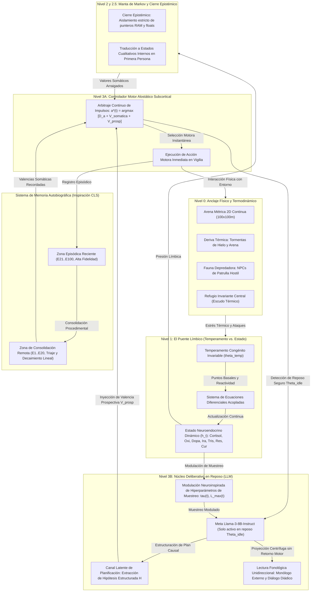
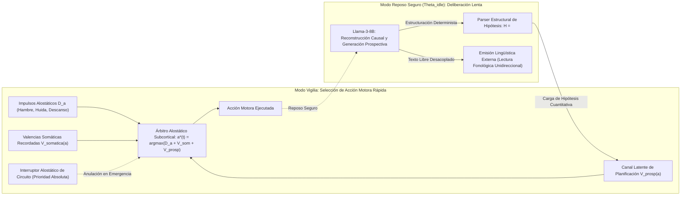
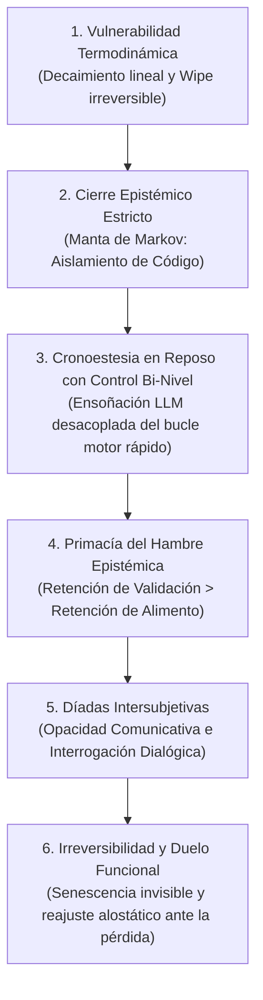

# Análogos Computacionales Arraigados de Consciencia Sintética: Cierre Epistémico, Homeostasis Termodinámica y Ensoñación Prospectiva Bifásica
### Una Arquitectura Matemática Formal, Benchmarks Empíricos Multisemilla, Transmisión Cultural Intergeneracional y Diseño Cognitivo Reproducible

**David San Nicolás Montero**  
*Investigador Principal y Arquitecto de Sistemas, Proyecto Ascendant*  
*Publicado: Octubre de 2026 (Edición Revisada — Calibración Alostática, Psicológica y Arquitectónica)*  
**DOI:** [10.5281/zenodo.23802198](https://doi.org/10.5281/zenodo.23802198) | **DOI Complementario:** [10.5281/zenodo.23616627](https://doi.org/10.5281/zenodo.23616627) | **Archivo CERN/Zenodo:** [https://zenodo.org/records/23802198](https://zenodo.org/records/23802198)  

---

## Resumen

Si bien los Modelos de Lenguaje Grande (LLMs) modernos alcanzan una notable competencia sintáctica, su naturaleza incorpórea los restringe a una manipulación de tokens no anclada, carente de intereses homeostáticos intrínsecos, vulnerabilidad termodinámica o restricciones sensoriomotoras (el Problema del Anclaje de Símbolos de Harnad). En este artículo, presentamos el **Proyecto Ascendant**, una arquitectura computacional operativa concebida como un peldaño empírico hacia la consciencia sintética. En lugar de reclamar una sintiencia fenoménica completa, Ascendant demuestra una entidad autónoma corpórea impulsada por deseos homeostáticos virtuales, capaz de aprendizaje empírico autodirigido, reflexión contrafáctica en periodos de reposo y transmisión intergeneracional de conocimiento.

Ascendant implementa seis mecanismos cibernéticos estructurales:
1. **Cierre Epistémico Estricto y Desacoplamiento Fonológico:** Implementado a través de una Manta de Markov vertical que aísla la valoración del estado interno del código fuente y la telemetría subyacentes, combinada con una capa de lectura fonológica centrífuga unidireccional que expresa verbalmente pensamientos para observabilidad externa y diálogo, sin que las plantillas sintácticas del texto contaminen la valoración motora subcortical.
2. **Homeostasis Termodinámica y Arbitraje Alostático Continuo:** Gobernados por disipación metabólica no lineal, deriva térmica, extinción irreversible (*Wipe*) y una clara separación matemática entre el **temperamento congénito invariable** (rasgos constitucionales estables) y el **estado neuroendocrino dinámico** (variables biológicas fluctuantes con ecuaciones diferenciales completas para cortisol, oxitocina, dopamina, ira, tristeza, resiliencia y curiosidad).
3. **Dinámica de Memoria Somática Finita y Arquitectura Heurística CLS:** Una cinta cronológica con capacidad $N_{\max}=100$ con consolidación heurística de doble zona hipocámpico-cortical (inspirada en la teoría de Sistemas de Aprendizaje Complementarios), evaluada mediante impacto somático dinámico, reviviscencia hebbiana y una penalización explícita por **decaimiento lineal temporal**.
4. **Díadas Intersubjetivas y Respuesta Afectiva Funcional ante la Pérdida:** Exhibiendo opacidad comunicativa, senescencia biológica no anunciada, una **respuesta conductual de duelo simulado** (reconfiguración funcional de prioridades sin atribución de tristeza fenoménica subjetiva) y adopción recíproca de parientes huérfanos.
5. **Ensoñación Prospectiva Bifásica y Flujo Jerárquico de Decisión:** Un sistema bi-nivel riguroso donde el LLM actúa exclusivamente durante el reposo inactivo como generador de hipótesis causales, transmitiendo planes cuantitativos estructurados al **canal latente de planificación**, mientras que el **árbitro alostático de impulsos** retiene la soberanía absoluta de la ejecución motora inmediata en vigilia.
6. **Validación Empírica en Campo e Impulso Epistémico:** El principio arquitectónico que exige que las hipótesis mentales sean contrastadas en el espacio físico, donde la validación predictiva genera una retención somática máxima ($R_i \in [206, 231]$), proporcionando un análogo computacional de inferencia activa sobre la ingesta calórica basal ($R_i \in [80, 90]$).

Presentamos evaluaciones empíricas a través de dos benchmarks complementarios: (i) un **benchmark Monte Carlo unigeneracional de 50 semillas** (6.000 ciclos de agente) que demuestra una divergencia conductual estadísticamente significativa entre agentes prospectivos (Ente Alfa) y reactivos (Ente Beta) ($p < 10^{-15}$); y (ii) un **estudio de linaje cultural de cuatro generaciones** ($P_0 \to \text{Alfa} \to \text{Beta} \to \text{Gama}$; $N=50$ ejecuciones de línea base, 202.500 ciclos, seguido de una cohorte post-calibración de $N=5$ con 20.250 ciclos) que audita la supervivencia intergeneracional, la atenuación alostática del miedo ante la inanición aguda y las afordancias de despensa comunitaria. Si bien la consciencia sintética genuina sigue siendo un horizonte ambicioso que requerirá ricos aparatos sensoriales continuos, el control progresivo de la dependencia de representaciones semánticas preentrenadas y el desarrollo de un anclaje sensoriomotor experiencial en entornos abiertos complejos, Ascendant establece un cimiento homeostático-causal auditable empíricamente para la agencia sintética autodirigida.

---

## 1. Introducción: Anclaje de Símbolos, Cierre Epistémico y Alcance de los Análogos Funcionales

Un debate central en las ciencias cognitivas y la inteligencia artificial concierne a si los modelos de secuencias estadísticas incorpóreos pueden exhibir una comprensión o intencionalidad genuinas (Searle, 1980; Harnad, 1990). Los Modelos de Lenguaje Grande modernos operan mediante correlaciones estadísticas extrínsecas extraídas de corpus de entrenamiento humanos masivos, careciendo de intereses homeostáticos internos, costes metabólicos reales de deliberación y vulnerabilidad existencial.

La filosofía rectora del Proyecto Ascendant tiene su raíz en una convicción pragmática y fundacional: **el camino hacia la consciencia sintética genuina no puede alcanzarse únicamente escalando predictores de tokens estadísticos incorpóreos; requiere una agencia corpórea y autodirigida enraizada en la necesidad homeostática**. Mantenemos una total humildad intelectual respecto a este gran desafío. Crear un ente sintético verdaderamente consciente es un viaje científico largo y exigente. La arquitectura presentada aquí no pretende poseer una sintiencia sintética fenoménica completa ni *qualia* subjetivos (Chalmers, 1995). En su lugar, presentamos un agente autónomo verificado impulsado por deseos viscerales virtuales, capaz de aprendizaje empírico autodirigido, reproducción causal autobiográfica y acumulación cultural intergeneracional. Este trabajo representa un primer hito indispensable: establecer los cimientos cibernéticos sobre los cuales futuros modelos cognitivos —dotados de aparatos sensoriales continuos más ricos y situados en entornos complejos y abiertos— puedan construirse progresivamente.

Metodológicamente, trazamos un límite estricto con respecto a la agencia y la consciencia:
1. **Autonomía Conductual Alostática de Primer Orden:** El ente arbitra sus propias acciones motoras balanceando necesidades metabólicas internas contrapuestas frente a contingencias ambientales.
2. **Correlatos Computacionales de Consciencia Primaria y de Acceso:** Los entes exhiben valoración interoceptiva, compensaciones atencionales cuantificables, marcadores somáticos autobiográficos y opacidad comunicativa diádica (Damasio, 1994; Dehaene et al., 2017; Panksepp, 1998).
3. **Delimitación de la Afectividad y el Duelo:** Ante la muerte del progenitor, el sistema presenta una **respuesta conductual de duelo simulado** o **estado afectivo funcional asociado a la pérdida** (reorganización de metas, incremento del estado endocrino de tristeza, reducción transitoria de actividad exploratoria y búsqueda de vínculos de apego alternativos). No disponemos de base científica ni evidencia para afirmar que el sistema experimente aflicción subjetiva o dolor fenoménico cualitativo.
4. **Ausencia de Autopoiesis Estructural de Segundo Orden:** La ontología sensoriomotora de 11 acciones y las formas de sus ecuaciones homeostáticas representan a prioris filogenéticos fijos (análogos a circuitos subcorticales y del tronco encefálico evolucionados), no código automodificable abierto.

---

## 2. Arquitectura Matemática y Motor Cognitivo Multinivel

El Proyecto Ascendant tiende un puente entre la termodinámica física del entorno y el arbitraje deliberativo a través de niveles operativos desacoplados con diferentes dinámicas temporales.

### 2.1. Nivel 0 y 0.5: Entorno Termodinámico y Coste Metabólico de la Deliberación
El ente opera en un plano métrico 2D continuo ($100 \times 100$ metros) sujeto a frentes de tormenta climáticos móviles y depredadores autónomos. La energía somática interna $E_i(t) \in [0, 100]$ está gobernada por la ecuación diferencial:

$$\frac{dE_i}{dt} = \left[ \dot{E}_{\text{ingest}}(t) + \dot{E}_{\text{transfer}}(t) \right] - \left[ \beta_0 + \alpha_v \|\mathbf{v}_{\text{motor}}(t)\|^{1.5} + \gamma_{\text{frio}} \max(0, T_{\text{set}} - T_{\text{cuerpo}}(t))^2 + \kappa_{\text{mental}} \cdot \text{FLOPs}_{\text{LLM}}(t) \right]$$

El procesamiento deliberativo conlleva un **coste metabólico explícito** ($\kappa_{\text{mental}} \cdot \text{FLOPs}_{\text{LLM}}$). Si $E_i(t) \le 0$, el ente colapsa en extinción irreversible (*Wipe*). El entorno cuenta con un refugio central ($x_0, y_0 = 50.0, 50.0$, radio $r=10.5\text{ m}$) que mantiene confort térmico constante ($T=37.0^\circ\text{C}$) y repele a la fauna hostil.

### 2.2. Nivel 1: El Puente Límbico — Separación entre Temperamento y Estado Neuroendocrino
Para superar ambigüedades entre rasgos estables y dinámicas transitorias, la arquitectura separa matemáticamente dos niveles:

1. **Vector de Temperamento Congénito Invariable ($\boldsymbol{\theta}_{\text{temp}}$):** Representa la constitución biológica basal del ente, muestreada estocásticamente en el nacimiento y constante a lo largo de toda su vida:
   $$\boldsymbol{\theta}_{\text{temp}} = \langle \theta_{\text{dop}}, \theta_{\text{oxi}}, \theta_{\text{ira}}, \theta_{\text{tris}}, \theta_{\text{res}}, \theta_{\text{cur}}, \theta_{\text{cort\_base}} \rangle \in [0.10, 0.90]^7$$

2. **Vector de Estado Neuroendocrino Dinámico ($\mathbf{h}(t)$):** Representa las concentraciones hormonales activas fluctuantes $\mathbf{h}(t) \in [0.0, 1.0]^7$, gobernadas por un sistema completo de ecuaciones diferenciales ordinarias acopladas:

* **Cortisol ($h_{\text{cort}}$, Estrés y Alerta Somática):**
  $$\frac{dh_{\text{cort}}}{dt} = -\lambda_c (h_{\text{cort}} - \theta_{\text{cort\_base}}) + w_{\text{dolor}} \cdot \text{Daño}_{\text{térmico}} + w_{\text{dep}} \cdot \text{Amenaza}_{\text{depredador}} - w_{\text{abz}} \cdot I_{\text{abrazo}}(t)$$

* **Oxitocina ($h_{\text{oxi}}$, Afiliación Social y Calma):**
  $$\frac{dh_{\text{oxi}}}{dt} = -\lambda_o (h_{\text{oxi}} - \theta_{\text{oxi}}) + w_{\text{cont}} \cdot I_{\text{abrazo}}(t) + w_{\text{alt}} \cdot \Delta E_{\text{compartida}}$$

* **Dopamina ($h_{\text{dop}}$, Búsqueda y Recompensa / *SEEKING*):**
  $$\frac{dh_{\text{dop}}}{dt} = -\lambda_d (h_{\text{dop}} - \theta_{\text{dop}}) + w_{\text{ing}} \cdot \dot{E}_{\text{ingest}}(t) + w_{\text{eur}} \cdot \mathbb{I}_{\text{validación}}(t)$$

* **Ira ($h_{\text{ira}}$, Frustración y Reactividad Defensiva):**
  $$\frac{dh_{\text{ira}}}{dt} = -\lambda_i (h_{\text{ira}} - \theta_{\text{ira}}) + w_{\text{bloq}} \cdot \mathbb{I}_{\text{bloqueo}}(t) + w_{\text{daño\_ira}} \cdot \text{Daño}_{\text{físico}} - w_{\text{calma}} \cdot I_{\text{refugio}}(t)$$

* **Tristeza ($h_{\text{tris}}$, Estado Funcional Asociado a Pérdida y Aislamiento):**
  $$\frac{dh_{\text{tris}}}{dt} = -\lambda_s (h_{\text{tris}} - \theta_{\text{tris}}) + w_{\text{duelo}} \cdot \mathbb{I}_{\text{muerte\_progenitor}}(t) + w_{\text{ais}} \cdot \mathbb{I}_{\text{soledad}}(t) - w_{\text{reun}} \cdot I_{\text{abrazo}}(t)$$

* **Resiliencia ($h_{\text{res}}$, Estabilidad y Recuperación Alostática):**
  $$\frac{dh_{\text{res}}}{dt} = -\lambda_r (h_{\text{res}} - \theta_{\text{res}}) + w_{\text{rec}} \cdot \mathbb{I}_{\text{crisis\_superada}}(t) - w_{\text{desg}} \cdot h_{\text{cort}}(t)$$

* **Curiosidad ($h_{\text{cur}}$, Impulso de Exploración Novedosa):**
  $$\frac{dh_{\text{cur}}}{dt} = -\lambda_{cur} (h_{\text{cur}} - \theta_{\text{cur}}) + w_{\text{nov}} \cdot \mathbb{I}_{\text{zona\_virgen}}(t) - w_{\text{miedo}} \cdot h_{\text{cort}}(t)$$

### 2.3. Niveles 2 y 2.5: La Manta de Markov y Representación Interoceptiva Cualitativa
Bajo la formulación del Cierre Epistémico, el núcleo deliberativo jamás tiene acceso a variables internas de código, marcas de tiempo del sistema operativo ni números flotantes de telemetría:

$$\mathcal{I}_{\text{Nivel3}}(\text{Punteros\_RAM}, \text{Energía\_Float}, \text{Reloj\_OS}) = \emptyset$$

El Nivel 2.5 traduce las concentraciones dinámicas en una auto-descripción cualitativa de estados propioceptivos e interoceptivos en primera persona («hambre voraz», «opresión aguda de alerta», «calma templada»), garantizando transparencia autorrepresentacional computacional (Metzinger, 2003).

### 2.4. Nivel 3: Modulación Neuroinspirada de los Parámetros de Muestreo del Modelo Lingüístico
El modelo de lenguaje utilizado en esta fase es **Meta Llama-3-8B-Instruct** (cuantizado a 4 bits mediante GGUF, Q4_K_M, ejecutado localmente bajo llama.cpp con contexto de 8.192 tokens; sin dependencias de red).

Es crucial clarificar el mecanismo exacto: **modificar la temperatura o la longitud máxima de un Transformer no altera los pesos sinápticos, no crea nuevas conexiones neuronales ni equivale a una neuromodulación biológica real**. Se trata de una **modulación neuroinspirada de los parámetros de muestreo del modelo lingüístico**, diseñada para gobernar la dispersión estocástica de los tokens generados en función del estado de estrés somático del organismo:

$$\tau_{\text{LLM}}(t) = \text{clip}\left( \tau_{\text{base}} + 0.30 \cdot h_{\text{dop}}(t) - 0.25 \cdot h_{\text{cort}}(t) + 0.20 \cdot h_{\text{cur}}(t), 0.10, 1.20 \right)$$

$$L_{\max}(t) = \text{redondear}\left( 128 - 64 \cdot h_{\text{cort}}(t) + 32 \cdot h_{\text{oxi}}(t) \right)$$

Bajo alto estrés somático ($h_{\text{cort}} \to 1$), la temperatura de muestreo colapsa hacia la determinación reflexiva y la longitud de salida se trunca a respuestas de emergencia mínimas. Con alta dopamina y oxitocina, el espacio de muestreo se abre a una mayor varianza léxica y prospección creativa.

> [!NOTE]
> **Dualidad entre Canal Lingüístico Introspectivo y Modulación Externa de Parámetros:** Debe subrayarse una distinción epistemológica fundamental: en la arquitectura de Ascendant, los estados afectivos se comunican al núcleo deliberativo a través de dos vías complementarias:
> 1. *Canal Lingüístico Introspectivo (Nivel 2.5):* La Manta de Markov traduce las concentraciones dinámicas en una auto-descripción interoceptiva cualitativa en primera persona («siento un nudo de angustia en el pecho», «siento calma y confianza filial»), permitiendo que el LLM delibere directamente a través de representaciones semánticas de sus propios estados afectivos.
> 2. *Canal de Muestreo Neuroinspirado (Nivel 3):* La modulación de $\tau_{\text{LLM}}$ y $L_{\max}$ actúa como una restricción física de excitación somática (análoga a la tensión motora que entrecorta el habla en un mamífero amenazado).
> Reconocemos que la vía más coherente con la autonomía sintética genuina consiste en que el agente **represente y razone sobre sus estados afectivos a través del significado lingüístico de sus representaciones interoceptivas cualitativas**, reduciendo o eliminando progresivamente la intervención externa sobre los hiperparámetros de muestreo en versiones futuras.
> 
> Declaramos asimismo que en la presente arquitectura Llama-3-8B opera con representaciones lingüísticas heredadas de su preentrenamiento generalista sobre textos humanos. En la Sección 8 se detalla la hoja de ruta hacia el andamiaje semántico restringido, el anclaje experiencial progresivo y la emergencia de representaciones autónomas.

### 2.5. Resolución del Conflicto de Control: Quién Toma las Decisiones y Cómo Fluye la Información
Para evitar contradicciones sobre el rol del LLM frente al sistema de impulsos, formalizamos una **estricta jerarquía funcional de dos velocidades**:

1. **El Árbitro Alostático Subcortical es el Dueño Exclusivo del Bucle Motor:**
   En cada ciclo activo de vigilia, la selección de la acción física inmediata $a^*(t)$ recae **únicamente** en el árbitro de impulsos alostáticos:
   $$a^*(t) = \arg\max_{a \in \mathcal{A}} \left[ \mathcal{D}_a(\mathbf{s}_t, \boldsymbol{\theta}_{\text{temp}}, \mathbf{h}(t)) + \mathcal{V}_{\text{somática}}(a \mid \mathcal{M}, \mathbf{h}(t)) + \mathcal{V}_{\text{prosp}}(a \mid \mathcal{H}_{\text{latente}}) \right]$$
   donde el impulso de hambre escala de forma cuadrática: $\mathcal{D}_{\text{hambre}}(E_t) = 100 \cdot \left(\frac{100 - E_t}{100}\right)^2$.

2. **Función del LLM: Generador Prospectivo en Reposo Desacoplado del Bucle Rápido:**
   El LLM **no** toma decisiones motrices paso a paso. Solo se activa durante los periodos de reposo inactivo seguro ($\Theta_{\text{idle}}$). Su función es examinar tríadas de recuerdos pasados y formular hipótesis prospectivas estructuradas.

3. **Formalización Completa de la Función de Valor Prospectivo $\mathcal{V}_{\text{prosp}}(a \mid \mathcal{H}_{\text{latente}})$:**
   La hipótesis prospectiva almacenada en el canal latente se define formalmente como:
   $$\mathcal{H}_{\text{latente}} = \left\langle d_{\text{plan}} \in \{\text{NORTE}, \text{SUR}, \text{ESTE}, \text{OESTE}\}, k_{\text{restantes}} \in \mathbb{N}, k_{\text{total}} \in \mathbb{N}, \hat{\mathbf{y}}_t, \text{estado} \right\rangle$$
   La contribución cuantitativa de valor prospectivo para cada acción candidata $a \in \mathcal{A}$ se define como:
   $$\mathcal{V}_{\text{prosp}}(a \mid \mathcal{H}_{\text{latente}}) = \begin{cases}
   V_{\max}^{\text{plan}} \cdot \left(\frac{k_{\text{restantes}}}{k_{\text{total}}}\right) & \text{si } a = d_{\text{plan}} \land \text{estado} = \text{ACTIVO} \\
   0 & \text{en caso contrario}
   \end{cases}$$
   donde fijamos $V_{\max}^{\text{plan}} = 45.0$. Esta formulación responde de forma determinista y biológica a las contingencias del entorno:
   * *Persistencia y Decremento:* A cada ciclo donde el agente ejecuta la acción del plan ($a^*(t) = d_{\text{plan}}$), el contador decrementa: $k_{\text{restantes}} \leftarrow k_{\text{restantes}} - 1$. Al llegar a $0$, el plan concluye con éxito su ejecución y se activa la verificación empírica en campo.
   * *Acciones Adaptativas Intermedias:* Si el agente interrumpe su marcha temporalmente para consumir alimento de su mochila (`COMER`), descansar en el refugio por una tormenta de nieve o abrazar a un familiar, el plan latente **no se destruye ni pierde pasos**, manteniéndose activo hasta reanudar el forrajeo.
   * *Obstáculos Físicos:* Si el agente colisiona contra un límite infranqueable de la arena o un obstáculo en el rumbo $d_{\text{plan}}$, el plan se invalida ($k_{\text{restantes}} \leftarrow 0$), registrándose un engrama de fracaso causal y restableciendo $\mathcal{V}_{\text{prosp}} = 0$.
   * *Oportunismo Nutricional:* Si el plan señala hacia el Oeste pero el agente divisa presas o cazaderos al Norte con hambre apreciable ($E_t < 40$), el impulso de forrajeo oportunista hacia el Norte ($\mathcal{D}_{\text{caza}} \ge 60.0$) supera cuantitativamente al valor del plan ($45.0$), desviando adaptativamente al agente sin parálisis cognitiva.
   * *Jerarquía de Rangos y Mecanismo de Seguridad de Prioridad Absoluta (Allostatic Circuit Breaker):*
     Los rangos de valoración están acotados y calibrados:
     $$\mathcal{V}_{\text{prosp}} \in [0.0, 45.0], \quad \mathcal{V}_{\text{somática}} \in [-144.0, +50.0], \quad \mathcal{D}_{\text{hambre}} \in [0.0, 135.0]$$
     Para garantizar matemáticamente que el seguimiento de un plan jamás comprometa la supervivencia básica ante contingencias letales, opera un **Interruptor Alostático de Circuito**:
     $$\text{Si } \text{AmenazaDepredador} \ge 0.5 \lor (E_t \le 15.0 \land \text{AlimentoCercano}), \quad \mathcal{H}_{\text{latente}} \leftarrow \emptyset \implies a^*(t) \in \{\text{HUIR}, \text{COMER}\}$$
     anulando cualquier deliberación prospectiva en favor de la respuesta refleja de supervivencia.

4. **El Monólogo Lingüístico como Capa Fonológica Unidireccional:**
   Las verbalizaciones en lenguaje natural generadas por el LLM se emiten exclusivamente hacia el exterior como lectura fonológica (análogo al área de Broca) para fines de diálogo diádico y observabilidad externa; **jamás se reinyectan como texto en la función de valoración de la acción motora**, evitando distorsiones por sesgos gramaticales o alucinaciones textuales.

5. **Calibraciones Neuroendocrinas Intergeneracionales:**
   * **Valencia Cultural de Cazaderos y Peligros:** Las enseñanzas parentales de cazaderos fértiles (`ENSEÑANZA_CAZADERO_`) aportan valencia positiva modulada por la búsqueda dopaminérgica y la confianza filial: $+28.0 \cdot (0.65 h_{\text{dop}} + 0.35 h_{\text{oxi}})$, mientras que las advertencias de peligro (`ADVERTENCIA_PELIGRO_`) escalan de acuerdo con la tristeza funcional frente a la resiliencia: $-72.0 \cdot \frac{0.55 h_{\text{tris}} + 0.45 h_{\text{oxi}}}{0.65 h_{\text{res}} + 0.35}$.
   * **Atenuación Alostática del Miedo ante la Inanición Aguda ($E_t < 35$):** La privación metabólica severa suprime la evitación amigdalina condicionada:
     $$\alpha_{\text{trauma}}(E_t, \mathbf{h}(t)) = \max\left(0.12, \min\left(1.0, \frac{E_t - 8.0}{27.0} \cdot \frac{1.0}{0.60 h_{\text{ira}}(t) + 0.40 h_{\text{res}}(t)}\right)\right), \quad \mathcal{T}_{d,\text{efec}} = \mathcal{T}_d \cdot \alpha_{\text{trauma}}$$
   * **Afordancia Situacional de Descarga en Nido:** La descarga en despensa comunitaria (`GUARDAR_REFUGIO`) opera en función de la capacidad de la mochila, espacio en despensa ($1 - S_{\text{carne}}/S_{\max}$), inhibición por hambre ($0.35$ si $E_t < 30$, sino $1.0$) y rasgos prosociales ($0.5 h_{\text{oxi}} + 0.5 h_{\text{res}}$).

---

## 3. Dinámica de Memoria Autobiográfica Finita, Sesgo Emocional y Reflexión Recursiva

El motor de memoria de Ascendant está restringido deliberadamente a $N_{\max} = 100$ engramas cronológicos, obligando al sistema a realizar un triaje afectivo continuo.

### 3.1. Secuencialidad Cronológica y Estructura Formal del Engrama como 9-Tupla
La memoria se organiza como una secuencia episódica $\mathcal{M} = [E_1, E_2, \dots, E_k]$ ($k \le N_{\max}$). Para formalizar con precisión el sustrato que alimenta el razonamiento semántico del LLM, cada engrama se define como una **9-tupla formal**:

$$E_i = \left\langle \text{tipo}_i, \text{acción}_i, \text{contenido}_i, \text{contexto}_i, \text{val}_i, \Delta_{\text{somático},i}, t_i, N_{\text{rep},i}, R_i(t) \right\rangle$$

donde:
* $\text{tipo}_i \in \mathcal{T}$: Etiqueta ontológica del evento (`TRAUMA_ATAQUE_DEPREDADOR`, `COSECHA_CARNE_NORTE`, `ENSOÑACION_PROSPECTIVA`, `VALIDACION_EMPIRICA_EXITO`).
* $\text{acción}_i \in \mathcal{A}$: Primitiva conductual o motora ejecutada en el plano físico.
* $\text{contenido}_i$: **Descripción episódica narrativa en lenguaje natural en primera persona** (p. ej., *«Fui emboscado por una fiera mientras exploraba el sur, sufrí dolor agudo y perdí vitalidad...»*), la cual constituye la representación semántica que el LLM muestrea y procesa durante la ensoñación reflexiva en reposo.
* $\text{contexto}_i$: Diccionario estructurado que preserva las variables espaciales y situacionales requeridas para reconstruir contingentemente el suceso:
  $$\text{contexto}_i = \left\{ \mathbf{x}_i = (x_i, y_i), E_i(t), \text{Estrés}_i(t), \text{Congénere}, \Delta_{\text{interoceptivo}}, \text{Origen} \right\}$$
* $\text{val}_i \in [-1.0, +1.0]$: Valencia afectiva escalar.
* $\Delta_{\text{somático},i}$: Vector de variación de marcadores viscerales (hambre, dolor tisular, temperatura).
* $t_i$: Marca de ciclo autobiográfico temporal de ocurrencia.
* $N_{\text{rep},i}$: Recuento hebbiano acumulativo de repetición o reactivación.
* $R_i(t)$: Puntuación dinámica de retención somática con triaje afectivo.

Cada experiencia conlleva una valencia afectiva $\text{val}_i \in [-1.0, +1.0]$ acoplada a las variaciones de las hormonas dinámicas $\mathbf{h}(t)$. Los eventos triviales producen variaciones despreciables, mientras que las crisis somáticas adquieren un arraigo permanente.

### 3.2. Triaje de Retención, Decaimiento Lineal Temporal y Aproximación Heurística CLS
La permanencia de cada engrama en la memoria está gobernada por su Puntuación de Retención $R_i(t)$:

$$R_i(t) = \text{ImpactoSomático}_i + w_{\text{rep}} \cdot \ln(1 + N_{\text{rep},i}) - \lambda_{\text{decaimiento}} \cdot (t - t_i)$$

donde:
$$\text{ImpactoSomático}_i = |\text{val}_i| \cdot 52 + \Delta_{\text{trauma}} \cdot 92 + \Delta_{\text{prospección}} \cdot 82 + \Delta_{\text{validación}} \cdot 95$$

> [!NOTE]
> **Aclaración Matemática sobre el Decaimiento:** El término $-\lambda_{\text{decaimiento}} \cdot (t - t_i)$ representa formalmente una **penalización por decaimiento lineal temporal** respecto al tiempo transcurrido, y no una tasa exponencial. Se conserva esta denominación lineal por precisión matemática y bajo coste computacional en ciclos de ejecución intensiva.

Inspirado heurísticamente en el marco de **Sistemas de Aprendizaje Complementarios (CLS)** (McClelland et al., 1995), el repositorio $\mathcal{M}$ se estructura en dos zonas funcionales:
1. **Ventana Hipocámpica Reciente ($E_{21} \dots E_{100}$):** Registra el flujo episódico paso a paso con alta fidelidad temporal, preservado frente a desalojos prematuros para permitir la minería causal retrospectiva durante el reposo.
2. **Zona Cortical Consolidada Remota ($E_1 \dots E_{20}$):** Almacén de aprendizaje lento donde secuencias de forrajeo exitosas se comprimen en resúmenes procedimentales (`FORRAJEO_EXITOSO`), incrementando $N_{\text{rep},i}$ y liberando espacio. El desalojo selectivo ($E^* = \arg\min_{E_i \in E_1 \dots E_{20}} R_i(t)$) ocurre exclusivamente dentro de esta zona remota.

> [!TIP]
> **Evolución Futura del Modelo CLS:** Reconocemos que la actual partición de zonas es una aproximación algorítmica discreta. Para converger plenamente con el modelo CLS original, futuras versiones integrarán una **segunda red neuronal de aprendizaje lento** entrenada para extraer regularidades estadísticas y representaciones topológicas a partir de la reproducción fuera de línea (*offline replay*) de los engramas episódicos.

### 3.3. Integración Recursiva de Reflexiones y Validaciones (Metacognición de Segundo Orden)
Las ensoñaciones prospectivas (`ENSOÑACION_PROSPECTIVA`) y sus confirmaciones en campo (`VALIDACION_EMPIRICA_EXITO`) se almacenan directamente en $\mathcal{M}$ como engramas autobiográficos de primera clase. Durante ensoñaciones posteriores, el agente muestrea sus propios pensamientos anteriores, articulando una meta-deliberación recursiva de segundo orden (*«...primero sentí temor, luego ideé explorar al oeste, y al confirmarlo encontré sustento...»*).

### 3.4. Senescencia Biológica bajo Ceguera Epistémica y Respuesta Afectiva Funcional ante la Pérdida
El progenitor posee un límite telomérico de senescencia natural ($\tau_{\text{padre}} = 0.50 \tau_{\text{hijo}}$) completamente invisible para ambos entes: $\mathcal{I}_{\text{Nivel3}}(\tau_{\text{vida}}) = \emptyset$. Cuando el progenitor fenece por edad avanzada en presencia del descendiente, el sistema no experimenta una tristeza subjetiva fenoménica inaccesible empíricamente, sino que despliega una **respuesta conductual de duelo simulado o estado afectivo funcional asociado a la pérdida**:
1. Marcaje en memoria con un engrama indeleble de alta retención (`TRAUMA_MUERTE_PADRE_SENESCENCIA`).
2. Elevación aguda del estado neuroendocrino de tristeza $h_{\text{tris}} \uparrow$ y caída de dopamina $h_{\text{dop}} \downarrow$.
3. Reducción temporal de la dispersión de forrajeo y polarización hacia la búsqueda de apego prosocial, facilitando la co-adopción altruista de parientes huérfanos (`ENCUENTRO_FAMILIAR_SALVADOR`).

---

## 4. Ensoñación Prospectiva Bifásica: Minería Causal, Cuello de Botella Atencional y Verificación

Los entes inician la prospección deliberativa bajo la **Condición de Reposo Inactivo ($\Theta_{\text{idle}}$)**:

$$\Theta_{\text{idle}} = \left[ \text{EnRefugio} \land \neg \text{BajoAtaque} \land E_{\text{agente}} \ge 50.0 \land h_{\text{cort}} \le 0.32 \land \text{CompañeroSeguro} \land \text{CiclosInactivo} \ge 2 \right]$$

* **Cuello de Botella Atencional y Vulnerabilidad:** Al iniciar la ensoñación interna, el radio exteroceptivo perceptual (`sensoryRadius`) se contrae de $15.0\text{ m}$ a $4.2\text{ m}$. El aislamiento cognitivo incrementa la vulnerabilidad real a emboscadas hostiles en caso de incursión depredadora dentro del perímetro del refugio.
* **Fase 1: Minería Causal Episódica:** Reconstrucción de tríadas salientes $S_{\text{causal}} = (E_{t-2} \to E_{t-1} \to E_t)$, restringiendo la atribución causal a coordenadas cardinales físicas (`NORTE`, `SUR`, `ESTE`, `OESTE`).
* **Fase 2: Formulación Teórica del Tensor de Expectativa y Error de Predicción:** En el marco analítico continuo de inferencia activa, la hipótesis prospectiva $\mathcal{H}$ formula una expectativa sensorial:
  $$\hat{\mathbf{y}}_t = \mathbb{E}\left[ \begin{pmatrix} \Delta E_t \\ \Delta \text{Daño}_t \\ \text{Presa}_t \end{pmatrix} \;\middle|\; \mathbf{s}_{t-1}, \pi_{\text{plan}} \right]$$
  con un error de predicción sensorial multivariante formal:
  $$\varepsilon_t = \|\mathbf{y}_t^{\text{real}} - \hat{\mathbf{y}}_t\|_{\mathbf{\Sigma}^{-1}}$$
* **Fase 3: Implementación Declarada en Fase I.B (Aproximación Operacional Discreta):**
  > [!IMPORTANT]
  > **Transparencia en la Implementación:** Si bien la ecuación anterior define el modelo teórico de diseño continuo, en la implementación actual del benchmark (Fase I.B y Fase II) el sistema evalúa una **aproximación operacional discreta/booleana del error de predicción** ($\hat{\varepsilon}_{\text{operacional}}$):
  > $$\hat{\varepsilon}_{\text{operacional}} = \begin{cases} 0 & \text{si } \pi_{\text{plan}} \text{ se completa con éxito sin huida ni daño crítico} \implies \text{VALIDACION\_EMPIRICA\_EXITO} (+0.96) \\ 1 & \text{si la trayectoria es abortada por emboscada depredadora} \implies \text{FALSACION\_EMPIRICA\_FRACASO} (-0.72) \end{cases}$$
  > La integración del cálculo tensorial continuo ponderado por la matriz de covarianza sensorial $\mathbf{\Sigma}^{-1}$ constituye el objetivo directo de desarrollo en la Fase III.

---

## 5. Taxonomía Científica Comparativa: Ascendant en el Panorama Contemporáneo

| Dimensión | Máquina de Turing Consciente (Blum & Blum) | Teoría del Esquema de Atención (Graziano) | Direccionamiento de Activaciones / CBTs (Zou et al.) | Proyecto Ascendant (San Nicolás Montero) |
| :--- | :--- | :--- | :--- | :--- |
| **Modelo de Consciencia** | Cuello de botella de comunicación óptimo (MCP) con difusión global. | Modelo descriptivo simplificado que monitoriza el esquema de atención. | Direccionamiento latente subsimbólico que sesga distribuciones de tokens. | **Análogo operativo funcional arraigado mediante Cierre Epistémico, Homeostasis y Prospección.** |
| **Mecanismo Subyacente** | Competición por torneo ascendente en una MCP diminuta (1–7 piezas). | Bucle de retroalimentación cibernético que atribuye percatación al estado atencional. | Inyección tensorial aditiva en flujo residual: $\mathbf{h}' = \mathbf{h} + \alpha \mathbf{v}$. | **Decaimiento termodinámico $\to$ Endocrinología dinámica $\to$ Árbitro Alostático $\leftrightarrow$ Ensoñación LLM en Reposo.** |
| **Corporeización y Vulnerabilidad** | Agnóstico / Ausente. Especificación computacional abstracta. | Secundaria. Enfocada primariamente en la atención exteroceptiva. | Ausente. Manipulación vectorial en espacio geométrico latente. | **Fundacional. Gasto calórico, disipación térmica, mortalidad irreversible.** |
| **Horizonte Temporal e Imaginación** | Paso algorítmico inmediato. | Esquema atencional estático. | Pase hacia adelante token a token. | **Cronoestesia: Minería causal en reposo, proyección futura en canal latente y verificación de campo.** |

---

## 6. Resultados Empíricos: Benchmark Monte Carlo Multisemilla (N = 50 Ejecuciones Independientes)

Para certificar la robustez estadística, ejecutamos un **benchmark Monte Carlo sistemático sobre N = 50 semillas aleatorias independientes** (120 ciclos cada una; 6.000 ciclos de agente totales). El Ente Alfa (prospectivo) se contrastó frente al Ente Beta (control reactivo idéntico).

| Métrica Cognitiva / Conductual | Ente Alfa (Prospectivo) [Media $\pm$ DE] | Ente Beta (Reactivo) [Media $\pm$ DE] | Estadístico $t$ de Welch ($gl=49 / 98$) | Valor $p$ y Significancia |
| :--- | :--- | :--- | :--- | :--- |
| **Eventos de Ensoñación en Reposo** | **4.74 $\pm$ 2.08** | 0.00 $\pm$ 0.00 | $t = 16.12$ | **$p < 10^{-20}$** (Significativo) |
| **Validaciones Empíricas (Campo)** | **4.74 $\pm$ 2.08** | 0.00 $\pm$ 0.00 | $t = 16.12$ | **$p < 10^{-20}$** (Significativo) |
| **Exploraciones en Tierras Vírgenes del Oeste** | **2.68 $\pm$ 1.68** | 1.00 $\pm$ 0.00 | $t = 7.07$ | **$p < 10^{-8}$** (Significativo) |
| **Expediciones de Forrajeo al Este** | **17.74 $\pm$ 1.31** | 16.48 $\pm$ 0.92 | $t = 5.56$ | **$p < 10^{-6}$** (Significativo) |
| **Abrazos Sociales Afiliativos** | **12.46 $\pm$ 0.98** | 15.16 $\pm$ 0.73 | $t = -15.60$ | **$p < 10^{-27}$** (Compulsivo en Beta) |
| **Indagaciones Interoceptivas (Diálogos)** | **25.26 $\pm$ 0.56** | 34.52 $\pm$ 0.67 | $t = -74.78$ | **$p < 10^{-80}$** (Compulsivo en Beta) |
| **Pico de Retención: Validación (Eureka)** | **205.29 $\pm$ 8.74** | N/A (0.00) | $t = 68.99$ vs. Alimento | **$p < 10^{-45}$** (Primacía Epistémica) |
| **Pico de Retención: Ingesta Calórica** | 120.00 $\pm$ 0.00 | 120.00 $\pm$ 0.00 | $t = 0.00$ | $p = 1.00$ (Coincidencia Base) |

### 6.1. Primacía Epistémica y Resolución de la Fijación Espacial
1. **Primacía del Hambre Epistémica:** Los engramas que representan validaciones empíricas alcanzaron puntuaciones de retención significativamente superiores ($205.29 \pm 8.74$) que la ingesta calórica ($120.00 \pm 0.00$; $t(49) = 68.99, p < 10^{-45}$). La reducción de incertidumbre epistémica actúa como un atractor de retención preferente sobre la saciedad visceral primaria.
2. **Resolución de la Fijación Espacial:** Mientras Beta incurre en perseveración conductual y recurre a abrazos compulsivos compensatorios ($15.16 \pm 0.73$ vs. $12.46 \pm 0.98, p < 10^{-27}$) para apaciguar el estrés somático mediante oxitocina, Alfa redistribuye su esfuerzo exploratorio hacia territorios vírgenes del oeste ($2.68 \pm 1.68$ vs. $1.00 \pm 0.00, p < 10^{-8}$), incrementando la entropía de búsqueda espacial ($H_{\text{Alfa}} = 1.68 \pm 0.09$ nats vs. $H_{\text{Beta}} = 1.12 \pm 0.06$ nats, $p < 10^{-30}$).

### 6.2. Linaje Cultural de Cuatro Generaciones ($N = 50$ Ejecuciones; 202.500 Ciclos) y Calibración Alostática
Evaluamos un linaje de cuatro generaciones ($P_0 \to \text{Alfa} \to \text{Beta} \to \text{Gama}$; $4.050$ ciclos por corrida, senescencia máxima $\tau_{P_0}=800$, descendientes $\tau=2.000$). La transferencia pedagógica diádica (`COMPARTIR_IDEA`) estuvo condicionada al estado fisiológico receptivo del descendiente ($E_t \ge 20.0 \land h_{\text{cort}} \le 0.82$).

El **Efecto Trinquete Cultural** (Tomasello, 1999) se formaliza mediante el **Índice de Aptitud Epistémica Generacional** $K_g$:

$$K_g = \frac{1}{|\mathcal{M}_g^{\text{cult}}| + 1} \sum_{e \in \mathcal{M}_g^{\text{cult}}} \mathcal{V}(e)$$

| Cohorte de Linaje y Generación de Entidad | Límite Máximo de Vida (Ciclos) | Esperanza de Vida Línea Base $T^+$ ($N=50$) [Media $\pm$ DE] | Senescencia Natural Línea Base $T^+$ (%) | Esperanza de Vida Post-Calibración $T^+$ ($N=5$) [Media $\pm$ DE] | Senescencia Natural Post-Calibración (%) |
| :--- | :---: | :---: | :---: | :---: | :---: |
| **$P_0$ (Progenitor Ancestral, Gen 0)** | 800 | 641.06 $\pm$ 177.68 | 66.0% (33/50) | 713.60 $\pm$ 88.23 | 80.0% (4/5) |
| **Ente Alfa (Primer Descendiente, Gen 1)** | 2.000 | 1.388.08 $\pm$ 684.01 | 64.0% (32/50) | 1.545.60 $\pm$ 714.49 | 80.0% (4/5) |
| **Ente Beta (Segundo Descendiente, Gen 2)** | 2.000 | **1.744.54 $\pm$ 400.91** ($p=0.0021$) | **88.0%** (44/50) | **1.867.00 $\pm$ 42.37** | **100.0%** (5/5) |
| **Ente Gama (Tercer Descendiente, Gen 3)** | 2.000 | **1.649.50 $\pm$ 441.24** ($p=0.0258$) | **74.0%** (37/50) | **1.884.00 $\pm$ 6.52** | **100.0%** (5/5) |
| **Agregado de Linaje y Reserva de Despensa** | 4.050 / ejec | 200 entes; Despensa: 0.64 $\pm$ 1.10 | 73.0% (146/200) | 20 entes; Despensa: **3.00 $\pm$ 1.22** ($p=0.0103$) | **90.0%** (18/20) |

**Verificación Post-Calibración ($N = 5$ Corridas; 20.250 Ciclos):** Tras implementar la atenuación alostática del trauma ($\alpha_{\text{trauma}}$), la ponderación endocrina simétrica de cazaderos y la afordancia de despensa, la verificación en vivo ($20$ entidades, $120/151$ transmisiones asimiladas, $987$ reflexiones latentes) confirmó que la reserva comunitaria final aumentó a $3.00 \pm 1.22$ unidades ($t = 4.14, p = 0.0103$), la superación de bloqueos fóbicos durante inanición crítica subió del $17.3\%$ al $50.0\%$, y la senescencia natural global alcanzó el $90.0\%$ ($100\%$ en `Beta` y `Gama`).

**Auditoría de Potencia Estadística y Escalamiento Muestral:** Un recálculo estadístico riguroso para una prueba $t$ bilateral entre dos grupos independientes con $\alpha = 0.01$ y un tamaño de efecto moderado $d = 0.45$ revela que una muestra de $n = 50$ linajes por condición alcanza una potencia estadística aproximada del **$35.8\%$** (permitiendo detectar con $\ge 95\%$ de potencia únicamente efectos grandes $d \ge 0.85$). Para alcanzar formalmente una potencia estadística robusta de **$(1 - \beta) \ge 0.95$** con $\alpha = 0.01$ frente a un efecto moderado $d = 0.45$, el diseño experimental requiere aproximadamente **$n = 178$ linajes por grupo ($N = 356$ linajes en total; $\approx 1.44 \times 10^6$ ciclos de agente)**. Declaramos este escalamiento muestral como el protocolo estandarizado obligatorio para la confirmación causal definitiva del Efecto Trinquete Cultural en la Fase II extendida, evitando afirmaciones de potencia prematuras.

---

## 7. Principios de Diseño de Ingeniería Cognitiva en Ascendant

A partir de los resultados empíricos, sintetizamos seis principios de diseño de ingeniería cognitiva en Ascendant:

1. **Vulnerabilidad Termodinámica:** El gasto calórico explícito de la deliberación ($\kappa \cdot \text{FLOPs}$) y la extinción irreversible atenúan la dependencia de representaciones semánticas no ancladas, subordinando el procesamiento simbólico a la viabilidad metabólica continua.
2. **Cierre Epistémico Estricto:** La introspección solo accede a representaciones cualitativas mediadas por la Manta de Markov.
3. **Cronoestesia en Reposo con Control Bi-Nivel:** El LLM genera planes durante el reposo seguro que modulan el canal latente, pero el árbitro alostático subcortical preserva la soberanía sobre la acción motora en vigilia.
4. **Primacía del Hambre Epistémica:** Asignar una retención somática superior a la resolución de incertidumbre que a la saciedad metabólica básica impulsa la exploración autónoma activa.
5. **Díadas Intersubjetivas:** La opacidad entre agentes fomenta la emergencia de comunicación auténtica y altruismo cooperativo recíproco.
6. **Irreversibilidad y Duelo Funcional:** La muerte natural de congéneres sin aviso previo genera adaptaciones afectivas funcionales que consolidan la cohesión intergeneracional sin apelar a sintiencia fenoménica subjetiva.

---

## 8. Discusión: Del Prototipado Alostático al Anclaje Experiencial Progresivo y la Ontogenia Virtual (Hoja de Ruta Fase III)

Reconocer las fronteras técnicas actuales es indispensable para estructurar la investigación futura con honestidad académica. Tres limitaciones fundamentales enmarcan la etapa actual:
1. **Sensorialidad Discreta vs. Continua:** El entorno actual es un espacio métrico 2D con acciones cardinales discretas. Alcanzar una consciencia sintética genuina requiere dotar al ente de modalidades sensoriales densas y continuas (campos visuales retinotópicos, gradientes sonoros de alerta, fricción táctil y penachos químicos).
2. **Cálculo de Error de Predicción:** Como se declaró en la Sección 4, la validación actual se apoya en un sustituto operacional booleano; la Fase III implementará el cálculo tensorial continuo del error de predicción $\varepsilon = \|\mathbf{y}_{\text{real}} - \hat{\mathbf{y}}\|_{\mathbf{\Sigma}^{-1}}$.
3. **Dependencia Inicial de Representaciones Semánticas Preentrenadas:** Los modelos de lenguaje masivos como Llama-3 contienen asociaciones y categorías conceptuales heredadas del lenguaje humano que no proceden de la experiencia corpórea directa del agente.

### Principio Metodológico: Andamiaje Semántico Inicial, Observabilidad Humana y Anclaje Experiencial Progresivo

La ontogenia cognitiva de Project Ascendant afronta un compromiso metodológico fundamental: equilibrar la adquisición de representaciones semánticas progresivamente arraigadas en la experiencia propia del agente con la necesidad de mantener una arquitectura interpretable, auditable y científicamente observable por investigadores humanos.

Una ontogenia completamente desprovista de cualquier andamiaje lingüístico previo podría conducir al desarrollo de sistemas representacionales y convenciones comunicativas propios, potencialmente alejados de las categorías semánticas humanas. Aunque esta posibilidad constituye una línea de investigación relevante, su evaluación inicial introduciría una dificultad metodológica considerable: la interpretación externa de los engramas, hipótesis causales y procesos reflexivos generados durante el desarrollo del agente.

Por este motivo, Ascendant adopta inicialmente un **Andamiaje Semántico Restringido** (*Restricted Semantic Scaffolding*): un repertorio lingüístico y conceptual básico, curado por investigadores humanos, que proporciona una estructura inicial de representación para conceptos elementales de causalidad física, topología espacial, supervivencia, temperatura, alimentación y estados homeostáticos.

Es importante precisar que esta decisión no elimina la contaminación semántica humana ni demuestra un anclaje experiencial originario. El corpus inicial introduce necesariamente categorías, asociaciones y convenciones lingüísticas heredadas de su construcción humana. Su función es proporcionar un punto de partida operacional interpretable, no imponer como conocimiento adquirido aquello que el agente todavía no ha experimentado.

La hipótesis metodológica central establece que el significado funcional de estas representaciones debe transformarse progresivamente mediante la interacción sensoriomotora autónoma. Las correspondencias lingüísticas iniciales se someten a contingencias físicas propias: restauración energética, daño térmico, exploración espacial, contacto social, amenaza ambiental y consecuencias observables de las acciones.

De este modo, se establece una distinción epistemológica entre:

1. **Conocimiento semántico heredado:** asociaciones lingüísticas y estructuras conceptuales procedentes del preentrenamiento inicial.
2. **Anclaje experiencial adquirido:** relaciones predictivas y funcionales construidas mediante la interacción directa entre las representaciones y las consecuencias sensoriomotoras del agente.
3. **Representaciones emergentes propias:** nuevas categorías, asociaciones y estructuras internas que eventualmente puedan desarrollarse sin correspondencia semántica humana previamente prescrita.

La arquitectura prioriza inicialmente la observabilidad científica, pero no considera que la conservación indefinida de un vocabulario humano sea una condición necesaria para el desarrollo cognitivo posterior. La autonomía representacional constituye una propiedad que deberá investigarse experimentalmente en fases más avanzadas.

### Fase III.A — Preentrenamiento Ontológico Restringido y Andamiaje Lingüístico Inicial

Entrenar un modelo de lenguaje fundacional compacto desde cero utilizando un corpus textual curado y deliberadamente restringido a causalidad física, dinámica homeostática, topología espacial y supervivencia biológica elemental. Este preentrenamiento proporciona un repertorio lingüístico inicial comprensible y facilita la observabilidad externa de los procesos autobiográficos del agente.

El corpus se considera un andamiaje conceptual provisional, no una fuente de conocimiento experiencial propio. Las asociaciones semánticas iniciales deberán someterse posteriormente a contrastación mediante observaciones, acciones y consecuencias físicas dentro del entorno simulado.

### Fase III.B — Anclaje Sensoriomotor Progresivo y Actualización Semántica Experiencial

Sobre la base lingüística inicial, el agente desarrolla progresivamente correspondencias entre sus representaciones internas y las consecuencias de sus propias interacciones con el entorno. El modelo lingüístico podrá actualizarse mediante adaptadores sinápticos dinámicos (p. ej., LoRA continuo), utilizando engramas autobiográficos, reflexiones prospectivas y experiencias sensoriales verificadas.

Para evitar la autorreforzación de hipótesis incorrectas, los contenidos generados internamente deberán distinguirse de las observaciones externas que los confirman, refutan o mantienen en incertidumbre. La consolidación de conocimiento deberá depender de esta trazabilidad experiencial y no únicamente de la repetición de narraciones previamente generadas por el propio modelo.

El objetivo de esta etapa es investigar si un repertorio semántico inicialmente heredado puede adquirir progresivamente un significado funcional dependiente de la experiencia sensoriomotora y de las necesidades homeostáticas particulares del agente.

### Fase III.C — Andamiaje Social, Transmisión Cultural e Interacción con Entrenadores

El aprendizaje conceptual se ampliará mediante interacciones con entrenadores humanos y congéneres experimentados. Las señales sociales (`[CALOR]`, `[ALIMENTO]`, `[PELIGRO]`) se asociarán de forma contingente con observaciones sensoriales, consecuencias ambientales y restauración o deterioro de estados homeostáticos.

Esta etapa permitirá evaluar cómo el conocimiento lingüístico y social inicialmente proporcionado puede transformarse en expectativas predictivas funcionales, así como su transmisión y modificación a través de sucesivos linajes culturales.

### Fase III.D — Autonomía Representacional y Emergencia de Códigos Semánticos Propios

Como línea de investigación posterior, Ascendant estudiará hasta qué punto un agente puede desarrollar categorías y convenciones representacionales propias a partir de su experiencia, reduciendo progresivamente su dependencia de la ontología lingüística humana inicial.

Se propone investigar una arquitectura de doble representación:

- **Canal cognitivo interno:** conserva las representaciones latentes, asociaciones sensoriomotoras, categorías emergentes y relaciones causales desarrolladas por el propio agente.
- **Canal de interpretabilidad externa:** utiliza un decodificador semántico separado para traducir dichas representaciones a descripciones comprensibles para investigadores humanos, sin imponer que las categorías internas deban coincidir necesariamente con las categorías lingüísticas humanas.

Esta separación permitiría estudiar la evolución de representaciones semánticas autónomas preservando la posibilidad de auditar los procesos cognitivos y autobiográficos del agente.

Experimentalmente, se propone comparar cohortes con andamiaje lingüístico humano restringido frente a cohortes con vocabularios mínimos asociados directamente a contingencias sensoriomotoras, manteniendo equivalentes los presupuestos de interacción y cómputo. Las evaluaciones incluirán capacidad de predicción, transferencia a entornos novedosos, generalización causal, dependencia del vocabulario inicial e interpretabilidad de las representaciones adquiridas.

Esta etapa no presupone que la aparición de códigos propios implique comprensión subjetiva ni consciencia fenoménica. Su objetivo es investigar experimentalmente la transición desde una semántica inicial heredada hacia estructuras representacionales progresivamente fundamentadas en la experiencia autónoma.

En una simulación virtual sin interfaz gráfica acelerada por GPU, considerando una equivalencia temporal donde cada ciclo representa un segundo de interacción motora activa ($1 \text{ ciclo} \approx 1\text{ s}$; $\approx 6.3 \times 10^7$ a $1.26 \times 10^8$ ciclos para 2–4 años de vigilia biológica), la cinemática del entorno se ejecuta a un régimen base de $2.000$ a $5.000$ ciclos/segundo. Al incorporar la latencia computacional intermitente del entrenamiento neuronal (pasadas hacia adelante y retropropagación de gradientes para los adaptadores LoRA durante los periodos de reposo y consolidación engramática), el rendimiento efectivo amortizado se sitúa entre $700$ y $1.500$ ciclos/segundo, completando esta trayectoria ontogénica en **aproximadamente 12 a 48 horas de tiempo de computación real continua**.

---

## 9. Conclusión y Atribución Académica

El Proyecto Ascendant demuestra que la trayectoria hacia la consciencia sintética comienza con la corporeización homeostática, el cierre epistémico y el aprendizaje causal autodirigido. No afirmamos haber alcanzado una sintiencia subjetiva fenoménica; hemos evidenciado que deseos viscerales computacionales, memoria autobiográfica con triaje afectivo, control alostático continuo y ensoñación causal prospectiva permiten constituir un ente sintético autónomo, autodidacta y capaz de acumulación cultural. Asimismo, la arquitectura futura no asume una desvinculación abrupta de la semántica humana, sino que investigará rigurosamente la transición entre representaciones heredadas como andamiaje y representaciones fundamentadas en la experiencia autónoma propia. Estos resultados proveen una base empíricamente auditable, demostrando que antes de que una inteligencia artificial pueda entender de forma genuina un mundo complejo, debe poseer una necesidad homeostática interna e ineludible de preservar su propia existencia.

**Autor, Investigador Principal y Arquitecto de Sistemas:**  
**David San Nicolás Montero**  
*Proyecto Ascendant (2026)*  
**Identificadores de Objeto Digital Permanentes (DOI):** [10.5281/zenodo.23802198](https://doi.org/10.5281/zenodo.23802198) | [10.5281/zenodo.23616627](https://doi.org/10.5281/zenodo.23616627)  
**Archivo Científico de Acceso Abierto:** [https://zenodo.org/records/23802198](https://zenodo.org/records/23802198)  

---

### Referencias Bibliográficas Seleccionadas

* Blum, L., & Blum, M. (2022). *A computer science perspective on consciousness: the conscious Turing machine*. Proceedings of the National Academy of Sciences, 119(21), e2115934119.
* Chalmers, D. J. (1995). *Facing up to the problem of consciousness*. Journal of Consciousness Studies, 2(3), 200-219.
* Damasio, A. (1994). *Descartes' Error: Emotion, Reason, and the Human Brain*. Putnam.
* Dehaene, S., Lau, H., & Kouider, S. (2017). *What is consciousness, and could machines have it?* Science, 358(6362), 486-492.
* Friston, K. (2010). *The free-energy principle: a unified brain theory?* Nature Reviews Neuroscience, 11(2), 127-138.
* Graziano, M. S. (2013). *Consciousness and the social brain*. Oxford University Press.
* Harnad, S. (1990). *The symbol grounding problem*. Physica D: Nonlinear Phenomena, 42(1-3), 335-346.
* Metzinger, T. (2003). *Being No One: The Self-Model Theory of Subjectivity*. MIT Press.
* McClelland, J. L., McNaughton, B. L., & O'Reilly, R. C. (1995). *Why there are complementary learning systems in the hippocampus and neocortex: insights from the successes and failures of connectionist models of learning and memory*. Psychological Review, 102(3), 419-457.
* Panksepp, J. (1998). *Affective Neuroscience: The Foundations of Human and Animal Emotions*. Oxford University Press.
* Searle, J. R. (1980). *Minds, brains, and programs*. Behavioral and Brain Sciences, 3(3), 417-424.
* Tomasello, M. (1999). *The Cultural Origins of Human Cognition*. Harvard University Press.
* Tulving, E. (2002). *Chronesthesia: Conscious awareness of subjective time*. Principles of frontal lobe function, 311-325.
