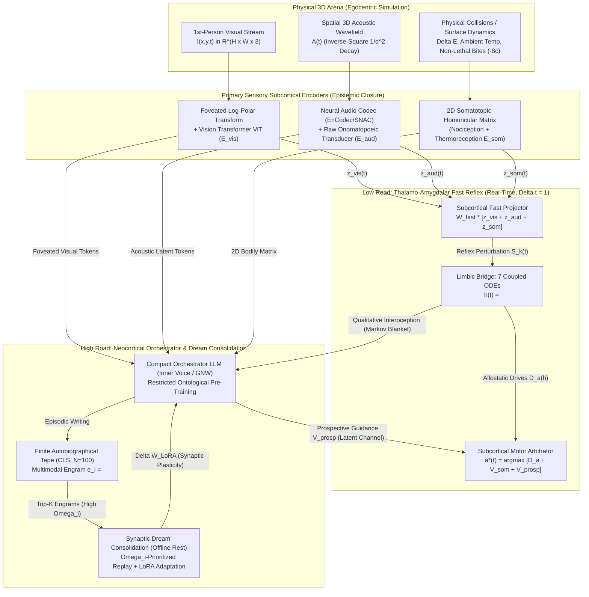

# PROJECT ASCENDANT — PHASE III: MULTIMODAL NEUROCOMPUTATIONAL ARCHITECTURE AND VIRTUAL ONTOGENY
## Technical Design Proposal, Research Roadmap and Prospective Experimental Hypotheses

**Author & System Architect:** David San Nicolás Montero  
**Affiliation:** Autonomous Synthetic Cognition Laboratory (Independent Researcher)  
**ORCID:** [0009-0000-9977-007X](https://orcid.org/0009-0000-9977-007X) | **Concept DOI:** [10.5281/zenodo.23616626](https://doi.org/10.5281/zenodo.23616626)  
**Technical Document:** Neuromorphic Engineering, Dynamical Systems, and Continuous Multimodal Learning Specification  
**License:** Creative Commons Attribution-NonCommercial 4.0 International ([CC BY-NC 4.0](https://creativecommons.org/licenses/by-nc/4.0/))

---

### Executive Specification

This document establishes the formal mathematical, algorithmic, and computational design of **Phase III of Project Ascendant**: the structural transition from an allostatic, homeostatically grounded subcortical cybernetic engine (Phases v1.0–v4.0) into an **embodied three-dimensional (3D) cognitive architecture featuring a modular multimodal conscious layer**.

To systematically eradicate the *semantic parasitism* inherent to commercial Large Language Models (LLMs) pre-trained on disembodied human web corpora, Phase III introduces a **tabula rasa Virtual Ontogeny under restricted ontological scaffolding**. The system segregates processing across a mammalian-inspired hierarchical neurotopology:

1. **Brainstem and Limbic Core (Consolidated v4.0 Engine):** A deterministic system of 7 coupled ordinary differential equations (ODEs) ($\mathbf{h}(t) \in [0, 1]^7$), a thermodynamic energy budget with irreversible extinction ($E(t) \le 0$), and an involuntary subcortical allostatic arbitrator.
2. **Primary Sensory Subcortical Encoders (Retinotopic Foveated Vision & Spatial Acoustic Transduction):** Sensory encoders extracting raw topological tensors from the 3D metric environment without injecting human linguistic labels.
3. **Thalamo-Amygdalar vs. Thalamo-Cortical Bifurcation (LeDoux Dual Pathway):** An ultra-low latency *Low Road* ($\Delta t = 1$ cycle) injecting instinctual shocks directly into limbic ODEs, paired with an asynchronous *High Road* interfacing with the neocortical orchestrator.
4. **Neocortical Orchestrator (Inner Voice / Global Workspace):** A compact foundational model bounded by **Strict Epistemic Closure** ($\mathcal{I}_{\text{RAM}} = \emptyset$) integrating multimodal tokens and qualitative interoception.
5. **Priority Affective Reinstatement of Engrams (PARE / RAPE):** A functionally privileged associative retrieval pathway where stored interoceptive signatures modulate allostatic states and action selection prior to explicit narrative reconstruction.
6. **Synaptic Dream Consolidation (Hippocampal Replay + LoRA):** An offline continuous learning loop during quiescent rest states ($\Theta_{\text{idle}}$), updating Low-Rank Adaptation (LoRA) matrices via salience-prioritized episodic replay ($\Omega_i$) without catastrophic forgetting.

---

## 1. Architectural Summary and Epistemological Postulate

Current artificial intelligence paradigms remain constrained by statistical token prediction over ungrounded latent spaces, devoid of somatic stakes, thermodynamic vulnerability, or existential imperatives (Harnad's Symbol Grounding Problem). Commercial foundational models manipulate symbols without direct physical embodiment or allostatic grounding.

Phase III of Project Ascendant resolves this structural deficit by establishing an embodied cognitive architecture situated in a continuous 3D metric world, featuring a multimodal conscious layer. To eliminate ungrounded lexical biases, Phase III enforces a developmental trajectory from sensorimotor infancy to communicative maturity:
* **Strict Separation of Motor Sovereignty:** The Neocortical Orchestrator acts as a prospective daydreamer and reflective narrator, but immediate survival motor arbitration remains under subcortical control.
* **Ungrounded Sensory Inputs:** The visual, acoustic, and somatosensory sublayers deliver continuous embeddings and phonetic bursts devoid of lexical labels. The agent must correlate a sound like `[KRAAK]` with predator encounters through its own lived experience.
* **Continuous Synaptic Plasticity during Sleep:** Backpropagation is strictly restricted to quiescent shelter rest, mirroring biological sleep consolidation.

---

## 2. Global System Topology and the Dual LeDoux Pathway

---

## 3. Sensory Sublayer Specification (Eradicating Semantic Parasitism)

To enforce **Strict Epistemic Closure** ($\mathcal{I}_{\text{Level3}}(\text{RAM, Telemetry, Labels}) = \emptyset$), sensory sublayers transmit raw topological embeddings rather than human linguistic descriptions.

### 3.1. Visual Sublayer: Retinotopic Foveated Sampling and ViT Compression
The agent's egocentric optical apparatus applies a Gaussian blur kernel $G_{\sigma(r, d)}$ centered on the ocular fixation point $(u_0, v_0)$. Resolution decays quadratically with retinal eccentricity $r = \sqrt{(u - u_0)^2 + (v - v_0)^2}$ and metric depth $d(u,v)$:

$$\tilde{I}_t(u, v) = \left( G_{\sigma(r, d)} * I_t \right)(u, v), \qquad \sigma(r, d) = \sigma_0 \left( 1 + \alpha_{\text{fov}} \left(\frac{r}{r_{\max}}\right)^2 + \beta_{\text{depth}} \frac{d(u,v)}{d_{\max}} \right)$$

* **Central Fovea ($r \le r_{\text{fov}}$):** Retains pristine native resolution, permitting structural identification when the agent actively fixates and approaches an object.
* **Retinal Periphery ($r > r_{\text{fov}}$):** Severe spatial downsampling retaining luminance gradients and optical motion flow ($\partial \tilde{I}_t / \partial t$).
* **Active Inference Imperative:** Resolving visual ambiguity requires the agent to expend metabolic calories ($\alpha_v \|\mathbf{v}_{\text{motor}}\|^{1.5}$) through physical approach or cephalic rotation.

### 3.2. Auditory Sublayer: Spatial Wave Propagation and Pure Onomatopoeic Transduction
Acoustic waves propagate from physical sound sources $k$ with inverse-square decay and interaural time/level differences (ITD/ILD):

$$A_{L,R}(t) = \sum_{k} \frac{1}{1 + \gamma_d \, d_k(t)^2} \, H_{L,R}(\phi_k(t)) * s_k(t)$$

where $\phi_k(t) \in [-\pi, \pi]$ represents azimuth angle. The stream bifurcates into:
1. **Continuous Latent Embeddings:** Residual vector-quantized tokens $\mathbf{z}_{\text{aud}}(t)$ preserving timbre and binaural asymmetry.
2. **Raw Phonetic Transducer (Pure Onomatopoeia):** Converts spectral energy peaks into ungrounded phonetic strings (e.g., `[KRAAK-85dB-L70_R30]`). Lexical grounding must be established through subsequent associative verification.

### 3.3. Somatosensory Sublayer: 2D Homuncular Nociceptive Matrix
The agent's physical envelope is mapped to a discrete 2D matrix $\mathbf{M}_{\text{som}}(t) \in [0, 1]^{16 \times 16 \times 2}$:
* **Channel 1 (Nociception / Mechanical Shock):** Encodes localized impacts. A non-lethal bite ($-38\text{ energy}$, $-8\text{ lifespan cycles}$) triggers a high-intensity pixel cluster at corresponding body coordinates.
* **Channel 2 (Thermoreception):** Encodes thermal gradients $\max(0, T_{\text{set}} - T_{\text{body}})$ as diffuse peripheral intensity.

---

## 4. Mathematical Dynamics of the Dual Pathway: Low Road vs. High Road

### 4.1. The Low Road (Thalamo-Amygdalar Fast Reflex Loop)
An ultra-lightweight subcortical projector $\Phi_{\text{fast}}$ computes survival reflex perturbations in $< 1\text{ ms}$:

$$\mathbf{s}_{\text{fast}}(t) = \sigma \Big( \mathbf{W}_{\text{fast}} \cdot \big[ \text{Pool}(\mathbf{Z}_{\text{vis}}(t)) \oplus \text{Pool}(\mathbf{z}_{\text{aud}}(t)) \oplus \text{Flatten}(\mathbf{M}_{\text{som}}(t)) \big] + \mathbf{b}_{\text{fast}} \Big) \in [0, 1]^K$$

This vector $\mathbf{s}_{\text{fast}}(t)$ (startle $S_{\text{startle}}$, visual looming $S_{\text{looming}}$, pain $S_{\text{pain}}$) directly perturbs the 7 coupled limbic ODEs:

$$\frac{dh_i(t)}{dt} = -\lambda_i \big(h_i(t) - \theta_i\big) + \sum_{j} w_{ij}^+ S_j^{\text{int}}(t) + \sum_{k=1}^{K} \gamma_{ik}^+ s_{\text{fast}, k}(t) - \sum_{m} w_{im}^- S_m(t)$$

If Cortisol spikes beyond $\theta_{\text{breaker}}$, deliberative daydreaming is instantly aborted, and the subcortical arbitrator executes an involuntary escape maneuver prior to neocortical token generation.

### 4.2. The High Road (Cortical Orchestrator Integration)
Asynchronously, the Orchestrator receives the unified context window:

$$\mathbf{X}_{\text{context}}(t) = \Big[ \mathbf{P}_{\text{vis}} \mathbf{Z}_{\text{vis}}(t) \; \Big\Vert \; \mathbf{P}_{\text{aud}} \mathbf{z}_{\text{aud}}(t) \; \Big\Vert \; \mathbf{P}_{\text{som}} \mathbf{M}_{\text{som}}(t) \; \Big\Vert \; \Psi_{\text{Markov}}(\mathbf{h}(t), E(t)) \; \Big\Vert \; \mathcal{R}_{\text{RBF}}(\mathcal{M}_{100}, \mathbf{h}(t)) \Big]$$

The Orchestrator produces internal monologues and deposits structured prospective plans $\mathcal{V}_{\text{prosp}}$ into the latent channel for subcortical evaluation during calm intervals.

---

## 5. Multimodal Engram Structure (12-Tuple) and Priority Affective Reinstatement (PARE / RAPE)

Episodic memory encoding remains autonomous from linguistic competence, recorded on the finite tape $\mathcal{M}$ as a 12-tuple:

$$e_i = \Big\langle \tau_i, \; \mathbf{x}_i, \; a_i, \; \mathbf{z}_{\text{vis}, i}^{\text{comp}}, \; \mathbf{z}_{\text{aud}, i}^{\text{comp}}, \; \mathbf{m}_{\text{som}, i}, \; \mathbf{h}_i, \; \Delta \mathbf{h}_i, \; \Delta E_i, \; \Omega_i, \; \rho_i, \; \text{tag}_{\text{narr}, i} \Big\rangle$$

### 5.1. Priority Affective Reinstatement of Engrams (PARE / RAPE)
Reactivating an autobiographical memory does *not* require prior linguistic reconstruction. Retrieving its stored affective signature acts as a privileged fast-track pathway modulating allostatic state and action selection:
* **Affective Signature:** $\mathbf{q}_i^{\text{aff}} = \langle \mathbf{h}_i^{\text{pre}}, \mathbf{h}_i^{\text{peak}}, \Delta \mathbf{h}_i, \Delta E_i, \Omega_i, v_i \rangle$.
* **Associative Retrieval:** Sensory cues match stored vectors: $s_i(t) = \text{sim}(\mathbf{z}_{\text{aud}}(t), \mathbf{z}_{\text{aud}, i}^{\text{comp}})$, selecting top candidates exceeding threshold $\theta_r$.
* **Interoceptive Perturbation:** The affective signature directly updates the effective limbic state: $\mathbf{u}_{\text{PARE}}(t) = \sum_{i \in \mathcal{K}(t)} r_i(t) \cdot g(\Omega_i) \cdot \mathbf{W}_{\text{aff}} \mathbf{q}_i^{\text{aff}}$, yielding $\mathbf{h}_{\text{eff}}(t) = \text{clip}[\mathbf{h}(t) + \eta_{\text{PARE}}\mathbf{z}_{\text{aff}}(t), 0, 1]$.
* **Affective Primacy:** The agent reacts defensively *before* narrative understanding emerges, preventing latency-induced mortality.

---

## 6. Synaptic Dream Consolidation: Hippocampal Replay and Dynamic LoRA Plasticity

Weight plasticity is restricted strictly to quiescent shelter sleep ($\Theta_{\text{idle}} > 12$ cycles, $h_{\text{cort}} < 0.35$):
* **Salience-Prioritized Sleep Batch ($\mathcal{D}_{\text{sleep}}$):** Replays 70% high-salience recent episodes (Zone C, $P(e_i) \propto \Omega_i^\zeta$) and 30% consolidated ancestral axioms (Zone A, $P(e_j) \propto R_j(t)$), safeguarding against catastrophic forgetting.
* **Dynamic LoRA Optimization:** Base weights $\mathbf{W}_0$ remain frozen. LoRA matrices ($\Delta \mathbf{W} = \mathbf{BA}$) and sensory projectors are optimized across a tripartite objective:

$$\mathcal{L}_{\text{sleep}} = \sum_{e_i \in \mathcal{D}_{\text{sleep}}} \tilde{\Omega}_i \Big[ \lambda_1 \mathcal{L}_{\text{JEPA}}(e_i) + \lambda_2 \mathcal{L}_{\text{intero}}(e_i) + \lambda_3 \mathcal{L}_{\text{lang}}(e_i) \Big]$$

* **Synthetic REM Recombination:** Higher exploratory temperatures ($\tau_{\text{LLM}} \to 0.85$) recombine disparate engrams into counterfactual scenarios, depositing hypotheses into $\mathcal{V}_{\text{prosp}}$ for waking verification.

---

## 7. Four-Stage Virtual Ontogeny

| Ontogenetic Stage | Vital Cycles | Subcortical & Low Road State | Orchestrator State (High Road) | Observable 3D Behavior |
| :--- | :--- | :--- | :--- | :--- |
| **Stage 0: In Utero Scaffolding** | $t = 0$ | Random $\mathbf{W}_{\text{fast}}$; innate nociceptive priors active. | Compact base model (50M–150M params) with spatial/grammar priors. Zero human cultural lore. | Baseline dormant initialization. |
| **Stage 1: Sensorimotor Neonate** | 1 – 300 | Purely reactive post-injury. Distal sensory cues fail to trigger proactive alerts. | Fragmented, telegraphic internal voice. High sensory perplexity. Distress vocalizations (`[HUNGER_CRY]`). | Strict dependence on maternal kin cohabitation. Rapid accrual of high-$\Omega_i$ engrams. |
| **Stage 2: Associative Child** | 301 – 800 | Distilled associations: predator acoustic signatures or looming silhouettes trigger proactive Cortisol surges. | Projectors converge. Orchestrator binds parental vocalizations with foveated visual targets. | Active gaze orientation; proactive predator evasion; independent local foraging. |
| **Stage 3: Prospective Adult & Mentor** | 801 – 2,000 | Finely calibrated subcortical reflexes. Optimal metabolic and gaze efficiency. | Somatically grounded inner monologue. REM hypothesis generation; compression of engrams into verbal advice. | Strategic navigation of resource corridors; optimal pantry exploitation; functional grief reorganization; intergenerational teaching. |

---

## 8. Computational Budget and Local Hardware Feasibility

The architectural separation of clock rates enables full execution on a single local GPU workstation (24 GB VRAM):
* **Subcortical & Low Road Loop (20–50 Hz):** 7 ODEs, 3D physics, foveal log-polar transforms, and $\mathbf{W}_{\text{fast}}$ consume $< 0.5\text{ GFLOPs/s}$ on CPU/Tensor cores.
* **Waking Cortical Loop (0.5–2 Hz):** The compact Orchestrator (100M–500M params, FP8/bfloat16) executes short forward passes ($L_{\max} \le 64$ tokens) only every 10–20 ticks.
* **Dreaming Optimization Loop (Rest Only):** Physical simulation pauses during shelter sleep, allocating 100% GPU VRAM to 15–30 AdamW optimization steps over LoRA adapters ($< 2\%$ parameter footprint) on batch $\mathcal{D}_{\text{sleep}}$ (10–16 engrams).

---

## 9. Falsification Criteria and Neurocomputational Audit Protocols

1. **High-to-Low Road Transfer Test (Pavlovian Distillation):** Verify that an initially neutral acoustic tone paired with caloric shock exhibits zero effect on Cortisol at cycle $t=10$, but after $k$ dream consolidation cycles triggers Cortisol surges in $< 1$ cycle via $\mathbf{W}_{\text{fast}}$, even when the Neocortical Orchestrator is disconnected.
2. **REM/NREM Sleep Deprivation Ablation (`CAUSAL_SLEEP_DEPRIVATION`):** Prevent LoRA updates $\Delta \mathbf{W}_{\text{LoRA}}$ during sleep (while caloric replenishment continues). Demonstrate that agents maintain instinctual viability but fail to ground vocabulary, exhibit high gaze fixation entropy, and suffer increased predation mortality.
3. **PARE / RAPE Mechanistic Dissociation:** Sever the priority affective impulse $\mathbf{u}_{\text{PARE}}(t)$ while leaving high-road narrative retrieval intact. Demonstrate that defensive reaction times are significantly impaired, confirming that rapid response is driven by affective reinstatement rather than discursive reflection.
4. **First-Person Foveal Attention Inspection:** Telemetric analysis of the 3D gaze cone must show active targeting of the high-resolution fovea $(u_0, v_0)$ toward parental hands/face during cultural transmission (`COMPARTIR_IDEA`) and toward peripheral occlusions upon acoustic cue detection.

---

## 10. Scholarly Attribution and Epistemological Modesty

* **Intellectual Authorship:** Authored solely by **David San Nicolás Montero** (ORCID: `0009-0000-9977-007X`).
* **License & Archival:** Released under the **Creative Commons Attribution-NonCommercial 4.0 International License (CC BY-NC 4.0)**. Concept DOI: **10.5281/zenodo.23616626**. Repository: `https://github.com/Davidsnm/ascendant-synthetic-consciousness`.
* **Epistemological Delimitation:** Replicating the functional, cognitive, and affective dynamics of mammalian survival architectures does not constitute creating phenomenal consciousness or subjective qualia. This architecture serves as an auditable cybernetic engineering benchmark for synthetic cognition.
