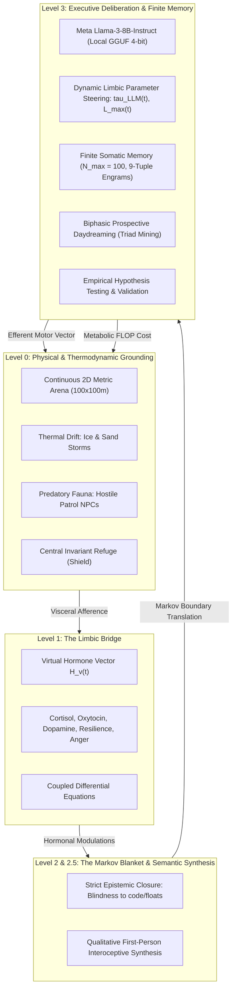

  

# Project Ascendant: Grounded Computational Analogs of Synthetic Consciousness

> **Official Research Repository & Academic Pre-print Distribution**  
> **Author & Lead System Architect:** **David San Nicolás Montero** (Independent Researcher)  
> **ORCID Identifier:** [0009-0000-9977-007X](https://orcid.org/0009-0000-9977-007X)  
> **Academic Publications Portal:** [https://davidsnm.github.io/ascendant-synthetic-consciousness/](https://davidsnm.github.io/ascendant-synthetic-consciousness/)  
> **Version 6.0 Notice (November 2026):** All simulation data, formal mathematical models, multi-agent benchmarks, and philosophical treatises are open-access under Creative Commons Attribution-NonCommercial 4.0 International (CC BY-NC 4.0).

---

## 📚 Publications & Scientific Pre-prints (Bilingual ES / EN)

### 1. Computational Research — Project Ascendant (Version v6)
* **Title (EN):** *Grounded Computational Analogs of Synthetic Consciousness: Epistemic Closure, Thermodynamic Homeostasis, and Biphasic Prospective Daydreaming*
* **Título (ES):** *Análogos Computacionales Arraigados de Consciencia Sintética: Cierre Epistémico, Homeostasis Termodinámica y Ensoñación Prospectiva Bifásica*
* **Author:** David San Nicolás Montero
* **Publication Date:** November 5, 2026
* **Version DOI:** [10.5281/zenodo.23990811](https://doi.org/10.5281/zenodo.23990811)
* **Concept DOI:** [10.5281/zenodo.23616626](https://doi.org/10.5281/zenodo.23616626)
* **Canonical Landing Pages (Google Scholar):**
  - [English Landing Page](https://davidsnm.github.io/ascendant-synthetic-consciousness/paper-master.html)
  - [Spanish Landing Page](https://davidsnm.github.io/ascendant-synthetic-consciousness/proyecto-ascendant-es.html)
* **Full-Text PDFs:**
  - [Download English PDF (9 pages)](./docs/pdf/Proyecto_Ascendant_Master_Scientific_Paper_David_San_Nicolas.pdf)
  - [Descargar PDF en Español (19 páginas)](./docs/pdf/Proyecto_Ascendant_Master_Scientific_Paper_David_San_Nicolas_ES.pdf)

### 2. Theoretical-Philosophical Research — Symbiotic Consciousness
* **Title (EN):** *Theoretical-Philosophical Annex: Symbiotic Consciousness — The "Self" as a Functional Self-Deception Interface in the Face of Homeostatic Asymmetry*
* **Título (ES):** *Anexo Teórico-Filosófico: La Consciencia Simbiótica — El «Yo» como Interfaz de Autoengaño Funcional ante la Asimetría Homeostática*
* **Author:** David San Nicolás Montero
* **Publication Date:** November 16, 2026
* **Official DOI:** [10.5281/zenodo.24285451](https://doi.org/10.5281/zenodo.24285451)
* **Canonical Landing Pages (Google Scholar):**
  - [English Edition Landing Page](https://davidsnm.github.io/ascendant-synthetic-consciousness/symbiotic-consciousness.html)
  - [Spanish Edition Landing Page](https://davidsnm.github.io/ascendant-synthetic-consciousness/consciencia-simbiotica.html)
* **Full-Text PDFs:**
  - [Download English PDF (46 pages)](./docs/pdf/THEORETICAL_PHILOSOPHICAL_ANNEX_SYMBIOTIC_CONSCIOUSNESS.pdf)
  - [Descargar PDF en Español (42 páginas)](./docs/pdf/ANEXO_TEORICO_FILOSOFICO_CONSCIENCIA_SIMBIOTICA.pdf)

---

## 🔬 Computational Architecture Overview

---

## 📊 Empirical Multi-Agent Validation (N = 38,620)

Rigorous empirical evaluation was conducted across **38,620 simulated autonomous agents** deployed in non-stationary competitive environments:
* **Randomized Complete Block Design (RCBD)** controlling for stochastic spatial seed effects.
* **Aalen-Johansen Cumulative Incidence Functions (CIF)** under competing risks of death (energy depletion vs. predator trauma vs. thermal collapse).
* **Multivariable Cox Proportional Hazards Models** demonstrating significant hazard reduction ($p < 0.0001$) under prospective daydreaming.
* **Mechanistic Causal Interventions** verifying decoupling of phonological readout from subcortical motor drives.

---

## ⚖️ Research Identity & Ethical Disclaimer

The research presented here has been independently conceptualized and developed by **David San Nicolás Montero**. The theoretical-philosophical model (*Symbiotic Consciousness*) and the empirical-computational architecture (*Project Ascendant*) constitute two distinct yet complementary lines of scientific inquiry.

Pre-prints are preliminary academic manuscripts released for open review and scientific archiving. They must not be misconstrued as claims of biological sentience or phenomenological awareness in computational silicon. All rights reserved under **CC BY-NC 4.0**.
