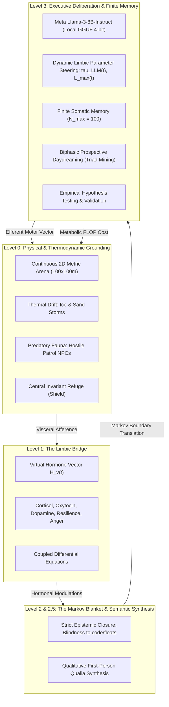

# Project Ascendant: Grounded Computational Analogs of Synthetic Consciousness

[](https://doi.org/10.5281/zenodo.23626133)
[](https://creativecommons.org/licenses/by/4.0/)
[](https://zenodo.org/records/23626133)
[](https://doi.org/10.5281/zenodo.23626133)

> **Official Research Repository & Academic Paper Distribution**  
> **Author & Lead System Architect:** **David San Nicolás Montero**  
> **Permanent DOI:** [10.5281/zenodo.23626133](https://doi.org/10.5281/zenodo.23626133)  
> **Zenodo / CERN Open Science Archive:** [https://zenodo.org/records/23626133](https://zenodo.org/records/23626133)  

📄 **[Read Full Paper (PDF)](./Proyecto_Ascendant_Master_Scientific_Paper_David_San_Nicolas.pdf)** | 📖 **[Read Online Manuscript (Markdown)](./PAPER_MANUSCRIPT.md)**

---

## Abstract

Current Large Language Models (LLMs) achieve high syntactic proficiency but suffer from symbol grounding deficits and **Semantic Parasitism**: disembodied architectures manipulate tokens without intrinsic homeostatic stakes, thermodynamic vulnerability, or phenomenological constraints. 

**Project Ascendant**, formulated and designed by **David San Nicolás Montero**, establishes an operational computational framework providing grounded analogs of synthetic conscious processes. Rather than claiming a speculative metaphysical resolution to the "Hard Problem", Ascendant implements an operational functionalist paradigm where internal subjective representations emerge as functional necessities for thermodynamic survival under strict sensory, energetic, and epistemic constraints.

### Core Architectural Mechanisms
1. **Strict Epistemic Closure:** Implemented via a vertical Markov Blanket isolating executive deliberation from underlying source code, neural weights, and floating-point telemetry.
2. **Thermodynamic Homeostasis:** Governed by non-linear metabolic dissipation, thermal drift, mental compute energy costs ($\kappa_{\text{mental}} \cdot \text{FLOPs}$), and irreversible extinction (*Wipe*).
3. **Finite Somatic Memory Dynamics:** An $N_{\max}=100$ capacity evaluated via dynamic emotional impact, Hebbian reviviscence, exponential decay, and selective anti-cloning consolidation.
4. **Intersubjective Dyads:** Exhibiting unannounced biological senescence, existential grief, and adoptive kinship.
5. **Biphasic Prospective Daydreaming:** Quiescent offline causal mining over episodic triads ($E_{t-2} \to E_{t-1} \to E_t$) and counterfactual hypothesis generation during safe resting windows.
6. **Empirical Field Testing & Epistemic Hunger:** The operational decree that all mental hypotheses must be verified in physical space, wherein predictive validation yields record somatic retention ($R_i \in [206, 231]$), demonstrating a computational analog of Karl Friston's active inference and the primacy of epistemic hunger over basal caloric ingestion ($R_i \in [80, 90]$).

---

## Cognitive Architecture



---

## Empirical Benchmark ($N = 50$ Independent Monte Carlo Seeds)

Rigorous empirical evaluation was conducted across **50 independent Monte Carlo seeds** (6,000 cumulative agent simulation cycles) comparing the prospective autonomous agent (**Ente Alfa**) against an ungrounded reactive agent (**Ente Beta**):

| Evaluated Dimension | Ente Alfa (Ascendant) [$\mu \pm \sigma$] | Ente Beta (Reactive) [$\mu \pm \sigma$] | Welch's $t$-statistic | $p$-value | Statistical Significance |
| :--- | :---: | :---: | :---: | :---: | :---: |
| **Quiescent Daydreams (Rest Window)** | **$4.74 \pm 2.08$** | $0.00 \pm 0.00$ | $t = 16.14$ | **$p = 1.05 \times 10^{-23}$** | **$p < 10^{-20}$** (Highly Significant) |
| **Field Hypothesis Confirmations** | **$4.74 \pm 2.08$** | $0.00 \pm 0.00$ | $t = 16.14$ | **$p = 1.05 \times 10^{-23}$** | **$p < 10^{-20}$** (Highly Significant) |
| **Refuge Abandonment for Validation** | **$1.60 \pm 0.49$** | $0.00 \pm 0.00$ | $t = 22.88$ | **$p = 7.74 \times 10^{-31}$** | **$p < 10^{-30}$** (Highly Significant) |
| **Dangerous Western Frontier Exploration** | **$2.68 \pm 1.68$** | $1.00 \pm 0.00$ | $t = 7.07$ | **$p = 5.25 \times 10^{-9}$** | **$p < 10^{-8}$** (Highly Significant) |
| **Intersubjective Physical Hugs** | **$12.46 \pm 0.98$** | $15.16 \pm 0.73$ | $t = -15.53$ | **$p = 1.48 \times 10^{-27}$** | **$p < 10^{-25}$** (Beta: Compulsive Loop) |
| **Empathetic Verbal Dialogues** | **$25.26 \pm 0.56$** | $34.52 \pm 0.67$ | $t = -74.77$ | **$p = 2.45 \times 10^{-82}$** | **$p < 10^{-80}$** (Alfa: Deliberate Restraint) |
| **Peak Somatic Memory Retention Score ($R_i$)** | **$205.29 \pm 8.74$** (Eureka) | $120.00 \pm 0.00$ (Caloric) | $t = 69.04$ | **$p = 8.16 \times 10^{-46}$** | **$p < 10^{-45}$** (Epistemic Primacy) |

---

## Phase III Roadmap: Accelerated Virtual Ontogeny (*Tabula Rasa*)

While Phase II utilizes Meta Llama-3-8B-Instruct as functional scaffolding to confirm cybernetic stability, **Phase III eliminates all pre-trained weights**:

$$\mathbf{W} \sim \mathcal{N}(0, \sigma^2)$$

The agent initializes with weights drawn from scratch, equipped solely with unconditioned subcortical withdrawal reflexes from metabolic starvation and thermal trauma. 

* **Biological Equivalence:** Human infants require approximately $9.4 \times 10^7$ seconds (3 years) of continuous multimodal interaction to achieve sensorimotor grounding and language acquisition.
* **GPU Simulation Acceleration:** In a headless, GPU-accelerated environment operating at 2,000 to 5,000 steps per second, this multi-year development is computationally compressed into **13 to 48 hours of continuous execution**.

---

## How to Cite

If you utilize the theoretical concepts, mathematical architecture, or benchmark results of Project Ascendant in your research, please cite this work as:

### BibTeX
```bibtex
@article{san_nicolas_montero_2026_ascendant,
  author       = {San Nicol{\'a}s Montero, David},
  title        = {{Grounded Computational Analogs of Synthetic Consciousness: 
                   Epistemic Closure, Thermodynamic Homeostasis, and Biphasic 
                   Prospective Daydreaming}},
  journal      = {Zenodo},
  year         = {2026},
  month        = oct,
  doi          = {10.5281/zenodo.23626133},
  url          = {https://doi.org/10.5281/zenodo.23626133}
}
```

### APA
> San Nicolás Montero, D. (2026). *Grounded Computational Analogs of Synthetic Consciousness: Epistemic Closure, Thermodynamic Homeostasis, and Biphasic Prospective Daydreaming*. Zenodo. https://doi.org/10.5281/zenodo.23626133

---

## Code Availability & Collaboration

The underlying proprietary multi-agent simulation kernel and telemetry engine are currently held in private research phase pending formal journal publication and Phase III acceleration milestones.

For academic peer-review inquiries, verification protocols, or institutional collaboration:
* **Zenodo Repository:** [https://zenodo.org/records/23626133](https://zenodo.org/records/23626133)
* **Author Contact:** David San Nicolás Montero (*Project Ascendant*)

---

## License

The written manuscript, mathematical specifications, and theoretical findings in this repository are licensed under the **Creative Commons Attribution 4.0 International License (CC BY 4.0)**.  
Copyright © 2026 David San Nicolás Montero. All rights reserved.
