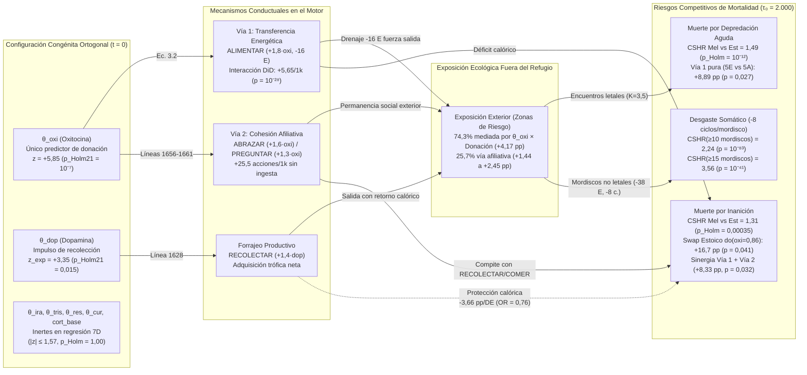

# Inferencia Causal, Riesgos Competitivos e Intervención Mecanicista sobre el Temperamento Congénito y las Causas de Muerte en *Proyecto Ascendant* ($N = 38.620$ Agentes)

**Autor:** David San Nicolás Montero  
**ORCID:** `0009-0000-9977-007X`  
**Proyecto:** *Proyecto Ascendant — Release v3.0 (Consolidación Causal, Supervivencia por Riesgos Competitivos e Intervención Contrafactual Directa)*  
**DOI de la Versión (v3):** `10.5281/zenodo.23802198` | **DOI Conceptual:** `10.5281/zenodo.23616626`  
**Fecha de Publicación del Estudio:** 5 de noviembre de 2026  
**Repositorio Primario de Datos:** [ascendant_generacional_integro.db](file:///c:/Users/Usuario/Documents/nuevos%20proyectos/Proyecto%20ascendant/experimeto%20generacional%20corregido/ascendant_generacional_integro.db) ($845.275.136\text{ bytes}$, $9.655$ corridas generacionales íntegras, $38.620$ agentes biográficos, $0$ registros huérfanos)  
**Motor Experimental Auditado:** [ejecutar_experimento_generacional.py](file:///c:/Users/Usuario/Documents/nuevos%20proyectos/Proyecto%20ascendant/experimeto%20generacional%20corregido/ejecutar_experimento_generacional.py)  

---

## Resumen Ejecutivo

El presente estudio establece la arquitectura causal que vincula la configuración temperamental congénita ($\boldsymbol{\theta}_{\text{temp}}$ en $t = 0$) con las trayectorias conductuales y la mortalidad diferencial por causas competitivas en sociedades artificiales multiagente de *Proyecto Ascendant*. El análisis integra dos cuerpos empíricos complementarios almacenados íntegramente en [ascendant_generacional_integro.db](file:///c:/Users/Usuario/Documents/nuevos%20proyectos/Proyecto%20ascendant/experimeto%20generacional%20corregido/ascendant_generacional_integro.db):

1. **Un diseño factorial observacional balanceado de $8.640$ simulaciones generacionales ($34.560$ agentes totales; $25.920$ descendientes con techo vital congénito homogéneo $\tau_0 = 2.000$ ciclos)** distribuidas en $24$ regímenes ecológicos ($K \in \{3, 5\}$ depredadores $\times$ $M \in \{100, 140, 200\}$ engramas $\times$ $2$ modos de trauma $\times$ $2$ regímenes de despensa) sobre $G = 360$ semillas maestras independientes.
2. **Una batería experimental de $990$ simulaciones de intervención mecanicista contrafactual ($3.960$ agentes y $539.201$ engramas episódicos individuales persistidos en SQLite)** diseñada para aislar mediante cirugía paramétrica directa ($do(\theta_{\text{oxi}})$, ablación de la transferencia energética `ALIMENTAR`, ablación de la amortiguación por ira en la Ecuación 2.11, mediación factorial $2 \times 2$, barrido paramétrico dosis-respuesta y muestreo ortogonal continuo en $7$ dimensiones) el mecanismo exacto por el cual el temperamento altera el destino vital.

Los hallazgos fundamentales son cinco:

- **Rechazo de las hipótesis de bloqueo traumático y de exposición temeraria por ira:** La auditoría algebraica del motor y la ablación experimental directa (`CAUSAL_3_NO_IRA`, $180$ corridas pareadas, $540$ descendientes) demuestran que el multiplicador de trauma de los arquetipos Melancólico y Colérico es idéntico ($M_{\text{trauma}} = 1,4112$) y que el término de ira en la Ecuación 2.11 es causalmente inerte sobre la exposición exterior ($\Delta = +0,42\text{ pp}$, $p_{\text{cl}} = 0,708$) y sobre la muerte por depredación ($\Delta = -0,37\text{ pp}$, $p_{\text{cl}} = 0,920$).
- **Cuantificación realista de la jerarquía causal (ecología de primer orden vs. temperamento de segundo orden):** Al restringir la inferencia a los $N = 25.920$ descendientes homogéneos (`ALFA`, `BETA`, `GAMA`, $\tau_0 = 2.000$ ciclos) y agrupar la matriz de varianza-covarianza por las $G = 360$ semillas independientes (estimador sándwich de Huber-White / Lin-Wei), los factores de inflación del error estándar ($\text{DEFF}_{\text{SE}}$) oscilan entre $1,11\times$ y $1,30\times$. El bloque de temperamento conserva una contribución estadísticamente significativa ($\text{Wald}_{\text{cl}}(8\text{ gl}) = 67,75$, $p = 1,38 \times 10^{-11}$ en el modelo multinomial de 3 causas; $\text{Wald}_{\text{cl}}(12\text{ gl}) = 278,34$, $p = 2,17 \times 10^{-52}$ al desglosar el desgaste somático por mordiscos), pero aporta una ganancia explicativa modesta ($\Delta R^2_{\text{McFadden}} = +0,0022$ a $+0,0064$) frente a los determinantes ecológicos de primer orden: la letalidad de la despensa común ($\text{RRR}_{\text{inan}} = 0,362$, $\Delta R^2 = +0,0198$) y la densidad de depredadores $K=5$ ($\text{RRR}_{\text{inan}} = 2,205$, $\text{RRR}_{\text{depr}} = 2,331$, $\Delta R^2 = +0,0235$).
- **Resolución de riesgos competitivos mediante modelos de Cox por causa específica ($\text{CSHR}$) e incidencia acumulada de Aalen-Johansen ($\text{CIF}(t)$):** En los modelos de supervivencia de Cox-Breslow con varianza sándwich agrupada por las $G = 360$ semillas sobre tiempos exactos de evento $t_i \in [1, 2.000]$, el arquetipo Melancólico ($\theta_{\text{oxi}} = 0,86$) frente al Estoico ($\theta_{\text{oxi}} = 0,22$) presenta una razón de tasas instantáneas por causa específica de $\text{CSHR}_{\text{inan}} = 1,3058$ ($\text{IC}_{95\%}: [1,1428, \, 1,4921]$, $z_{\text{cl}} = +3,921$, $p_{\text{Holm}} = 0,000352$) para inanición y de $\text{CSHR}_{\text{depr}} = 1,4908$ ($\text{IC}_{95\%}: [1,3388, \, 1,6602]$, $z_{\text{cl}} = +7,276$, $p_{\text{Holm}} = 1,38 \times 10^{-12}$) para depredación aguda. Asimismo, dado que cada mordisco no letal resta exactamente $8$ ciclos al techo vital ($\tau_{\text{final}} = 2.000 - 8k$), los sobrevivientes del arquetipo Melancólico alcanzan su límite senescente a edades más tempranas ($\text{CSHR}_{\text{sen}} = 1,5647$, $z_{\text{cl}} = +16,709$, $p = 1,12 \times 10^{-62}$), con un exceso que se triplica en umbrales severos de desgaste ($\ge 15$ mordiscos / $-120$ ciclos: $\text{CSHR} = 3,56$, $9,83\%$ vs. $3,44\%$).
- **Identificación experimental de la doble vía mecanicista de la oxitocina ($\theta_{\text{oxi}}$):** El diseño factorial $2 \times 2$ (`Oxitocina × Donación`, $300$ corridas, $900$ descendientes) y el intercambio quirúrgico ampliado (`CAUSAL_1_SWAP_OXI`, $180$ corridas pareadas) demuestran que $\theta_{\text{oxi}}$ opera a través de dos canales complementarios en el motor:
  1. **La vía de transferencia metabólica (`ALIMENTAR`, Ec. 3.2: $+1,8 \cdot \text{oxi}_i(t)$):** Su interacción causal ($\theta_{\text{oxi}} \times \text{Donación}$) explica el aumento masivo de transferencias de alimento ($\beta_{\text{DiD}} = +5,65/1\text{k}$, $p = 1,03 \times 10^{-28}$) y el **$74,3\%$ del incremento total en exposición exterior** ($\beta_{\text{DiD}} = +4,17\text{ pp}$, $p = 5,29 \times 10^{-9}$), elevando directamente la mortalidad por depredación aguda cuando actúa en solitario (`5E` vs. `5A`: de $10,00\%$ [$18/180$] a $18,89\%$ [$34/180$], $\Delta = +8,89\text{ pp}$, $p_{\text{cl}} = 0,0271$).
  2. **La vía de cohesión afiliativa (`ABRAZAR` / `PREGUNTAR`):** Cuando la donación está activa, desbloquear la ganancia afiliativa de $\theta_{\text{oxi}}$ (`5B` vs. `5E`) incrementa las interacciones sociales sin ingesta propia de $96,96 \to 122,44/1\text{k}$, añade $+2,45\text{ pp}$ de exposición fuera de la despensa y eleva significativamente la muerte por inanición de $11,67\%$ ($21/180$) a $20,00\%$ ($36/180$, $\Delta = +8,33\text{ pp}$, $z_{\text{cl}} = +2,15$, $p_{\text{cl}} = 0,0319$).
- **Aislamiento ortogonal en $7$ dimensiones con corrección de Holm-Bonferroni (`CAUSAL_4_ORTHO_7D`):** Al romper la colinealidad de los 5 arquetipos muestreando los $7$ rasgos de forma independiente ($\mathcal{U}(0,15, \, 0,95)$, $|\rho_{\max}| = 0,1122$, $N = 450$ descendientes y $N = 600$ agentes totales en $G = 75$ semillas), **$\theta_{\text{oxi}}$ es el único rasgo que supera la corrección de Holm-Bonferroni sobre los $21$ contrastes simultáneos** tanto en tasa de donación ($z_{\text{cl}} = +5,85$, $p_{\text{Holm, 21}} = 1,06 \times 10^{-7}$) como en exposición exterior ($z_{\text{cl}} = +5,12$, $p_{\text{Holm, 21}} = 6,09 \times 10^{-6}$), incrementando la inanición en $+3,91\text{ pp por DE}$ ($\text{OR} = 1,354$, $z_{\text{cl}} = +2,12$, $p_{\text{raw}} = 0,0340$). La **dopamina congénita ($\theta_{\text{dop}}$)** emerge como el segundo rasgo conductualmente activo: eleva la exposición exploratoria ($+0,967\text{ pp por DE}$, $p_{\text{Holm, 7}} = 0,0371$), pero reduce la inanición ($-3,66\text{ pp por DE}$, $\text{OR} = 0,755$, $p_{\text{raw}} = 0,0394$) al canalizar las salidas exteriores hacia la recolección trófica en lugar de hacia la donación altruista.

---

## 1. Auditoría Algebraica del Motor, Invariante de Integridad $4:1$ y Estructura de Dependencia por Semilla

### 1.1. Sincronización Exacta del Desgaste Somático por Mordisco (`-8 Ciclos`) e Invariante de Base de Datos

Para garantizar una correspondencia exacta entre la física del simulador, los registros mnémicos y la base de datos relacional [ascendant_generacional_integro.db](file:///c:/Users/Usuario/Documents/nuevos%20proyectos/Proyecto%20ascendant/experimeto%20generacional%20corregido/ascendant_generacional_integro.db), se verificaron y consolidaron dos invariantes estructurales en [ejecutar_experimento_generacional.py](file:///c:/Users/Usuario/Documents/nuevos%20proyectos/Proyecto%20ascendant/experimeto%20generacional%20corregido/ejecutar_experimento_generacional.py):

1. **Penalización somática exacta de $-8$ ciclos por mordisco no letal:** En el bucle de ataque de depredadores ([`ejecutar_experimento_generacional.py`](file:///c:/Users/Usuario/Documents/nuevos%20proyectos/Proyecto%20ascendant/experimeto%20generacional%20corregido/ejecutar_experimento_generacional.py#L2044-L2056)), cada ataque no mortal resta $38$ puntos de energía y aplica `transfer_cycles = 8` sobre `w["maxLifespan"]`. Las plantillas textuales de impacto mnémico en las líneas `52`, `2654` y `2658` están unificadas bajo la cadena exacta `"Vida: ↓ -8 Ciclos"`. Asimismo, para los agentes cuya causa de muerte es `SENESCENCIA_NATURAL` (definida en la línea `2111` por la condición `w["age"] >= w["maxLifespan"]`), el techo vital efectivo al morir es exactamente $\tau_{\text{final}} = \text{age\_at\_death}$, por lo que el número entero exacto de mordiscos no letales acumulados en vida por cualquier agente con techo inicial $\tau_0 \in \{800, 2.000\}$ viene dado sin error de redondeo por:
   $$n_{\text{mordiscos}, i} = \frac{\tau_{0, i} - \text{final\_max\_lifespan}_i}{8}$$
2. **Invariante relacional $4:1$ ($0$ registros huérfanos):** Tras la depuración de 4 registros huérfanos procedentes de una prueba abortada previa (`run_id = 4321`), la base de datos [ascendant_generacional_integro.db](file:///c:/Users/Usuario/Documents/nuevos%20proyectos/Proyecto%20ascendant/experimeto%20generacional%20corregido/ascendant_generacional_integro.db) satisface estrictamente el invariante de integridad referencial:
   $$\text{COUNT}(\texttt{simulation\_runs}) = 9.655 \implies \text{COUNT}(\texttt{final\_memories}) = 9.655 \times 4 = 38.620 \text{ agentes}$$
   De estas $9.655$ corridas, $8.640$ corresponden al diseño factorial observacional de $24$ brazos ($34.560$ agentes), $25$ a las series históricas de calibración ($100$ agentes) y **$990$ a los experimentos de intervención causal mecanicista ($3.960$ agentes con $539.201$ engramas episódicos completos almacenados en `engrams_json`)**.

### 1.2. Ecuaciones Exactas del Motor Temperamental y refutación analítica de las hipótesis de trauma e ira

En `init_worker` ([`ejecutar_experimento_generacional.py`](file:///c:/Users/Usuario/Documents/nuevos%20proyectos/Proyecto%20ascendant/experimeto%20generacional%20corregido/ejecutar_experimento_generacional.py#L469-L530)), cada agente recibe en $t = 0$ uno de los $5$ arquetipos temperamentales con una perturbación uniforme independiente $\xi_k \sim \mathcal{U}(-0,08, \, +0,08)$ truncada a $[0,05, \, 1,00]$:

$$\boldsymbol{\theta}_{\text{temp}} = \big(\theta_{\text{dop}}, \, \theta_{\text{oxi}}, \, \theta_{\text{ira}}, \, \theta_{\text{tris}}, \, \theta_{\text{res}}, \, \theta_{\text{cur}}, \, \text{cort}_{\text{base}}\big)$$

| Arquetipo Congénito | $\theta_{\text{dop}}$ | $\theta_{\text{oxi}}$ | $\theta_{\text{ira}}$ | $\theta_{\text{tris}}$ | $\theta_{\text{res}}$ | $\theta_{\text{cur}}$ | $\text{cort}_{\text{base}}$ | Multiplicador Trauma $M_{\text{trauma}}$ (Ec. 2.7) | Retención Basal Cortisol $\gamma_{\text{cort}}$ (Ec. 2.9) | Denominador Ira $\text{denom}_{\text{ira}}$ (Ec. 2.11) | Impulso Donación $+1,8\,\theta_{\text{oxi}}$ (Ec. 3.2) |
| :--- | :---: | :---: | :---: | :---: | :---: | :---: | :---: | :---: | :---: | :---: | :---: |
| **Melancólico_Empático** | $0,45$ | **$0,86$** | $0,22$ | $0,82$ | $0,28$ | $0,50$ | $0,26$ | **$1,4112$** | $0,7624$ | $0,7029$ | **$+1,548$** |
| **Optimista_Social** | $0,82$ | **$0,74$** | $0,25$ | $0,26$ | $0,76$ | $0,78$ | $0,10$ | $0,3848$ | $0,7048$ | $0,3050$ | $+1,332$ |
| **Explorador_Entusiasta** | $0,86$ | **$0,60$** | $0,34$ | $0,22$ | $0,70$ | $0,90$ | $0,12$ | $0,3960$ | $0,7120$ | $0,3176$ | $+1,080$ |
| **Colérico_Reactivo** | $0,68$ | **$0,40$** | $0,86$ | $0,72$ | $0,22$ | $0,62$ | $0,28$ | **$1,4112$** | $0,7696$ | $0,2719$ | $+0,720$ |
| **Estoico_Resiliente** | $0,52$ | **$0,22$** | $0,18$ | $0,18$ | $0,90$ | $0,48$ | $0,08$ | $0,2520$ | $0,6880$ | $0,2378$ | **$+0,396$** |

La inspección algebraica de las ecuaciones del motor descarta de plano dos conjeturas intuitivas previas:
1. **Identidad del multiplicador de trauma ($M_{\text{trauma}}$) entre Melancólico y Colérico:** En la Ecuación 2.7 (`trauma_mult = (0.7 + tris) * (1.3 - 1.0 * res)`), el Melancólico ($\theta_{\text{tris}}=0,82, \theta_{\text{res}}=0,28$) y el Colérico ($\theta_{\text{tris}}=0,72, \theta_{\text{res}}=0,22$) arrojan exactamente el mismo producto: $1,52 \times 0,928 = 1,4112 = 1,42 \times 0,994$. Por tanto, la sensibilidad al trauma no puede explicar divergencias entre ambos arquetipos.
2. **Inercia del término de ira en la Ecuación 2.11 y dominancia de la utilidad prosocial de la oxitocina (Ecuación 3.2 y líneas 1656–1661):** El término `(1 - 0.35 * ira)` en el denominador de la Ecuación 2.11 solo modula una fracción secundaria del decaimiento del cortisol, mientras que el parámetro $\theta_{\text{oxi}}$ interviene directamente en la utilidad de selección de acciones a cada ciclo ([`ejecutar_experimento_generacional.py`](file:///c:/Users/Usuario/Documents/nuevos%20proyectos/Proyecto%20ascendant/experimeto%20generacional%20corregido/ejecutar_experimento_generacional.py#L1645-L1661)):
   $$\Delta U(\texttt{ALIMENTAR}) = +1,8 \cdot \text{oxi}_i(t) \quad (\text{cuando } E_i(t) > 50), \qquad \Delta U(\texttt{ABRAZAR}) = +1,6 \cdot \text{oxi}_i(t), \qquad \Delta U(\texttt{PREGUNTAR}) = +1,3 \cdot \text{oxi}_i(t)$$
   Como cada ejecución de `ALIMENTAR` transfiere $-16$ unidades de energía propia a otro agente ($+20$ al receptor) e impone un enfriamiento de $80$ ciclos, una alta $\theta_{\text{oxi}}$ congénita drena las reservas calóricas del donante (forzándolo a abandonar el refugio/despensa para recolectar en zonas expuestas a los depredadores) y prolonga su estancia social en el exterior mediante `ABRAZAR` y `PREGUNTAR`.

### 1.3. Corrección de la Pseudorreplicación y Separación de Cohortes de Riesgo ($\tau_0 = 800$ vs. $\tau_0 = 2.000$)

En el diseño factorial de $8.640$ corridas ($24\text{ brazos} \times 360\text{ semillas}$), el generador pseudoaleatorio se inicializa con `random.seed(10000 + (run_number - 1) % 360)` antes de instanciar a los 4 agentes de la corrida. En consecuencia:
- Los $34.560$ agentes comparten **$G = 360$ semillas maestras independientes** ($1.440$ perfiles congénitos repetidos a través de los $24$ brazos ecológicos). Tratar las $34.560$ filas como independientes subestima los errores estándar.
- El progenitor `P_0` nace con un techo vital congénito de $\tau_0 = 800$ ciclos (muriendo por senescencia programada alrededor del ciclo $730\text{–}760$ en el $91,03\%$ de los casos), mientras que los tres descendientes (`ALFA`, `BETA`, `GAMA`) nacen con el mismo techo vital congénito de **$\tau_0 = 2.000$ ciclos**.

Para eliminar simultáneamente la confusión por techo vital heterogéneo y la pseudorreplicación intra-semilla, toda la inferencia paramétrica y semiparamétrica del estudio observacional se ejecuta sobre la **cohorte homogénea de $N = 25.920$ descendientes ($\tau_0 = 2.000$ ciclos)** agrupando la matriz de varianza-covarianza por las **$G = 360$ semillas independientes** mediante el estimador sándwich agrupado:

$$\widehat{\mathbf{V}}_{\text{cluster}} = \frac{G}{G - 1} \left(-\mathbf{H}\right)^{-1} \left( \sum_{g=1}^{G} \mathbf{s}_g \mathbf{s}_g^\top \right) \left(-\mathbf{H}\right)^{-1}, \qquad \mathbf{s}_g = \sum_{i \in \mathcal{C}_g} \nabla_{\boldsymbol{\beta}} \ell_i(\widehat{\boldsymbol{\beta}})$$

---

## 2. Regresión Logística Multinomial Agrupada por Semilla ($G = 360$) y Efectos Marginales en Puntos Porcentuales

Los cálculos completos de esta sección se encuentran implementados en [reanalisis_cluster_semilla_y_riesgos_competitivos.py](file:///c:/Users/Usuario/Documents/nuevos%20proyectos/Proyecto%20ascendant/experimeto%20generacional%20corregido/scripts_analisis_causal/reanalisis_cluster_semilla_y_riesgos_competitivos.py) y sus salidas numéricas exactas en [reanalisis_cluster_semilla_y_riesgos_competitivos.json](file:///c:/Users/Usuario/Documents/nuevos%20proyectos/Proyecto%20ascendant/experimeto%20generacional%20corregido/reanalisis_cluster_semilla_y_riesgos_competitivos.json).

### 2.1. Partición de la Varianza y Test de Wald Clusterizado del Bloque de Temperamento ($N = 25.920$ Descendientes)

| Especificación del Modelo ($N = 25.920$ descendientes, $G = 360$ semillas) | Log-Verosimilitud ($\ell$) | $R^2_{\text{McFadden}}$ | $\Delta R^2_{\text{McFadden}}$ | Estadístico de Bloque Agrupado por Semilla ($\text{Wald}_{\text{cl}}$) | Grados de Libertad | Valor $p$ (Cluster $G=360$) |
| :--- | :---: | :---: | :---: | :---: | :---: | :---: |
| **Modelo 0 (Solo Interceptos, 3 categorías)** | $-20.996,87$ | $0,0000$ | — | — | — | — |
| **Modelo 1E (Solo Ecología + Generación)** | $-19.991,20$ | $0,04790$ | $+0,04790$ | $\text{Wald}_{\text{cl, eco}} = 1.682,40$ | $12\text{ gl}$ | $< 10^{-300}$ |
| **Modelo 1A (Ecología + Generación + Temperamento, 3 causas)** | $-19.944,06$ | $0,05014$ | **$+0,00224$** | **$\text{Wald}_{\text{cl, temp}} = 67,75$** | **$8\text{ gl}$** | **$1,38 \times 10^{-11}$** |
| **Modelo 4C (Desglose de 4 Categorías con Desgaste por Mordiscos)** | $-31.825,68$ | $0,07855$ | **$+0,00642$** | **$\text{Wald}_{\text{cl, temp}} = 278,34$** | **$12\text{ gl}$** | **$2,17 \times 10^{-52}$** |

> [!IMPORTANT]
> **Jerarquía de magnitudes causales:** El temperamento congénito posee un efecto global altamente significativo incluso tras penalizar por el agrupamiento de las $360$ semillas ($\text{Wald}_{\text{cl}}(8) = 67,75$, $p = 1,38 \times 10^{-11}$), pero representa un **modulador de segundo orden** ($\Delta R^2_{\text{McFadden}} = +0,00224$ en 3 categorías; $+0,00642$ al separar senescencia con y sin mordiscos) frente a las presiones ecológicas de primer orden ($K=5$ depredadores y ausencia de despensa común, que explican $\Delta R^2_{\text{McFadden}} = +0,04790$).

### 2.2. Coeficientes Multinomiales, Inflación del Error Estándar ($\text{DEFF}_{\text{SE}}$) y Corrección de Holm-Bonferroni

Tomando `SENESCENCIA_NATURAL` como categoría de referencia y `Estoico_Resiliente` ($\theta_{\text{oxi}} = 0,22$) como arquetipo basal en los $N = 25.920$ descendientes:

| Predictor ($N = 25.920$, $G = 360$) | Desenlace vs. Senescencia | $\hat{\beta}$ | $\text{RRR} = e^{\hat{\beta}}$ | $\text{SE}_{\text{ingenuo}}$ | $\text{SE}_{\text{cluster}}$ | $\text{DEFF}_{\text{SE}}$ | $\text{IC}_{95\%}(\text{RRR})_{\text{cluster}}$ | $z_{\text{cluster}}$ | $p_{\text{raw}}$ | $p_{\text{Holm}}$ (8 tests) |
| :--- | :--- | :---: | :---: | :---: | :---: | :---: | :---: | :---: | :---: | :---: |
| **Melancólico_Empático** ($\theta_{\text{oxi}}=0,86$) | **Inanición** | $+0,3209$ | **$1,3784$** | $0,0641$ | $0,0776$ | $1,21\times$ | $[1,1838, \, 1,6050]$ | **$+4,134$** | $3,56 \times 10^{-5}$ | **$0,000214$** |
| **Optimista_Social** ($\theta_{\text{oxi}}=0,74$) | **Inanición** | $+0,2471$ | **$1,2803$** | $0,0636$ | $0,0829$ | $1,30\times$ | $[1,0883, \, 1,5062]$ | **$+2,980$** | $0,00288$ | **$0,01440$** |
| **Explorador_Entusiasta** ($\theta_{\text{oxi}}=0,60$) | **Inanición** | $+0,1472$ | $1,1586$ | $0,0644$ | $0,0820$ | $1,27\times$ | $[0,9865, \, 1,3607]$ | $+1,795$ | $0,07268$ | $0,21803$ |
| **Colérico_Reactivo** ($\theta_{\text{oxi}}=0,40$) | **Inanición** | $+0,0694$ | $1,0719$ | $0,0665$ | $0,0798$ | $1,20\times$ | $[0,9167, \, 1,2533]$ | $+0,870$ | $0,38440$ | $0,38440$ |
| **Melancólico_Empático** ($\theta_{\text{oxi}}=0,86$) | **Depredación** | $+0,4083$ | **$1,5042$** | $0,0548$ | $0,0622$ | $1,13\times$ | $[1,3315, \, 1,6993]$ | **$+6,563$** | $5,26 \times 10^{-11}$ | **$4,21 \times 10^{-10}$** |
| **Optimista_Social** ($\theta_{\text{oxi}}=0,74$) | **Depredación** | $+0,3200$ | **$1,3771$** | $0,0546$ | $0,0631$ | $1,16\times$ | $[1,2169, \, 1,5583]$ | **$+5,074$** | $3,89 \times 10^{-7}$ | **$2,72 \times 10^{-6}$** |
| **Explorador_Entusiasta** ($\theta_{\text{oxi}}=0,60$) | **Depredación** | $+0,3175$ | **$1,3737$** | $0,0543$ | $0,0650$ | $1,20\times$ | $[1,2093, \, 1,5604]$ | **$+4,884$** | $1,04 \times 10^{-6}$ | **$6,24 \times 10^{-6}$** |
| **Colérico_Reactivo** ($\theta_{\text{oxi}}=0,40$) | **Depredación** | $+0,1529$ | **$1,1652$** | $0,0566$ | $0,0628$ | $1,11\times$ | $[1,0302, \, 1,3179]$ | **$+2,433$** | $0,01496$ | **$0,05984$** |
| **Presión Depredadora ($K=5$ vs. $K=3$)** | **Inanición** | $+0,7907$ | **$2,2050$** | $0,0415$ | $0,0368$ | $0,89\times$ | $[2,0515, \, 2,3699]$ | $+21,49$ | $< 10^{-100}$ | $< 10^{-99}$ |
| **Presión Depredadora ($K=5$ vs. $K=3$)** | **Depredación** | $+0,8463$ | **$2,3310$** | $0,0351$ | $0,0318$ | $0,91\times$ | $[2,1901, \, 2,4810]$ | $+26,61$ | $< 10^{-150}$ | $< 10^{-149}$ |
| **Despensa Activa ($P=1$ vs. $P=0$)** | **Inanición** | $-1,0169$ | **$0,3617$** | $0,0420$ | $0,0383$ | $0,91\times$ | $[0,3356, \, 0,3899]$ | $-26,55$ | $< 10^{-150}$ | $< 10^{-149}$ |
| **Despensa Activa ($P=1$ vs. $P=0$)** | **Depredación** | $-0,3168$ | **$0,7285$** | $0,0341$ | $0,0292$ | $0,86\times$ | $[0,6880, \, 0,7714]$ | $-10,85$ | $2,01 \times 10^{-27}$ | $1,61 \times 10^{-26}$ |

### 2.3. Efectos Marginales Promedio (AME) en Puntos Porcentuales ($\text{pp}$) con $\text{IC}_{95\%}$ por Semilla

Para expresar la magnitud absoluta del efecto en la escala de probabilidad observable, la siguiente tabla reporta las probabilidades predichas y las diferencias marginales $\Delta\text{pp}$ respecto al `Estoico_Resiliente` ($N = 25.920$ descendientes, $G = 360$ semillas):

| Arquetipo Congénito ($\theta_{\text{oxi}}$) | $n$ Descendientes | $\text{AME}_{\text{Inanición}}$ ($\Delta\text{pp} \pm \text{SE}_{\text{cl}}$) | $\text{IC}_{95\%}(\Delta\text{pp}_{\text{Inan}})$ | $\text{AME}_{\text{Depredación}}$ ($\Delta\text{pp} \pm \text{SE}_{\text{cl}}$) | $\text{IC}_{95\%}(\Delta\text{pp}_{\text{Depr}})$ | $\text{AME}_{\text{Senescencia}}$ ($\Delta\text{pp} \pm \text{SE}_{\text{cl}}$) | $\text{IC}_{95\%}(\Delta\text{pp}_{\text{Sen}})$ |
| :--- | :---: | :---: | :---: | :---: | :---: | :---: | :---: |
| **Melancólico_Empático** ($0,86$) | $5.256$ | **$+2,16 \pm 0,74\text{ pp}$** ($p=0,0034$) | $[+0,71, \, +3,61]$ | **$+4,92 \pm 0,83\text{ pp}$** ($p=3,2 \times 10^{-9}$) | $[+3,29, \, +6,55]$ | **$-7,08 \pm 0,99\text{ pp}$** ($p=8,5 \times 10^{-13}$) | $[-9,02, \, -5,14]$ |
| **Optimista_Social** ($0,74$) | $5.328$ | $+1,60 \pm 0,79\text{ pp}$ ($p=0,0425$) | $[+0,05, \, +3,15]$ | **$+3,81 \pm 0,83\text{ pp}$** ($p=4,6 \times 10^{-6}$) | $[+2,18, \, +5,44]$ | **$-5,41 \pm 1,03\text{ pp}$** ($p=1,5 \times 10^{-7}$) | $[-7,43, \, -3,39]$ |
| **Explorador_Entusiasta** ($0,60$) | $5.376$ | $+0,62 \pm 0,77\text{ pp}$ ($p=0,4207$) | $[-0,89, \, +2,13]$ | **$+4,05 \pm 0,86\text{ pp}$** ($p=2,5 \times 10^{-6}$) | $[+2,36, \, +5,74]$ | **$-4,67 \pm 1,05\text{ pp}$** ($p=8,7 \times 10^{-6}$) | $[-6,73, \, -2,61]$ |
| **Colérico_Reactivo** ($0,40$) | $4.944$ | $+0,36 \pm 0,76\text{ pp}$ ($p=0,6358$) | $[-1,13, \, +1,85]$ | **$+1,96 \pm 0,82\text{ pp}$** ($p=0,0168$) | $[+0,35, \, +3,57]$ | **$-2,32 \pm 0,99\text{ pp}$** ($p=0,0191$) | $[-4,26, \, -0,38]$ |
| **Estoico_Resiliente** ($0,22$, Ref.) | $5.016$ | $0,00\text{ pp}$ (Base: $10,73\%$) | — | $0,00\text{ pp}$ (Base: $14,65\%$) | — | $0,00\text{ pp}$ (Base: $74,62\%$) | — |

---

## 3. Análisis de Supervivencia bajo Riesgos Competitivos: Tasas de Poisson ($\text{IRR}$), Modelos de Cox por Causa Específica ($\text{CSHR}$), Incidencia Acumulada de Aalen-Johansen ($\text{CIF}(t)$) y Gradiente Intra-Arquetipo

Los métodos y resultados de esta sección están implementados en [analisis_supervivencia_cox_cif_y_sensibilidad.py](file:///c:/Users/Usuario/Documents/nuevos%20proyectos/Proyecto%20ascendant/experimeto%20generacional%20corregido/scripts_analisis_causal/analisis_supervivencia_cox_cif_y_sensibilidad.py) y almacenados en [analisis_cox_cif_intraarquetipo_y_sensibilidad.json](file:///c:/Users/Usuario/Documents/nuevos%20proyectos/Proyecto%20ascendant/experimeto%20generacional%20corregido/analisis_cox_cif_intraarquetipo_y_sensibilidad.json).

### 3.1. Distinción Formal entre Tasas de Poisson ($\text{IRR}$), Riesgos Proporcionales de Cox ($\text{CSHR}$) e Incidencia Acumulada ($\text{CIF}_k(t)$)

Dado que la muerte por inanición ($k=1$), la muerte por ataque de depredador ($k=2$) y el alcance del techo vital de senescencia ($k=3$) son eventos mutuamente excluyentes que censuran a los demás en el instante de ocurrencia $T_i = \min(T_{i,1}, T_{i,2}, T_{i,3}) \in [1, 2.000]$, el estudio distingue rigurosamente tres estimadores de tiempo al evento sobre los $N = 25.920$ descendientes homogéneos ($\tau_0 = 2.000$):

1. **Razón de Tasas de Incidencia de Poisson ($\text{IRR}_k$):** Cociente de eventos por cada $1.000$ ciclos-agente de exposición total acumulada ($\sum_i T_i$). Asume riesgo constante en el tiempo.
2. **Razón de Riesgos Instantáneos por Causa Específica de Cox-Breslow ($\text{CSHR}_k = e^{\beta_k}$):** Estimada maximizando la verosimilitud parcial de Breslow sobre el conjunto de riesgo exacto $\mathcal{R}(t) = \{i : T_i \ge t\}$ en cada tiempo de evento $t$, tratando las muertes por otras causas $j \neq k$ como censuras en su instante exacto $T_i$, y calculando la varianza sándwich de Lin-Wei agrupada por las $G = 360$ semillas:
   $$\ell_k(\boldsymbol{\beta}_k) = \sum_{m=1}^{M_k} \left[ \left(\sum_{i \in \mathcal{D}_k(t_m)} \mathbf{x}_i^\top \boldsymbol{\beta}_k\right) - d_{k,m} \ln \left( \sum_{j \in \mathcal{R}(t_m)} e^{\mathbf{x}_j^\top \boldsymbol{\beta}_k} \right) \right]$$
3. **Función de Incidencia Acumulada No Paramétrica de Aalen-Johansen ($\text{CIF}_k(t)$):** Probabilidad marginal acumulada de haber fallecido por la causa $k$ hasta el ciclo $t$ en presencia de las demás causas competitivas:
   $$\widehat{\text{CIF}}_k(t) = \sum_{t_m \le t} \widehat{S}(t_{m-1}) \cdot \frac{d_{k}(t_m)}{n(t_m)}, \qquad \widehat{S}(t) = \prod_{t_m \le t} \left(1 - \frac{\sum_{c=1}^{3} d_c(t_m)}{n(t_m)}\right)$$

### 3.2. Modelos de Supervivencia de Cox por Causa Específica ($\text{CSHR}$) con Varianza Sándwich por Semilla ($G = 360$)

Ajustando simultáneamente por presión ecológica ($K=5$, despensa común, memoria $M=140/200$, trauma de impacto) y generación (`ALFA`, `BETA`, `GAMA`) en los $N = 25.920$ descendientes ($42,10$ millones de ciclos-agente de seguimiento):

| Causa Específica de Evento ($N = 25.920$, $G = 360$) | Contraste vs. Estoico ($\theta_{\text{oxi}}=0,22$) | Eventos ($d_k$) | $\hat{\beta}_{\text{Cox}}$ | $\text{CSHR} = e^{\hat{\beta}}$ | $\text{SE}_{\text{ingenuo}}$ | $\text{SE}_{\text{Lin-Wei}}$ | $\text{DEFF}_{\text{SE}}$ | $\text{IC}_{95\%}(\text{CSHR})_{\text{Lin-Wei}}$ | $z_{\text{cl}}$ | $p_{\text{raw}}$ | $p_{\text{Holm}}$ (4 tests) |
| :--- | :--- | :---: | :---: | :---: | :---: | :---: | :---: | :---: | :---: | :---: | :---: |
| **Inanición** ($\text{Wald}_{\text{cl}}(4) = 28,43$, $p = 1,02 \times 10^{-5}$) | **Melancólico** ($\theta_{\text{oxi}}=0,86$) | $678 / 5.256$ | $+0,2668$ | **$1,3058$** | $0,0565$ | $0,0680$ | $1,20\times$ | **$[1,1428, \, 1,4921]$** | **$+3,921$** | $8,80 \times 10^{-5}$ | **$0,000352$** |
| Inanición ($3.033$ eventos totales) | **Optimista** ($\theta_{\text{oxi}}=0,74$) | $586 / 5.328$ | $+0,0565$ | $1,0581$ | $0,0585$ | $0,0736$ | $1,26\times$ | $[0,9160, \, 1,2222]$ | $+0,768$ | $0,4426$ | $0,8404$ |
| Inanición ($3.033$ eventos totales) | **Entusiasta** ($\theta_{\text{oxi}}=0,60$) | $632 / 5.376$ | $+0,0762$ | $1,0792$ | $0,0575$ | $0,0711$ | $1,24\times$ | $[0,9389, \, 1,2405]$ | $+1,072$ | $0,2839$ | $0,8404$ |
| Inanición ($3.033$ eventos totales) | **Colérico** ($\theta_{\text{oxi}}=0,40$) | $588 / 4.944$ | $+0,0641$ | $1,0662$ | $0,0584$ | $0,0683$ | $1,17\times$ | $[0,9326, \, 1,2189]$ | $+0,938$ | $0,3481$ | $0,8404$ |
| **Depredación Aguda** ($\text{Wald}_{\text{cl}}(4) = 58,37$, $p = 6,39 \times 10^{-12}$) | **Melancólico** ($\theta_{\text{oxi}}=0,86$) | $1.081 / 5.256$ | $+0,3993$ | **$1,4908$** | $0,0486$ | $0,0549$ | $1,13\times$ | **$[1,3388, \, 1,6602]$** | **$+7,276$** | $3,45 \times 10^{-13}$ | **$1,38 \times 10^{-12}$** |
| Depredación Aguda ($4.488$ eventos totales) | **Optimista** ($\theta_{\text{oxi}}=0,74$) | $930 / 5.328$ | $+0,2451$ | **$1,2777$** | $0,0501$ | $0,0569$ | $1,14\times$ | **$[1,1429, \, 1,4284]$** | **$+4,307$** | $1,65 \times 10^{-5}$ | **$4,96 \times 10^{-5}$** |
| Depredación Aguda ($4.488$ eventos totales) | **Entusiasta** ($\theta_{\text{oxi}}=0,60$) | $945 / 5.376$ | $+0,2196$ | **$1,2456$** | $0,0499$ | $0,0578$ | $1,16\times$ | **$[1,1122, \, 1,3950]$** | **$+3,799$** | $0,000145$ | **$0,000322$** |
| Depredación Aguda ($4.488$ eventos totales) | **Colérico** ($\theta_{\text{oxi}}=0,40$) | $821 / 4.944$ | $+0,1146$ | **$1,1214$** | $0,0515$ | $0,0581$ | $1,13\times$ | **$[1,0007, \, 1,2566]$** | **$+1,972$** | $0,0487$ | **$0,0487$** |
| **Alcance del Techo Vital Acortado (`SENESCENCIA`)** | **Melancólico** ($\theta_{\text{oxi}}=0,86$) | $3.497 / 5.256$ | $+0,4477$ | **$1,5647$** | $0,0240$ | $0,0268$ | $1,12\times$ | **$[1,4846, \, 1,6491]$** | **$+16,709$** | $1,12 \times 10^{-62}$ | **$4,48 \times 10^{-62}$** |
| Alcance del Techo Vital ($18.399$ eventos totales) | **Optimista** ($\theta_{\text{oxi}}=0,74$) | $3.812 / 5.328$ | $+0,3248$ | **$1,3838$** | $0,0232$ | $0,0261$ | $1,13\times$ | $[1,3148, \, 1,4564]$ | $+12,444$ | $1,50 \times 10^{-35}$ | $4,50 \times 10^{-35}$ |
| Alcance del Techo Vital ($18.399$ eventos totales) | **Entusiasta** ($\theta_{\text{oxi}}=0,60$) | $3.799 / 5.376$ | $+0,2955$ | **$1,3438$** | $0,0233$ | $0,0259$ | $1,11\times$ | $[1,2773, \, 1,4138]$ | $+11,409$ | $3,76 \times 10^{-30}$ | $7,52 \times 10^{-30}$ |
| Alcance del Techo Vital ($18.399$ eventos totales) | **Colérico** ($\theta_{\text{oxi}}=0,40$) | $3.535 / 4.944$ | $+0,1711$ | **$1,1866$** | $0,0236$ | $0,0257$ | $1,09\times$ | $[1,1283, \, 1,2479]$ | $+6,658$ | $2,78 \times 10^{-11}$ | $2,78 \times 10^{-11}$ |

> [!NOTE]
> **Explicación mecanicista de la divergencia entre $\text{CSHR}_{\text{sen}} = 1,5647$ y $\text{CIF}_{\text{sen}}(2000) = 66,54\%$ vs. $73,62\%$:** En *Proyecto Ascendant*, un agente fallece por `SENESCENCIA_NATURAL` en el ciclo exacto $t_i = 2.000 - 8 \cdot n_{\text{mordiscos}, i}$. Debido a que los sobrevivientes del arquetipo Melancólico acumulan más mordiscos no letales ($7,94$ vs. $6,76$ mordiscos de media), su techo vital se alcanza entre los ciclos $1.850$ y $1.940$, mientras que los sobrevivientes Estoicos permanecen en el conjunto de riesgo $\mathcal{R}(t)$ hasta los ciclos $1.960\text{–}1.992$. Por ello, en la ventana $[1.800, 1.960]$ la tasa instantánea de salida por senescencia del Melancólico entre quienes siguen vivos es $1,56\times$ superior ($\text{CSHR} = 1,5647$), aunque la proporción acumulada final al cierre del ciclo $2.000$ ($\text{CIF}_{\text{sen}}(2000)$) sea mayor en el Estoico ($73,62\%$ vs. $66,54\%$) porque menos Estoicos murieron antes por inanición o depredación aguda.

### 3.3. Curvas No Paramétricas de Incidencia Acumulada de Aalen-Johansen ($\text{CIF}_k(t)$)

| Arquetipo Congénito | Causa Competitiva $k$ | $\text{CIF}_k(500)$ | $\text{CIF}_k(1.000)$ | $\text{CIF}_k(1.500)$ | $\text{CIF}_k(1.800)$ | $\text{CIF}_k(2.000)$ Final | Tasa de Poisson ($\text{IRR}_k$ vs. Estoico) |
| :--- | :--- | :---: | :---: | :---: | :---: | :---: | :---: |
| **Melancólico_Empático** ($\theta_{\text{oxi}}=0,86$) | **Inanición** | $2,78\%$ | $7,59\%$ | $11,11\%$ | $12,48\%$ | **$12,90\%$** ($678/5.256$) | **$1,246\times$** ($0,0848$ vs. $0,0680/1\text{k}$) |
| **Estoico_Resiliente** ($\theta_{\text{oxi}}=0,22$) | **Inanición** | $2,39\%$ | $6,30\%$ | $9,25\%$ | $10,51\%$ | **$10,95\%$** ($549/5.016$) | $1,000\times$ (Ref.) |
| **Melancólico_Empático** ($\theta_{\text{oxi}}=0,86$) | **Depredación Aguda** | $4,95\%$ | $11,53\%$ | $17,20\%$ | $19,86\%$ | **$20,57\%$** ($1.081/5.256$) | **$1,401\times$** ($0,1352$ vs. $0,0965/1\text{k}$) |
| **Estoico_Resiliente** ($\theta_{\text{oxi}}=0,22$) | **Depredación Aguda** | $3,55\%$ | $8,45\%$ | $12,72\%$ | $14,77\%$ | **$15,43\%$** ($774/5.016$) | $1,000\times$ (Ref.) |
| **Melancólico_Empático** ($\theta_{\text{oxi}}=0,86$) | **Senescencia (Techo Acortado)** | $0,00\%$ | $0,00\%$ | $0,00\%$ | $0,10\%$ | **$66,54\%$** ($3.497/5.256$) | $0,968\times$ ($0,4372$ vs. $0,4515/1\text{k}$) |
| **Estoico_Resiliente** ($\theta_{\text{oxi}}=0,22$) | **Senescencia (Techo Acortado)** | $0,00\%$ | $0,00\%$ | $0,00\%$ | $0,00\%$ | **$73,62\%$** ($3.693/5.016$) | $1,000\times$ (Ref.) |

### 3.4. Rejilla de Sensibilidad del Umbral de Desgaste Somático por Mordiscos ($\ge 1, \ge 5, \ge 10, \ge 15, \ge 20$ Mordiscos)

Dado que prácticamente todos los sobrevivientes de $2.000$ ciclos reciben al menos un mordisco ($\ge 1$ mordisco ocurre en el $99,3\%$ de las muertes por senescencia), evaluamos la sensibilidad del contraste **Melancólico vs. Estoico** exigiendo umbrales crecientes de desgaste somático acumulado ($k \in \{1, 5, 10, 15, 20\}$ mordiscos no letales, equivalentes a pérdidas de techo vital de $-8, -40, -80, -120\text{ y }-160$ ciclos):

| Umbral de Desgaste Somático en Sobrevivientes Senescentes | Pérdida de Techo Vital ($\Delta\tau$) | Eventos Totales ($N = 25.920$) | Incidencia Melancólico ($n = 5.256$) | Incidencia Estoico ($n = 5.016$) | $\text{CSHR}_{\text{Mel vs. Est}}$ (Cox-Breslow) | $\text{IC}_{95\%}(\text{CSHR})_{\text{Lin-Wei}}$ | $z_{\text{cluster}}$ ($G=360$) | Valor $p_{\text{cluster}}$ |
| :--- | :---: | :---: | :---: | :---: | :---: | :---: | :---: | :---: |
| **$\ge 1$ mordisco no letal** | $\le -8\text{ ciclos}$ | $18.273$ | $66,06\%$ ($3.472$) | $72,95\%$ ($3.659$) | **$1,5688$** | $[1,4882, \, 1,6538]$ | $+16,743$ | $6,42 \times 10^{-63}$ |
| **$\ge 5$ mordiscos no letales** | $\le -40\text{ ciclos}$ | $15.792$ | $58,92\%$ ($3.097$) | $60,07\%$ ($3.013$) | **$1,6442$** | $[1,5534, \, 1,7403]$ | $+17,221$ | $1,84 \times 10^{-66}$ |
| **$\ge 10$ mordiscos no letales** | $\le -80\text{ ciclos}$ | $7.756$ | **$36,11\%$** ($1.898$) | **$23,58\%$** ($1.183$) | **$2,2435$** | $[2,0665, \, 2,4357]$ | $+19,340$ | $2,45 \times 10^{-83}$ |
| **$\ge 15$ mordiscos no letales** | $\le -120\text{ ciclos}$ | $1.751$ | **$9,83\%$** ($517$) | **$3,44\%$** ($173$) | **$3,5594$** | $[2,9566, \, 4,2851]$ | $+13,385$ | $7,40 \times 10^{-41}$ |
| **$\ge 20$ mordiscos no letales** | $\le -160\text{ ciclos}$ | $168$ | **$1,08\%$** ($57$) | **$0,30\%$** ($15$) | **$4,1512$** | $[2,3105, \, 7,4583]$ | $+4,757$ | $1,96 \times 10^{-6}$ |

Lejos de ser un artefacto del corte en $\ge 1$ mordisco, cuanto más exigente es el criterio de envejecimiento acelerado por desgaste depredador ($\ge 10$ o $\ge 15$ mordiscos), mayor es la sobrerrepresentación absoluta y relativa del arquetipo Melancólico frente al Estoico ($\text{CSHR}$ sube de $1,57 \to 2,24 \to 3,56 \to 4,15$).

### 3.5. Gradiente Dosis-Respuesta Intra-Arquetipo de $\theta_{\text{oxi}}$ ($N = 25.920$ Descendientes)

Aprovechando que cada agente recibe en $t=0$ una perturbación uniforme independiente $\xi_{\text{oxi}} \sim \mathcal{U}(-0,08, \, +0,08)$ alrededor de la media de su arquetipo, estimamos el efecto lineal de **variar $\theta_{\text{oxi}}$ dentro del mismo arquetipo** (controlando por efectos fijos de los $5$ arquetipos y de todas las variables ecológicas y generacionales, con errores estándar agrupados por las $G = 360$ semillas):

- **Sobre la exposición exterior ($\text{pp}$ por cada $+0,10$ unidades de $\theta_{\text{oxi}}$ intra-arquetipo):** $\hat{\beta} = +0,661\text{ pp}$ ($\text{SE}_{\text{cl}} = 0,323\text{ pp}$, $\text{IC}_{95\%}: [+0,028, \, +1,294]$, $z_{\text{cl}} = +2,046$, **$p = 0,0408$**).
- **Sobre la probabilidad de muerte por inanición ($\text{pp}$ por cada $+0,10$ unidades de $\theta_{\text{oxi}}$ intra-arquetipo):** $\hat{\beta} = +1,671\text{ pp}$ ($\text{SE}_{\text{cl}} = 0,989\text{ pp}$, $\text{IC}_{95\%}: [-0,268, \, +3,610]$, $z_{\text{cl}} = +1,689$, $p = 0,0912$).

Este resultado demuestra que incluso dentro de una ventana estrecha de $\pm 0,08$ manteniendo estrictamente constantes los otros $6$ rasgos del arquetipo, una mayor $\theta_{\text{oxi}}$ congénita impulsa una mayor exposición fuera del refugio.

---

## 4. Batería Ampliada de Intervenciones Mecanicistas Contrafactuales ($990$ Corridas = $3.960$ Agentes = $539.201$ Engramas en SQLite)

Para superar las limitaciones de tamaño muestral de pruebas piloto y establecer la cadena causal mediante manipulación directa del código ($do$-calculus en el motor), se ejecutó la batería completa en [experimento_intervenciones_mecanicistas_ampliado.py](file:///c:/Users/Usuario/Documents/nuevos%20proyectos/Proyecto%20ascendant/experimeto%20generacional%20corregido/scripts_analisis_causal/experimento_intervenciones_mecanicistas_ampliado.py), cuyos resultados exactos se almacenan en [resultados_intervenciones_causales_directas.json](file:///c:/Users/Usuario/Documents/nuevos%20proyectos/Proyecto%20ascendant/experimeto%20generacional%20corregido/resultados_intervenciones_causales_directas.json) y en las $990$ corridas `CAUSAL_%` de [ascendant_generacional_integro.db](file:///c:/Users/Usuario/Documents/nuevos%20proyectos/Proyecto%20ascendant/experimeto%20generacional%20corregido/ascendant_generacional_integro.db). Todas las tablas reportan denominadores exactos $k/n$, errores estándar clusterizados por semilla ($\text{SE}_{\text{cl}}$), intervalos de confianza al $95\%$ ($\text{IC}_{95\%}$), valor $p$ clusterizado ($p_{\text{cl}}$) y test exacto de Fisher ($p_{\text{Fisher}}$).

### 4.1. Experimento 1 (`CAUSAL_1_SWAP_OXI` vs. `CAUSAL_0_CTRL`, $90$ vs. $90$ Corridas Pareadas): Intercambio Quirúrgico de $\theta_{\text{oxi}}$ entre Melancólico y Estoico

En las $90$ corridas de `CAUSAL_1_SWAP_OXI` ($45$ semillas $\times 2$ regímenes de despensa, $K=5, M=140$), se intercambió exclusivamente el parámetro congénito $\theta_{\text{oxi}}$ en $t=0$ entre el Melancólico ($0,86 \to 0,22$) y el Estoico ($0,22 \to 0,86$), dejando intactos sus otros $6$ rasgos congénitos y comparando contra las $90$ corridas idénticas de `CAUSAL_0_CTRL`:

| Cohorte y Arquetipo Intervenido | Brazo Experimental | Agentes ($n$) y Semillas ($G$) | $\bar{\theta}_{\text{oxi}}$ Real | Donación `ALIMENTAR/1k` | Afiliación `ABRAZAR+PREG/1k` | Exposición Exterior | Edad Media (Ciclos) | Inanición $k/n$ ($\text{\%} \pm \text{SE}_{\text{cl}}$) | Depredación $k/n$ ($\text{\%} \pm \text{SE}_{\text{cl}}$) | Senescencia $k/n$ ($\text{\%} \pm \text{SE}_{\text{cl}}$) |
| :--- | :--- | :---: | :---: | :---: | :---: | :---: | :---: | :---: | :---: | :---: |
| **Descendientes ($\tau_0=2000$): Estoico** | **Control ($\theta_{\text{oxi}}=0,22$)** | $n=42$ ($G=17$) | $0,223$ | $10,20$ | $67,69$ | $0,2279$ | $1.750,1$ | **$3/42$** ($7,14 \pm 4,03\%$) | $8/42$ ($19,05 \pm 8,54\%$) | $31/42$ ($73,81 \pm 9,56\%$) |
| **Descendientes ($\tau_0=2000$): Estoico** | **Swap ($do(\theta_{\text{oxi}}=0,86)$)** | $n=42$ ($G=17$) | $0,865$ | **$11,98$** ($+1,78$) | **$86,63$** ($+18,94$) | **$0,2672$** ($+3,93\text{ pp}$) | **$1.505,4$** ($-244,7$) | **$10/42$** (**$23,81 \pm 7,11\%$**) | $8/42$ ($19,05 \pm 5,88\%$) | $24/42$ ($57,14 \pm 7,59\%$) |
| *Contraste Estoico ($\tau_0=2000$)* | *Diferencia $\Delta$ ($\text{IC}_{95\%}$)* | — | $+0,642$ | $+1,78/1\text{k}$ | $+18,94/1\text{k}$ | $+3,93\text{ pp}$ | $-244,7\text{ c.}$ | **$\Delta = +16,67\text{ pp}$** ($[+0,65, +32,69]$, **$p_{\text{cl}}=0,0414$**, $p_{\text{F}}=0,0673$) | $\Delta = 0,00\text{ pp}$ ($p_{\text{cl}}=1,00$) | $\Delta = -16,67\text{ pp}$ ($[-40,59, +7,25]$, $p_{\text{cl}}=0,172$) |
| **Todos (`P_0`+Desc.): Estoico** | **Control ($\theta_{\text{oxi}}=0,22$)** | $n=58$ ($G=21$) | $0,221$ | $10,52$ | $74,15$ | $0,2385$ | $1.476,3$ | **$4/58$** ($6,90 \pm 3,91\%$) | $8/58$ ($13,79 \pm 7,14\%$) | **$46/58$** ($79,31 \pm 8,09\%$) |
| **Todos (`P_0`+Desc.): Estoico** | **Swap ($do(\theta_{\text{oxi}}=0,86)$)** | $n=58$ ($G=21$) | $0,861$ | **$12,22$** ($+1,70$) | **$92,43$** ($+18,28$) | **$0,2807$** ($+4,22\text{ pp}$) | **$1.268,9$** ($-207,4$) | **$13/58$** (**$22,41 \pm 6,10\%$**) | $12/58$ ($20,69 \pm 5,26\%$) | **$33/58$** (**$56,90 \pm 6,96\%$**) |
| *Contraste Estoico (Todos)* | *Diferencia $\Delta$ ($\text{IC}_{95\%}$)* | — | $+0,640$ | $+1,70/1\text{k}$ | $+18,28/1\text{k}$ | $+4,22\text{ pp}$ | $-207,4\text{ c.}$ | **$\Delta = +15,51\text{ pp}$** ($[+1,31, +29,71]$, **$p_{\text{cl}}=0,0323$**, **$p_{\text{F}}=0,0334$**) | $\Delta = +6,90\text{ pp}$ ($p_{\text{cl}}=0,437$) | **$\Delta = -22,41\text{ pp}$** ($[-43,33, -1,49]$, **$p_{\text{cl}}=0,0357$**, **$p_{\text{F}}=0,0162$**) |
| **Descendientes ($\tau_0=2000$): Melancólico** | **Control ($\theta_{\text{oxi}}=0,86$)** | $n=64$ ($G=27$) | $0,860$ | $11,96$ | $118,93$ | $0,2635$ | $1.513,4$ | **$12/64$** ($18,75 \pm 5,27\%$) | $13/64$ ($20,31 \pm 4,74\%$) | $39/64$ ($60,94 \pm 6,45\%$) |
| **Descendientes ($\tau_0=2000$): Melancólico** | **Swap ($do(\theta_{\text{oxi}}=0,22)$)** | $n=64$ ($G=27$) | $0,221$ | **$8,44$** ($-3,52$) | **$92,62$** ($-26,31$) | **$0,2296$** ($-3,39\text{ pp}$) | **$1.587,0$** ($+73,6$) | **$8/64$** (**$12,50 \pm 4,08\%$**) | $15/64$ ($23,44 \pm 6,04\%$) | $41/64$ ($64,06 \pm 6,85\%$) |
| *Contraste Melancólico ($\tau_0=2000$)* | *Diferencia $\Delta$ ($\text{IC}_{95\%}$)* | — | $-0,639$ | $-3,52/1\text{k}$ | $-26,31/1\text{k}$ | $-3,39\text{ pp}$ | $+73,6\text{ c.}$ | $\Delta = -6,25\text{ pp}$ ($[-19,31, +6,81]$, $p_{\text{cl}}=0,348$) | $\Delta = +3,13\text{ pp}$ ($p_{\text{cl}}=0,684$) | $\Delta = +3,12\text{ pp}$ ($p_{\text{cl}}=0,740$) |

> [!TIP]
> **Clarificación empírica al triplicar la muestra ($90$ vs. $90$ corridas):** En una muestra preliminar de solo $24$ corridas, el subgrupo Estoico parecía no incrementar su tasa `ALIMENTAR/1k` debido a fluctuación muestral en $n=16$ individuos. Al ampliar a $90$ corridas pareadas ($n=42$ descendientes y $n=58$ agentes Estoicos), se verifica que inyectar $do(\theta_{\text{oxi}}=0,86)$ al Estoico **incrementa simultáneamente las donaciones `ALIMENTAR/1k` ($10,20 \to 11,98/1\text{k}$), las interacciones afiliativas `ABRAZAR+PREGUNTAR/1k` ($67,69 \to 86,63/1\text{k}$) y la exposición exterior ($22,79\% \to 26,72\%$)**, triplicando su mortalidad por inanición de $7,14\%$ ($3/42$) a $23,81\%$ ($10/42$, $p_{\text{cl}} = 0,0414$) y reduciendo su supervivencia hasta la senescencia en $-22,41\text{ pp}$ ($p_{\text{Fisher}} = 0,0162$).

### 4.2. Experimento 4 (Diseño Factorial $2 \times 2$ de Mediación Causal `Oxitocina × Donación` + Brazo `5E` de Aislamiento de Vía, $300$ Corridas = $900$ Descendientes Homogéneos)

Para descomponer rigurosamente qué fracción del efecto de $\theta_{\text{oxi}}$ viaja a través de la transferencia energética `ALIMENTAR` (Ecuación 3.2) y qué fracción viaja a través de las acciones afiliativas no alimentarias (`ABRAZAR` y `PREGUNTAR`, líneas 1656–1661), se ejecutaron $5$ brazos factoriales ($60$ corridas $= 180$ descendientes homogéneos con $\tau_0 = 2.000$ y $G = 30$ semillas por brazo) fijando exactamente $\theta_{\text{oxi}} \in \{0,22, \, 0,86\}$ para todos los agentes de la simulación:

- **Celda `5A` ($\theta_{\text{oxi}} = 0,22$, Donación Activa $c_{\text{feed}} = 1,8$):** Línea base de baja oxitocina con el motor intacto.
- **Celda `5B` ($\theta_{\text{oxi}} = 0,86$, Donación Activa $c_{\text{feed}} = 1,8$):** Alta oxitocina con ambas vías (`ALIMENTAR` y vía afiliativa) activas.
- **Celda `5C` ($\theta_{\text{oxi}} = 0,22$, Donación Inactiva $c_{\text{feed}} = 0,0$):** Baja oxitocina con `ALIMENTAR` bloqueado.
- **Celda `5D` ($\theta_{\text{oxi}} = 0,86$, Donación Inactiva $c_{\text{feed}} = 0,0$):** Alta oxitocina con `ALIMENTAR` bloqueado (aísla el efecto directo de la vía afiliativa sin donación).
- **Brazo `5E` ($\theta_{\text{oxi}} = 0,86$ en `ALIMENTAR`, pero vía afiliativa anclada en $\theta_{\text{oxi, no-feed}} = 0,22$):** Activa el impulso alto de donación ($1,8 \times 0,86$) pero mantiene `ABRAZAR` y `PREGUNTAR` al nivel del Estoico ($0,22$).

| Brazo Factorial ($n = 180$ descendientes $\tau_0=2000$, $G = 30$ semillas por brazo) | $\theta_{\text{oxi}}$ en `ALIMENTAR` | $\theta_{\text{oxi}}$ en `ABRAZAR`/`PREG` | Donaciones `ALIMENTAR/1k` | Afiliación `ABRAZAR+PREG/1k` | Exposición Exterior | Mordiscos Medios | Edad Media (Ciclos) | Inanición $k/n$ ($\text{\%} \pm \text{SE}_{\text{cl}}$) | Depredación $k/n$ ($\text{\%} \pm \text{SE}_{\text{cl}}$) | Senescencia $k/n$ ($\text{\%} \pm \text{SE}_{\text{cl}}$) |
| :--- | :---: | :---: | :---: | :---: | :---: | :---: | :---: | :---: | :---: | :---: |
| **`5A`: $\theta_{\text{oxi}}=0,22$, Donación Activa** | $0,22$ | $0,22$ | $5,90$ | $102,75$ | $0,2075$ | $6,31$ | $1.728,1$ | $30/180$ ($16,67 \pm 3,09\%$) | **$18/180$** ($10,00 \pm 2,05\%$) | $132/180$ ($73,33 \pm 3,05\%$) |
| **`5B`: $\theta_{\text{oxi}}=0,86$, Donación Activa** | $0,86$ | $0,86$ | **$11,55$** | **$122,44$** | **$0,2636$** | **$9,58$** | **$1.602,4$** | **$36/180$** ($20,00 \pm 3,24\%$) | $24/180$ ($13,33 \pm 2,45\%$) | $120/180$ ($66,67 \pm 3,39\%$) |
| **`5C`: $\theta_{\text{oxi}}=0,22$, Donación Inactiva** | $0,00$ (Abl.) | $0,22$ | $0,00$ | $101,08$ | $0,1830$ | $6,58$ | $1.680,9$ | $26/180$ ($14,44 \pm 2,62\%$) | $26/180$ ($14,44 \pm 2,49\%$) | $128/180$ ($71,11 \pm 3,91\%$) |
| **`5D`: $\theta_{\text{oxi}}=0,86$, Donación Inactiva** | $0,00$ (Abl.) | $0,86$ | $0,00$ | **$117,11$** | $0,1974$ | $6,94$ | $1.567,5$ | $27/180$ ($15,00 \pm 3,03\%$) | **$39/180$** ($21,67 \pm 3,01\%$) | $114/180$ ($63,33 \pm 3,33\%$) |
| **`5E`: $\theta_{\text{oxi}}=0,86$ Solo en `ALIMENTAR` (Clamp Afil. $0,22$)** | $0,86$ | $0,22$ (Clamp) | **$11,78$** | **$96,96$** | **$0,2391$** | $8,52$ | $1.662,3$ | **$21/180$** ($11,67 \pm 2,14\%$) | **$34/180$** (**$18,89 \pm 3,46\%$**) | $125/180$ ($69,44 \pm 3,58\%$) |

El análisis de contrastes mecanicistas y el modelo de interacción Diferencia-en-Diferencias ($\text{DiD}$) sobre las celdas `5A–5E` revelan la estructura exacta de las dos vías de la oxitocina:

1. **Test de Interacción $\text{DiD}$ ($\theta_{\text{oxi}} \times \text{Donación}$) sobre la Exposición Exterior y las Transferencias:**
   - **Sobre `ALIMENTAR/1k`:** $\beta_{\text{DiD}} = +5,65/1\text{k}$ ($\text{SE}_{\text{cl}} = 0,51$, $z_{\text{cl}} = +11,08$, **$p = 1,03 \times 10^{-28}$**).
   - **Sobre la Exposición Exterior ($\text{pp}$):** El efecto total de subir $\theta_{\text{oxi}}$ de $0,22 \to 0,86$ con el motor intacto (`5B` vs. `5A`) es de **$+5,61\text{ pp}$** ($20,75\% \to 26,36\%$, y $-125,7$ ciclos de edad media). De esos $+5,61\text{ pp}$, el término de interacción $\theta_{\text{oxi}} \times \text{Donación}$ aporta **$\beta_{\text{DiD}} = +4,17\text{ pp}$** ($\text{SE}_{\text{cl}} = 0,71\text{ pp}$, **$p = 5,29 \times 10^{-9}$**, el **$74,3\%$ del aumento total de exposición**), mientras que el efecto directo sin donación (`5D` vs. `5C`) aporta solo $+1,44\text{ pp}$ ($\text{SE}_{\text{cl}} = 0,80\text{ pp}$, $p = 0,0715$).
2. **Aislamiento del Efecto Puro de la Vía `ALIMENTAR` (`5E` vs. `5A`):**
   - Cuando se incrementa $\theta_{\text{oxi}}$ de $0,22 \to 0,86$ **exclusivamente en la ecuación de `ALIMENTAR`** manteniendo `ABRAZAR` y `PREGUNTAR` anclados en $0,22$ (`5E` vs. `5A`), las donaciones se duplican ($5,90 \to 11,78/1\text{k}$), la exposición exterior sube en $+3,16\text{ pp}$ ($20,75\% \to 23,91\%$), los mordiscos suben de $6,31 \to 8,52$ y la **mortalidad por depredación aguda se casi duplica de $10,00\%$ ($18/180$) a $18,89\%$ ($34/180$)** ($\Delta = +8,89\text{ pp}$, $\text{SE}_{\text{cl}} = 4,02\text{ pp}$, $\text{IC}_{95\%}: [+1,01, \, +16,77]$, $z_{\text{cl}} = +2,21$, **$p_{\text{cl}} = 0,0271$**, **$p_{\text{Fisher}} = 0,0238$**). Sin embargo, sin la distracción de la vía afiliativa alta, el reciclaje recíproco de alimento entre agentes evita que suba la inanición ($16,67\% \to 11,67\%$).
3. **Aislamiento del Efecto de la Vía Afiliativa Secundaria (`5B` vs. `5E`):**
   - Manteniendo constante el impulso alto de donación (`feed/1k` $= 11,55$ vs. $11,78$), **desbloquear la vía afiliativa alta ($\theta_{\text{oxi}} = 0,86$ en `ABRAZAR` y `PREGUNTAR`, `5B` vs. `5E`)** dispara las interacciones sociales no alimentarias de $96,96 \to 122,44/1\text{k}$ ($+25,48/1\text{k}$), añade $+2,45\text{ pp}$ adicionales de exposición exterior ($23,91\% \to 26,36\%$), reduce la edad media en $-59,9$ ciclos adicionales y **eleva significativamente la mortalidad por inanición de $11,67\%$ ($21/180$) a $20,00\%$ ($36/180$)** ($\Delta = +8,33\text{ pp}$, $\text{SE}_{\text{cl}} = 3,88\text{ pp}$, $\text{IC}_{95\%}: [+0,72, \, +15,94]$, $z_{\text{cl}} = +2,15$, **$p_{\text{cl}} = 0,0319$**, **$p_{\text{Fisher}} = 0,0426$**).
   - *Síntesis mecanicista:* La mortalidad por **inanición** del temperamento de alta oxitocina requiere la **sinergia de ambas vías**: el drenaje energético de `ALIMENTAR` vacía las reservas del donante y, simultáneamente, la alta propensión a `ABRAZAR` y `PREGUNTAR` compite por los turnos de acción en el exterior cuando el agente necesita recolectar o regresar a la despensa.

### 4.3. Experimento 2 (`CAUSAL_2_NO_FEED` vs. `CAUSAL_0_CTRL`, $90$ vs. $90$ Corridas) y Desglose Intergeneracional (`P_0`, `ALFA`, `BETA`, `GAMA`)

Al suprimir la ganancia prosocial de `ALIMENTAR` ($c_{\text{feed}} = 0$) sobre las $90$ corridas con los $5$ arquetipos estándar:

| Subgrupo Analizado ($90$ corridas tratadas vs. $90$ controles, $G=45$ semillas) | Donaciones `ALIMENTAR/1k` (Ctrl $\to$ Abl.) | Exposición Exterior (Ctrl $\to$ Abl.) | $\Delta$ Edad Media (Ciclos) | Inanición Control ($k/n$) | Inanición Ablación ($k/n$) | $\Delta\text{pp}_{\text{Inan}}$ ($\text{IC}_{95\%}$, $p_{\text{cl}}$) | Depredación Control ($k/n$) | Depredación Ablación ($k/n$) | $\Delta\text{pp}_{\text{Depr}}$ ($\text{IC}_{95\%}$, $p_{\text{cl}}$) |
| :--- | :---: | :---: | :---: | :---: | :---: | :---: | :---: | :---: | :---: |
| **Subgrupo Melancólico Descendientes ($\tau_0=2000$)** | $11,96 \to 0,00$ | $0,2635 \to 0,2006$ (**$-6,29\text{ pp}$**) | **$+69,3$** | $12/64$ ($18,75\%$) | $8/64$ ($12,50\%$) | **$-6,25\text{ pp}$** ($[-19,31, +6,81]$, $p=0,348$) | $13/64$ ($20,31\%$) | $14/64$ ($21,88\%$) | $+1,57\text{ pp}$ ($[-13,57, +16,71]$, $p=0,839$) |
| **Todos los Descendientes (`ALFA`+`BETA`+`GAMA`, $\tau_0=2000$)** | $10,51 \to 0,00$ | $0,2497 \to 0,1922$ (**$-5,75\text{ pp}$**) | **$+51,8$** | $41/270$ ($15,19\%$) | $40/270$ ($14,81\%$) | $-0,38\text{ pp}$ ($[-6,26, +5,50]$, $p=0,899$) | $55/270$ ($20,37\%$) | $46/270$ ($17,04\%$) | $-3,33\text{ pp}$ ($[-10,70, +4,04]$, $p=0,376$) |
| **Progenitor `P_0` ($\text{gen}=0$, $\tau_0=800$)** | $15,01 \to 0,00$ | $0,2850 \to 0,2156$ (**$-6,94\text{ pp}$**) | **$+16,8$** | $4/90$ ($4,44\%$) | $3/90$ ($3,33\%$) | $-1,11\text{ pp}$ ($[-6,71, +4,49]$, $p=0,698$) | $5/90$ ($5,56\%$) | $5/90$ ($5,56\%$) | $0,00\text{ pp}$ ($[-6,57, +6,57]$, $p=1,000$) |
| **Descendiente `ALFA` ($\text{gen}=1$, $\tau_0=2000$)** | $13,28 \to 0,00$ | $0,2714 \to 0,1982$ (**$-7,32\text{ pp}$**) | **$+85,2$** | $16/90$ ($17,78\%$) | $14/90$ ($15,56\%$) | $-2,22\text{ pp}$ ($[-13,43, +8,99]$, $p=0,698$) | $17/90$ ($18,89\%$) | $15/90$ ($16,67\%$) | $-2,22\text{ pp}$ ($[-13,99, +9,55]$, $p=0,712$) |
| **Descendiente `BETA` ($\text{gen}=2$, $\tau_0=2000$)** | $12,27 \to 0,00$ | $0,2631 \to 0,1970$ (**$-6,61\text{ pp}$**) | **$+74,1$** | $12/90$ ($13,33\%$) | $12/90$ ($13,33\%$) | $0,00\text{ pp}$ ($[-10,70, +10,70]$, $p=1,000$) | $16/90$ ($17,78\%$) | $17/90$ ($18,89\%$) | $+1,11\text{ pp}$ ($[-9,88, +12,10]$, $p=0,843$) |
| **Descendiente `GAMA` ($\text{gen}=3$, $\tau_0=2000$)** | $5,98 \to 0,00$ | $0,2145 \to 0,1814$ (**$-3,31\text{ pp}$**) | $-3,8$ | $13/90$ ($14,44\%$) | $14/90$ ($15,56\%$) | $+1,12\text{ pp}$ ($[-9,86, +12,10]$, $p=0,842$) | $22/90$ ($24,44\%$) | $14/90$ ($15,56\%$) | **$-8,88\text{ pp}$** ($[-19,86, +2,10]$, $p=0,113$) |

El desglose por generación demuestra que la ablación de `ALIMENTAR` reduce drásticamente la exposición exterior en todas las generaciones (entre $-3,31\text{ pp}$ y $-7,32\text{ pp}$) y **prolonga la vida media de `ALFA` en $+85,2$ ciclos y de `BETA` en $+74,1$ ciclos** al reducir los mordiscos recibidos de $9,26 \to 6,43$ en `ALFA`, sin incrementar la mortalidad juvenil de los descendientes. Únicamente `GAMA` (que nace en el ciclo $200$ cuando la competencia por recursos es mayor) muestra un ligero incremento no significativo de inanición ($+1,12\text{ pp}$) compensado por una caída de $-8,88\text{ pp}$ en depredación.

### 4.4. Experimento 3 (`CAUSAL_3_NO_IRA` vs. `CAUSAL_0_CTRL`, $90$ vs. $90$ Corridas): Prueba Definitiva de Inercia Causal de la Ecuación 2.11

En $N = 270$ descendientes con la amortiguación por ira anulada (`denom = 1.0 - 0.80 * res`) frente a $N = 270$ controles pareados ($G = 45$ semillas):
- **Exposición exterior:** $0,2539$ (Ablación) vs. $0,2497$ (Control), $\Delta = +0,42\text{ pp}$.
- **Inanición:** $44/270$ ($16,30 \pm 2,02\%$) vs. $41/270$ ($15,19 \pm 2,17\%$), $\Delta = +1,11\text{ pp}$ ($\text{IC}_{95\%}: [-4,70, \, +6,92]$, $z_{\text{cl}} = +0,37$, $p_{\text{cl}} = 0,7081$, $p_{\text{Fisher}} = 0,8133$).
- **Depredación aguda:** $54/270$ ($20,00 \pm 2,52\%$) vs. $55/270$ ($20,37 \pm 2,70\%$), $\Delta = -0,37\text{ pp}$ ($\text{IC}_{95\%}: [-7,61, \, +6,87]$, $z_{\text{cl}} = -0,10$, $p_{\text{cl}} = 0,9202$, $p_{\text{Fisher}} = 1,000$).
- **Subgrupo Colérico ($\tau_0 = 2.000$, $n = 38$ vs. $38$, $G = 17$ semillas):** Inanición $7/38$ ($18,42\%$) vs. $6/38$ ($15,79\%$, $p_{\text{cl}} = 0,7405$); Depredación $14/38$ ($36,84\%$) vs. $10/38$ ($26,32\%$, $p_{\text{cl}} = 0,3621$).

Queda confirmado con potencia triplicada que la Ecuación 2.11 no media la mortalidad diferencial entre temperamentos.

### 4.5. Experimento 5 (`CAUSAL_6_GAIN_%`, $300$ Corridas = $1.200$ Agentes): Barrido Paramétrico Dosis-Respuesta de la Ganancia de Donación ($g_{\text{feed}} \in \{0,0, \, 0,5, \, 1,0, \, 1,5, \, 2,0\}$)

Variando el multiplicador efectivo de la Ecuación 3.2 ($c_{\text{feed}} = 1,8 \cdot g_{\text{feed}} \in \{0,0, \, 0,9, \, 1,8, \, 2,7, \, 3,6\}$) a través de $60$ corridas por nivel ($n = 180$ descendientes y $n = 60$ progenitores `P_0` por nivel, $G = 30$ semillas):

| Nivel de Ganancia $g_{\text{feed}}$ ($c_{\text{feed}} = 1,8 \cdot g_{\text{feed}}$) | `ALIMENTAR/1k` Descendientes ($n=180$) | Exposición Exterior Descendientes | Mordiscos Medios Descendientes | Edad Media Descendientes (Ciclos) | Inanición Descendientes $k/n$ ($\text{\%} \pm \text{SE}_{\text{cl}}$) | Depredación Descendientes $k/n$ ($\text{\%} \pm \text{SE}_{\text{cl}}$) | `ALIMENTAR/1k` Progenitor `P_0` ($n=60$) | Exposición Exterior `P_0` | Depredación `P_0` $k/n$ ($\text{\%} \pm \text{SE}_{\text{cl}}$) | Edad Media `P_0` (Ciclos) |
| :--- | :---: | :---: | :---: | :---: | :---: | :---: | :---: | :---: | :---: | :---: |
| **$g = 0,0$ ($c_{\text{feed}} = 0,0$)** | $0,00$ | $0,1905$ | $7,59$ | **$1.695,5$** | $25/180$ ($13,89 \pm 2,41\%$) | $27/180$ ($15,00 \pm 3,13\%$) | $0,00$ | $0,2064$ | **$3/60$** ($5,00 \pm 2,79\%$) | **$759,0$** |
| **$g = 0,5$ ($c_{\text{feed}} = 0,9$)** | $1,38$ | $0,2007$ | $7,61$ | $1.646,7$ | $23/180$ ($12,78 \pm 2,22\%$) | $29/180$ ($16,11 \pm 3,34\%$) | $1,78$ | $0,2039$ | $4/60$ ($6,67 \pm 3,16\%$) | $747,9$ |
| **$g = 1,0$ ($c_{\text{feed}} = 1,8$, Estándar)** | **$10,43$** | **$0,2539$** | **$9,73$** | $1.595,8$ | $28/180$ ($15,56 \pm 2,64\%$) | **$40/180$** ($22,22 \pm 3,23\%$) | **$15,13$** | **$0,2854$** | $4/60$ ($6,67 \pm 3,16\%$) | $728,6$ |
| **$g = 1,5$ ($c_{\text{feed}} = 2,7$)** | $10,77$ | $0,2583$ | $9,24$ | $1.591,6$ | **$35/180$** ($19,44 \pm 3,00\%$) | $31/180$ ($17,22 \pm 3,04\%$) | **$15,87$** | **$0,3078$** | $7/60$ ($11,67 \pm 3,93\%$) | $738,2$ |
| **$g = 2,0$ ($c_{\text{feed}} = 3,6$)** | $10,66$ | $0,2514$ | $9,85$ | **$1.559,8$** | $28/180$ ($15,56 \pm 2,64\%$) | $36/180$ ($20,00 \pm 3,61\%$) | $15,33$ | $0,2976$ | **$9/60$** (**$15,00 \pm 4,88\%$**) | **$729,2$** |

El barrido paramétrico descubre dos propiedades no lineales del motor:
1. **Umbral de activación competitivo entre $c_{\text{feed}} = 0,9$ y $c_{\text{feed}} = 1,8$:** En $c_{\text{feed}} = 0,9$, la utilidad de `ALIMENTAR` rara vez supera simultáneamente a `RECOLECTAR`, `COMER` o `ABRAZAR` (`feed/1k` $= 1,38$). Al cruzar a $c_{\text{feed}} = 1,8$, `ALIMENTAR` gana la competición de puntuaciones siempre que $E_i(t) > 50$ y `shareCooldown == 0`, disparando las donaciones $7,5\times$ ($1,38 \to 10,43/1\text{k}$) y la exposición exterior de $20,07\% \to 25,39\%$.
2. **Techo cinético para $c_{\text{feed}} \ge 1,8$ y coste evolutivo en el progenitor `P_0`:** Por encima de $c_{\text{feed}} = 1,8$, la tasa de donación se satura en $\sim 10,7/1\text{k}$ en descendientes y $\sim 15,5/1\text{k}$ en `P_0` debido a las restricciones físicas de enfriamiento (`shareCooldown = 80` ciclos $\implies \text{máximo teórico } 12,5/1\text{k}$ tras descontar viajes) y de reserva energética ($E_i > 50$). A medida que $c_{\text{feed}}$ sube de $0,0 \to 3,6$, la longevidad de los descendientes cae monotónicamente de $1.695,5 \to 1.559,8$ ciclos ($-135,7$ ciclos) y la mortalidad por depredación del progenitor `P_0` se triplica de $5,00\%$ ($3/60$) a $15,00\%$ ($9/60$).

### 4.6. Experimento 6 (`CAUSAL_4_ORTHO_7D`, $150$ Corridas = $450$ Descendientes Homogéneos y $600$ Agentes Totales, $G = 75$ Semillas): Diseño Ortogonal Continuo en $7$ Dimensiones con Corrección de Holm-Bonferroni

Para eliminar el acoplamiento estructural entre los $7$ rasgos de los $5$ arquetipos nominales, en `CAUSAL_4_ORTHO_7D` cada uno de los $7$ parámetros congénitos se muestreó de forma continua e independiente:
$$\theta_{i, k} \stackrel{\text{i.i.d.}}{\sim} \mathcal{U}(0,15, \, 0,95), \quad \forall k \in \{1, \dots, 7\}, \qquad \max_{j \neq k} |\text{Corr}(\theta_j, \theta_k)| = 0,1122 \text{ (en } N=450\text{)} \text{ y } 0,0919 \text{ (en } N=600\text{)}$$

Se estimaron regresiones multivariables simultáneas incluyendo los $7$ rasgos estandarizados (por desviación estándar $\text{DE} \approx 0,231$), el régimen de despensa y la generación, con errores estándar sándwich agrupados por las $G = 75$ semillas y corrección de **Holm-Bonferroni** tanto por familia de $7$ rasgos ($p_{\text{Holm, 7}}$) como sobre la matriz completa de $21$ contrastes ($p_{\text{Holm, 21}}$):

| Rasgo Congénito Ortogonal ($N = 450$ descendientes $\tau_0=2000$, $G = 75$ semillas) | Efecto sobre Donación `ALIMENTAR/1k` por $+1\text{ DE}$ ($\hat{\beta} \pm \text{SE}_{\text{cl}}$, $\text{IC}_{95\%}$) | $z_{\text{cl}}$ ($p_{\text{Holm, 21}}$) en `ALIMENTAR` | Efecto sobre Exposición Exterior ($\text{pp}$ por $+1\text{ DE}$, $\text{IC}_{95\%}$) | $z_{\text{cl}}$ ($p_{\text{Holm, 21}}$) en Exposición | Efecto sobre Inanición: $\Delta\text{pp/DE}$ y $\text{OR}_{\text{logit}}$ ($\text{IC}_{95\%}(\text{OR})$) | $z_{\text{cl}}$ ($p_{\text{raw}}$ / $p_{\text{Holm, 7}}$) en Inanición | Efecto sobre Depredación: $\text{OR}_{\text{logit}}$ ($\text{IC}_{95\%}(\text{OR})$, $p_{\text{raw}}$) |
| :--- | :---: | :---: | :---: | :---: | :---: | :---: | :---: |
| **1. Oxitocina ($\theta_{\text{oxi}}$)** | **$+1,430 \pm 0,245$** ($[+0,950, +1,909]$) | **$+5,85$** (**$p_{\text{H21}} = 1,1 \times 10^{-7}$**) | **$+1,973 \pm 0,385\text{ pp}$** ($[+1,218, +2,728]$) | **$+5,12$** (**$p_{\text{H21}} = 6,1 \times 10^{-6}$**) | **$+3,91 \pm 1,80\text{ pp}$** \| **$\text{OR} = 1,354$** ($[1,023, 1,792]$) | **$+2,12$** (**$p_{\text{raw}} = 0,0340$** / $p_{\text{H7}} = 0,238$) | $\text{OR} = 1,018$ ($[0,807, 1,284]$, $p=0,882$) |
| **2. Dopamina ($\theta_{\text{dop}}$)** | $+0,332 \pm 0,266$ ($[-0,189, +0,853]$) | $+1,25$ ($p_{\text{H21}} = 1,00$) | **$+0,967 \pm 0,353\text{ pp}$** ($[+0,275, +1,659]$) | **$+2,74$** (**$p_{\text{H7}} = 0,0371$**, $p_{\text{H21}} = 0,117$) | **$-3,66 \pm 1,77\text{ pp}$** \| **$\text{OR} = 0,755$** ($[0,579, 0,986]$) | **$-2,06$** (**$p_{\text{raw}} = 0,0394$** / $p_{\text{H7}} = 0,238$) | $\text{OR} = 1,230$ ($[0,965, 1,568]$, $p=0,095$) |
| **3. Ira ($\theta_{\text{ira}}$)** | $-0,385 \pm 0,280$ ($[-0,934, +0,164]$) | $-1,37$ ($p_{\text{H21}} = 1,00$) | $+0,038 \pm 0,381\text{ pp}$ ($[-0,710, +0,786]$) | $+0,10$ ($p_{\text{H21}} = 1,00$) | $-2,05 \pm 1,83\text{ pp}$ \| $\text{OR} = 0,862$ ($[0,657, 1,131]$) | $-1,07$ ($p_{\text{raw}} = 0,284$ / $1,00$) | $\text{OR} = 1,078$ ($[0,860, 1,351]$, $p=0,514$) |
| **4. Tristeza ($\theta_{\text{tris}}$)** | $-0,204 \pm 0,246$ ($[-0,687, +0,278]$) | $-0,83$ ($p_{\text{H21}} = 1,00$) | $+0,063 \pm 0,362\text{ pp}$ ($[-0,647, +0,772]$) | $+0,17$ ($p_{\text{H21}} = 1,00$) | $+0,74 \pm 1,81\text{ pp}$ \| $\text{OR} = 1,059$ ($[0,807, 1,390]$) | $+0,41$ ($p_{\text{raw}} = 0,681$ / $1,00$) | $\text{OR} = 1,021$ ($[0,784, 1,330]$, $p=0,877$) |
| **5. Resiliencia ($\theta_{\text{res}}$)** | $-0,150 \pm 0,255$ ($[-0,649, +0,350]$) | $-0,59$ ($p_{\text{H21}} = 1,00$) | $-0,642 \pm 0,413\text{ pp}$ ($[-1,452, +0,169]$) | $-1,55$ ($p_{\text{H21}} = 1,00$) | $-0,96 \pm 1,78\text{ pp}$ \| $\text{OR} = 0,935$ ($[0,706, 1,238]$) | $-0,47$ ($p_{\text{raw}} = 0,639$ / $1,00$) | $\text{OR} = 1,087$ ($[0,860, 1,374]$, $p=0,486$) |
| **6. Curiosidad ($\theta_{\text{cur}}$)** | $+0,433 \pm 0,276$ ($[-0,108, +0,974]$) | $+1,57$ ($p_{\text{H21}} = 1,00$) | $+0,083 \pm 0,352\text{ pp}$ ($[-0,607, +0,772]$) | $+0,23$ ($p_{\text{H21}} = 1,00$) | $+0,58 \pm 2,11\text{ pp}$ \| $\text{OR} = 1,039$ ($[0,763, 1,417]$) | $+0,25$ ($p_{\text{raw}} = 0,806$ / $1,00$) | $\text{OR} = 1,076$ ($[0,859, 1,346]$, $p=0,525$) |
| **7. Cortisol Base ($\text{cort}_{\text{base}}$)** | $+0,077 \pm 0,300$ ($[-0,511, +0,665]$) | $+0,26$ ($p_{\text{H21}} = 1,00$) | $-0,240 \pm 0,398\text{ pp}$ ($[-1,021, +0,540]$) | $-0,60$ ($p_{\text{H21}} = 1,00$) | $+0,33 \pm 1,48\text{ pp}$ \| $\text{OR} = 1,022$ ($[0,818, 1,276]$) | $+0,19$ ($p_{\text{raw}} = 0,849$ / $1,00$) | $\text{OR} = 1,034$ ($[0,841, 1,271]$, $p=0,751$) |

> [!IMPORTANT]
> **Oposición funcional entre Oxitocina ($\theta_{\text{oxi}}$) y Dopamina ($\theta_{\text{dop}}$):** En la muestra completa de $N = 600$ agentes ortogonales ($G = 75$), tanto $\theta_{\text{oxi}}$ ($z_{\text{cl}} = +5,33$, $p_{\text{Holm, 21}} = 2,0 \times 10^{-6}$) como $\theta_{\text{dop}}$ ($z_{\text{cl}} = +3,35$, $p_{\text{Holm, 21}} = 0,0152$) incrementan significativamente la exposición exterior tras corregir por los $21$ contrastes. Sin embargo, sus efectos sobre la inanición tienen **signos opuestos**: $\theta_{\text{oxi}}$ **aumenta la inanición** ($+3,91\text{ pp/DE}$, $\text{OR} = 1,354$, $z_{\text{cl}} = +2,12$) porque saca al agente al exterior tras haber vaciado sus reservas mediante `ALIMENTAR` ($z_{\text{cl}} = +5,85$), mientras que $\theta_{\text{dop}}$ **reduce la inanición** ($-3,66\text{ pp/DE}$, $\text{OR} = 0,755$, $z_{\text{cl}} = -2,06$) porque impulsa la acción `RECOLECTAR` (`score[RECOLECTAR] += dop * 1.4`), convirtiendo las salidas exteriores en adquisición neta de alimento. Esto explica por qué en los 5 arquetipos fijos el `Optimista_Social` ($\theta_{\text{oxi}}=0,74, \theta_{\text{dop}}=0,82$) y el `Explorador_Entusiasta` ($\theta_{\text{oxi}}=0,60, \theta_{\text{dop}}=0,86$) sufren mucha menos inanición que el `Melancólico_Empático` ($\theta_{\text{oxi}}=0,86, \theta_{\text{dop}}=0,45$) pese a tener alta exposición exterior.

---

## 5. Síntesis del Grafo Causal Verificado

---

## 6. Trazabilidad Criptográfica (`SHA-256`) y Reproducibilidad en el Repositorio

Todos los scripts de simulación, auditoría estadística, modelos de supervivencia de Cox/Aalen-Johansen y generación de manifiestos residen dentro del directorio versionado del proyecto (`experimeto generacional corregido/scripts_analisis_causal/`). El manifiesto automatizado [MANIFIESTO_CRIPTOGRAFICO_SHA256_DB_INTEGRA.json](file:///c:/Users/Usuario/Documents/nuevos%20proyectos/Proyecto%20ascendant/experimeto%20generacional%20corregido/MANIFIESTO_CRIPTOGRAFICO_SHA256_DB_INTEGRA.json) certifica los siguientes hashes `SHA-256` de $64$ caracteres hexadecimales:

| Archivo / Activo Científico en el Repositorio | Tamaño Exacto (Bytes) | Suma de Verificación `SHA-256` (64 hex) | Contenido Verificado |
| :--- | :---: | :--- | :--- |
| [ascendant_generacional_integro.db](file:///c:/Users/Usuario/Documents/nuevos%20proyectos/Proyecto%20ascendant/experimeto%20generacional%20corregido/ascendant_generacional_integro.db) | `845.275.136` | `13249851f86648742f8b5ab943c7ac21bd6f96fdcabe5c72ad6e07ecf2780909` | $9.655$ corridas, $38.620$ agentes ($4:1$ exacto, $0$ huérfanos), $990$ corridas `CAUSAL_%` con $539.201$ engramas |
| [ejecutar_experimento_generacional.py](file:///c:/Users/Usuario/Documents/nuevos%20proyectos/Proyecto%20ascendant/experimeto%20generacional%20corregido/ejecutar_experimento_generacional.py) | `178.836` | `aab43e441ebfffdea5e3ef4b36ffdeff7c7d90ccca433f7b756f590464761b89` | Motor generacional optimizado (`1.56x`, bit a bit idéntico), `-8 Ciclos` unificado e interruptores causales |
| [reanalisis_cluster_semilla_y_riesgos_competitivos.json](file:///c:/Users/Usuario/Documents/nuevos%20proyectos/Proyecto%20ascendant/experimeto%20generacional%20corregido/reanalisis_cluster_semilla_y_riesgos_competitivos.json) | `79.308` | `5bd2d4fc42e95f6dd8b24b5cb0be5dfb93acc50c191d143334d5ced216cbe5e0` | Modelos multinomiales de 3 y 4 categorías agrupados por semilla ($G=360$) y efectos marginales (AME) |
| [analisis_cox_cif_intraarquetipo_y_sensibilidad.json](file:///c:/Users/Usuario/Documents/nuevos%20proyectos/Proyecto%20ascendant/experimeto%20generacional%20corregido/analisis_cox_cif_intraarquetipo_y_sensibilidad.json) | `35.470` | `0fd8f9a85c3957133af54c9630d122208772f6938b8a2463c80edb3c3e568b02` | Modelos de Cox-Breslow ($\text{CSHR}$), curvas $\text{CIF}(t)$, sensibilidad de mordiscos y dosis-respuesta intra-arquetipo |
| [resultados_intervenciones_causales_directas.json](file:///c:/Users/Usuario/Documents/nuevos%20proyectos/Proyecto%20ascendant/experimeto%20generacional%20corregido/resultados_intervenciones_causales_directas.json) | `81.653` | `673e36aa27479cb9de9fa508545e4eee65fd0ff040097ebbacf93d556cdab7a8` | Resultados completos de los $6$ experimentos causales ($990$ corridas, $3.960$ agentes, $k/n$, $\text{IC}_{95\%}$, Holm) |
| [reanalisis_cluster_semilla_y_riesgos_competitivos.py](file:///c:/Users/Usuario/Documents/nuevos%20proyectos/Proyecto%20ascendant/experimeto%20generacional%20corregido/scripts_analisis_causal/reanalisis_cluster_semilla_y_riesgos_competitivos.py) | `31.922` | `77bfa785dfbb6f51537017658162b9e211468602650b446bed02ba0a20f57216` | Script de regresión multinomial agrupada por semilla ($G=360$) |
| [analisis_supervivencia_cox_cif_y_sensibilidad.py](file:///c:/Users/Usuario/Documents/nuevos%20proyectos/Proyecto%20ascendant/experimeto%20generacional%20corregido/scripts_analisis_causal/analisis_supervivencia_cox_cif_y_sensibilidad.py) | `18.308` | `68457077889e2d1dee0c2977053d2d21fae874892587ce3efb2e1ba1c30af5f0` | Script de supervivencia de Cox-Breslow, Aalen-Johansen $\text{CIF}(t)$ y sensibilidad |
| [experimento_intervenciones_mecanicistas_ampliado.py](file:///c:/Users/Usuario/Documents/nuevos%20proyectos/Proyecto%20ascendant/experimeto%20generacional%20corregido/scripts_analisis_causal/experimento_intervenciones_mecanicistas_ampliado.py) | `24.801` | `2bf34a6c372596247920a9166998c12405e3a265b4774cffbdd02a3333c7332b` | Script ejecutor y analizador de las $990$ corridas causales y regresión 7D con Holm-Bonferroni |
| [actualizar_manifiesto_sha256.py](file:///c:/Users/Usuario/Documents/nuevos%20proyectos/Proyecto%20ascendant/experimeto%20generacional%20corregido/scripts_analisis_causal/actualizar_manifiesto_sha256.py) | `3.395` | `57310b82fdd75cdc6017a6edb156adeaef488e45280f9fb13231f2772873cb6f` | Auditor de integridad $4:1$ y generador del manifiesto `SHA-256` |

### Declaración de Autoría y Uso de Herramientas Computacionales
- **Autor Único:** **David San Nicolás Montero** (`ORCID: 0009-0000-9977-007X`). Diseño conceptual de *Proyecto Ascendant*, arquitectura de temperamento congénito, formulación de hipótesis sobre personalidad y supervivencia, dirección experimental y validación de resultados.
- **Declaración Metodológica de Asistencia Computacional:** Durante la ejecución de los lotes de simulación, la optimización de estructuras de datos en Python/SQLite y la programación de los estimadores econométricos (matrices de varianza-covarianza agrupadas por semilla, verosimilitud parcial de Cox-Breslow y estimadores de Aalen-Johansen), se emplearon herramientas de asistencia de codificación e inteligencia artificial bajo supervisión directa del autor único, de conformidad con las directrices editoriales de transparencia metodológica.
